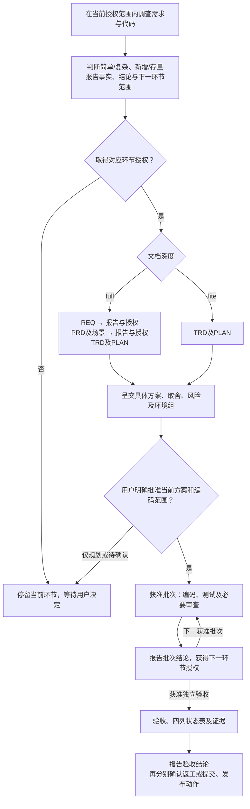

# AI Coding 研发工作流

<a id="runtime-boundary"></a>
## 执行入口与读取范围

本文件完整定义本工作流的执行规则、阶段交接与 DSL 契约。执行时只按需读取本文件、被调用的技能/审查代理以及技能包内的模板和脚本；**不要读取源仓库的 `design-docs/`、README 等外部说明文档来补充执行规则**。被委派的执行者遵守同一边界；需要补充的公共规则先维护到本文件。

目标业务项目的用户指令、项目约定、需求文档、代码、测试和证据仍是实际任务输入，按本次授权范围正常读取。此边界不限制业务调查与验证，也不把维护工作流本身视为实施业务项目的授权。

**所有环节遵守[交付与授权](#stage-authorization)：产出结果后先报告结论，获得用户对下一环节的授权再继续；仅允许有充分事实支持的极简无歧义例外。** 复杂新功能也必须评估具体 TRD 后才能编码。历史功能逻辑变更还必须按[存量确认](#existing-confirmation)先确认具体代码设计，full 与 lite 均适用，不能以一般实施授权或“内部调整”替代。

**重大设计还须在展开详细设计前遵守[设计边界确认](#design-boundary)。** 进入设计环节不等于获准扩张系统职责、数据归属或功能范围；不得先批量生成表、接口和任务，再让用户纠正未经确认的前提。

通过软链接加载时，解析本文件真实路径以定位技能包内的模板、脚本和关联技能；无需向上查找源仓库设计文档。使用宿主已有工具与项目测试框架，不绑定模型、代理接口或第三方工作流。

导航：[执行步骤](#steps) · [人类可读](#human-readable) · [设计边界](#design-boundary) · [环节授权](#stage-authorization) · [环境授权](#environment-authorization) · [需求分支](#requirement-branch) · [需求分流](#routing) · [邮件通知](#notify) · [文档职责](#documents) · [PRD 模板](#prd-template) · [TRD 模板](#trd-template) · [DSL](#dsl) · [迭代承接](#iteration) · [测试](#right-bicep) · [证据](#evidence) · [验收](#task-status) · [接入](#onboarding) · [脚本](#script-entry)

<a id="steps"></a>
## 执行步骤

1. 确认实际 projectRoot、授权范围、已有文档及需求目录，例如 `doc/req-r01-profile/`；在首次写入需求文档或代码前，按[需求分支规则](#requirement-branch)创建并切换工作分支，续做时核对并复用对应分支。核对[运行前提](#onboarding)，按[分流规则](#routing)分别判断本轮复杂度与存量影响。
2. 在当前授权范围内调查并记录具体代码事实；涉及重大设计时，先按[设计边界确认](#design-boundary)呈交必要性、现有能力、拟新增职责与取舍，确认后再展开受影响的详细设计。涉及历史功能逻辑时，无论 full/lite，都标明受影响部分；在获准的技术设计环节按[确认规则](#existing-confirmation)呈交具体代码设计，取得用户确认后才能修改相关逻辑，不在调查或需求环节提前完成下游设计。已有本次同一具体方案的确认直接复用，未决问题只阻塞其影响部分。
3. 从首个实际环节维护[全链路证据](#evidence)。lite 由 [trd-writer](../trd-writer/SKILL.md)维护 TRD＋PLAN，使用[共用 TRD 模板](assets/feature/technical.md)和 [lite 任务模板](assets/lite/plan.yaml)；full 按 [req-writer](../req-writer/SKILL.md) → [prd-writer](../prd-writer/SKILL.md) → trd-writer 分环节产出设计与计划，使用[完整模板](assets/feature/)。两种模式的 TRD 均按[模板规则](#trd-template)保留章节，lite 简写内容。每次交接先向用户报告结果并取得下一环节授权，不自动串行完成所有阶段。按[迭代承接](#iteration)保留基线、编号和未完任务。
4. 按[DSL 契约](#dsl)完善任务，执行 `validate`、`render`、`check`，并完成[人类可读性交付检查](#human-readable)。交付具体 TRD、阅读计划、关键取舍、风险、未决项和环境操作范围；脚本检查只证明结构，不证明可读性，也不代表用户批准。满足[环节授权](#stage-authorization)，且获准执行明确编码批次后，才交给 [coder](../coder/SKILL.md)。仅规划或待授权时，实施/验收标明未执行。
5. 在当前获准批次内按[测试与审查规则](#right-bicep)推进任务。独立工作可并行，但不得提前进入尚未授权的环节；指定[唯一协调记录者](#collaboration)归并 DSL、证据与生成视图。批次结束报告结论，再取得下一批次或独立验收的授权。发现方案或重要影响变化时暂停受影响部分并确认。
6. 获得独立验收环节授权后，交给 [e2e-validator](../e2e-validator/SKILL.md)核对真实场景、测试、契约与保留行为。打回按[依赖恢复](#rework)处理；依据真实结果更新状态和证据，执行 `render`、`status`、`check`，交付[四列状态表](#task-status)及全链路证据。
7. 报告完成范围、验证结果、未决项和提交状态；提交、push、合并、部署分别遵守环节授权，不因编码或验收结束自动进行。已明确确认的同一对象和范围直接复用。需要提交时遵守 [Git 追溯](#traceability)，后续在原需求目录持续维护。

<a id="stage-authorization"></a>
## 全局规则：环节交付后先报告，再授权下一环节

**默认每个环节产出结果后，先向用户报告结论并获得明确授权，才能开始下一环节。** 本节是本工作流所有阶段 skill、审查代理和并行执行者的共享权威规则；full/lite、新功能/存量、业务开发/流程维护均适用。文档模式、代码是否全新、文件是否已写完，都不能豁免环节交接。

唯一可自行执行的例外是：事项已在用户授权范围内，且 AI 有充分事实确认它**非常简单、不会有歧义，并能 100% 确定没有问题**。只要存在任何未知、选择分歧、未验证影响或外部依赖不确定性，就不能使用此例外；不能用“高置信度”“只是基础工作”或虚构的 100% 保证代替事实。采用例外时说明事项及判断依据；复杂方案和明确要求用户确认的事项不得套用。

环节按可独立交付的成果与决策边界划分，不按每次工具调用划分。在已获准环节内完成同一产物所必需的调查、读取、编辑、测试、自审/独立检查及修正可以继续，不为这些内部步骤重复询问；不得为了绕过授权，临时将本应独立交付的环节合并为“完整任务”或扩大实施批次。

| 当前环节的交付 | 获得明确授权后才能进入 |
|---|---|
| 调查事实、范围与复杂度结论 | REQ，或 lite 的 TRD＋PLAN |
| REQ：需求、范围与待决事项 | PRD＋验收场景 |
| PRD：按指定模板完整编写的产品规格、场景与业务接口边界 | TRD＋PLAN |
| TRD＋PLAN：具体方案、批次、风险与环境操作 | 明确范围的编码批次 |
| 编码批次：代码、测试及必要审查结论 | 下一批次或独立端到端验收 |
| 独立验收：通过、失败与未验证范围 | 返工环节或提交 |
| 提交、推送、合并、部署各自的实际结果 | 下一项交付或发布动作 |

交接时展示：**本环节结论、可审阅产物及版本、实际验证和未决项、下一环节目标与允许范围、需用户决定的问题。** 确认必须对应已经展示的对象；“OK／下一步”只承接紧邻且明确的确认事项。流程启动确认不批准尚未产生的 TRD，方案批准不自动授权其后的所有批次、验收和发布动作；内部审查、测试或 CLI 成功也不能代替用户批准。

复杂需求无论新旧，必须展示具体 TRD＋PLAN、主要取舍与风险，取得用户对当前方案及实施范围的明确确认后才能编码。涉及历史逻辑时再按[详细代码设计](#existing-confirmation)补齐必要内容。事实由 AI 查明；关键决策通过用户级 `grilling`（或已加载的 grill-me 委托）按问题依赖分轮确认，只问仍需用户决定的问题，达成共同理解后再实施。

同一对象、版本与范围已经得到明确确认时直接复用，不重复审批；不能把上一环节授权扩张为下一环节授权。业务行为、公共契约、重要技术决策、代码边界或环境影响发生实质变化时，先呈交差异和影响，重新确认受影响部分。其余工作只能在它自己的现有授权范围内继续。

TRD 尚未产出时，在 `evidence.md` 记录环节、产物版本/摘要、报告结论、用户原始答复及来源、批准的下一环节/范围、排除项和待决项，不为留证提前编写 TRD。进入技术设计后，TRD 的“影响与确认”维护当前方案及授权范围并引用前序记录；后续 evidence 记录实际交付、确认和执行过程，不复制维护方案正文。尚待授权必须明写；不得由 AI 自行补造用户批准。DSL 和 CLI 只检查其既有结构，不能认证用户是否确实批准；不得以新增一个未受支持的布尔字段冒充授权验证。

<a id="design-boundary"></a>
## 重大设计先确认边界，禁止自行扩张

**重大设计必须先与用户确认关键前提和取舍，再展开受影响的详细设计；不能只在编码前补问。** 本规则适用于需求、产品、技术与计划，以及主代理、子代理和审查者；“仅写草稿”不豁免此边界。

- 重大设计包括系统职责或数据归属变化、架构与模块拆分、批量新增表或持久化副本、重要身份/隔离/标识体系，以及新增业务流程、基础设施或明显增加建设维护成本的方案。不以表或文件数量作为唯一判断标准。
- 先核实并区分用户明确需求、已有系统/接口事实、AI 假设与建议，说明哪些能力应复用、哪些确需本项目新增。现有系统拥有的数据默认通过其接口使用；改为同步、副本或本地权威数据，须单独说明必要性、一致性与维护代价并取得确认。接口暂不可用或需要 mock/测试数据，不能成为复制生产业务模型的依据。
- 在当前获准环节内，先交付可评估的简明提案：问题及需求依据、现有能力与职责边界、拟新增内容、必要性、主要取舍/风险和待决项。涉及数据设计先列拟保存的数据及归属、用途，不直接展开整套字段字典和依赖任务。用户确认相应边界与取舍后再细化；不得先做大方案再以“已经写好”“只是待评估”要求用户事后兜底。
- 关键取舍可按[接入约定](#onboarding)使用用户级 `grilling` 分轮澄清；事实由 AI 自行核实，只把仍需用户决定的问题交给用户。涉及的重大决定未确认时，只继续不依赖该决定且已获授权的调查或工作，不默认采用自己的推荐方案。
- “完善数据和接口”“支持真实业务”“可扩展”或“保证可靠性”不能被扩大解释为复制外部系统、预建通用平台或给每个技术状态单独建表。每项新增须能追溯到已确认需求或明确呈交的必要技术理由；存在技术理由仍不替代重大取舍的用户确认。AI 自写的 REQ/PRD/TRD、审查结论和测试结果不能反向充当用户授权。
- 用户明确排除的方案不得自行增加例外；确有冲突时先展示事实和影响再确认。沿用[环节授权记录](#stage-authorization)保存用户原话、确认对象和范围；同一已确认对象与范围直接复用，普通实施细节不逐项另设审批。新增或改变重大边界只重新确认受影响部分，边界确认也不自动授权编码、环境操作或恢复暂停的业务开发。

<a id="environment-authorization"></a>
## 重要环境操作：TRD 中成组确认，范围内复用

在 TRD 中列明环境组的**目标与用途、具体操作、版本/镜像、数据与权限边界、资源及费用范围、清理和恢复方式、验证方式**，向用户报告并取得明确授权后执行。同一组已批准的操作可以复用授权，不为每次测试重复询问；环境授权不能代替进入下一业务环节的授权。

例如启动已有本机 Docker、拉取指定镜像、创建及销毁隔离测试容器，可作为一组明确授权的测试准备。不能只写“准备环境”便推定这些操作全部获准。只读检查现状可以在当前调查范围内进行；新增主机/全局工具安装或升级、全局配置、持久/共享服务、网络或权限、真实数据/数据库迁移、真实供应商付费调用等，要先确认其具体影响，不能隐藏在“本地测试”或依赖安装里。

目标、操作、版本、数据、权限或费用超出已确认环境组时，只暂停并重新确认超出部分。保持隔离且仍属于既定范围的重复测试、清理和重建不需要重新授权。环境组及用户确认与方案共用上述证据位置；未确认则不得创建、修改或使用相应环境。


<a id="requirement-branch"></a>
## 需求开始前创建工作分支

每项新需求开始时，先只读确认目标项目、需求目录、Git 状态和基线，再在**目标业务仓库**创建并切换需求分支；完成后才能写入该需求的文档或代码。此规则包含新功能、修复、full/lite 和仅规划任务；通过软链接调用 skill 时，不能误在共享 skills 源仓库切分支。直接调用任一阶段技能也要执行相同检查。

分支名为 **`<类型前缀><需求目录完整名称>`**，前缀后与 `doc/` 下的目录名逐字一致，不包含 `doc/`，不改需求目录、DSL 的 `feature` 或已有 R/S/T 编号：

| 需求类型 | 目录示例 | 分支示例 |
| --- | --- | --- |
| 新功能 | `doc/req-r01-profile/` | `feature_req-r01-profile` |
| 修复 | `doc/req-r02-login/` | `fixed_req-r02-login` 或 `bug_req-r02-login` |

仅使用 `feature_`、`fixed_`、`bug_` 三种前缀。用户已指定类型或前缀时沿用；未指定的新功能使用 `feature_`，缺陷修复使用 `bug_`，已有同需求修复分支使用 `fixed_` 时直接沿用。前缀只表达工作类型，不替代基于代码的存量影响判断。

- **新建前：** 在实际 projectRoot 核对 `git status --short`、当前分支、相关本地/远程分支及 worktree。按用户或项目约定选择基线；未指定时核实当前 HEAD 是否适合作为本需求起点，不能默认叠在无关需求分支上。用 `git check-ref-format --branch <分支名>` 校验名称，确认未被其他需求占用，再执行 `git switch -c <分支名> <已核对的基线>`，用 `git branch --show-current` 核对实际结果。
- **已有分支：** 同一需求续做、切换阶段或继续迭代时，核对归属后切回/复用对应分支，不为每个阶段重新创建。只有已核实属于该需求的远程分支时，从它建立本地跟踪分支；分支已被另一 worktree 使用时复用对应工作区。同名但归属不符时先解决命名冲突，不用 `-C`、`-B` 或删除分支强制覆盖。
- **保留工作区：** 不自动 reset、清理、stash 或提交既有修改。无关未提交工作需要隔离时，在不改动原工作区的前提下从已核对基线建立独立 worktree，并把后续 projectRoot 指向它；需要沿用的本需求未提交内容不能因此遗失。无法安全分离时说明具体冲突，继续只读调查。
- **记录与失败：** 将需求目录、分支名、基线提交、实际切换结果和工作区位置记录到该需求的 `evidence.md`。创建、切换或验证失败时，不在主干或无关分支继续写需求文档/代码，也不声称分支已准备完成。分支准备不自动授权提交、push、合并或部署。

## 基本设计原则

- **人类和 AI 都可读，这是交付硬性要求。** 所有产出遵守[人类可读规范](#human-readable)，不能以紧凑、节省 token 或机器可解析为由，用自定义编码代替正常说明。
- **充分思考，适度设计。** 前期尽量梳理完整的业务场景、异常与风险，明确团队协作中的职责、交付边界、接口契约和依赖关系；重大技术决策记录方案取舍、影响与待决问题。文档深度按需求复杂度选择，风险决定调查与验证的深度：简单需求使用精简规格，高风险也要写清影响与措施；目标、关键契约和验收标准必须明确；不为假想需求预建架构或堆砌流程。
- **可迭代。** 按需求小步完善文档、规格和实现，允许规范随实践演进；优先细化当前要做的工作，提前识别影响后续协作和重大决策的约束。保留稳定标识和 Git 历史，破坏性变更说明版本与迁移方式。
- **可维护。** 每份文档职责清楚，同一事实只维护一处，其他地方通过引用关联。文档、DSL、测试与代码同步更新；保持简约，避免重复副本、无价值字段和不必要的流程。

<a id="human-readable"></a>
## 强制规范：所有产出必须人类可读

本规则适用于 full/lite 的需求、产品、技术设计、数据字典、附录、图示、计划、证据和交付报告，也适用于主代理、子代理及审查者。**读者无需历史聊天、实现源码或自定义符号对照表，就应能理解当前问题、业务含义、设计理由、具体做法、影响和待决事项。**

- 先用自然语言说明用途、行为和原因，技术说明再给出必要实现细节，使用真实表名、字段名、类型和标准术语；首次使用影响理解的缩写时解释其含义。稳定的需求/场景/任务编号用于追溯，不代替业务名称和说明。
- **禁止自创压缩语法。** 不用 `B/K/H` 代替数据类型、`!/?/=x` 代替空值和默认值、`S` 代替商家/站点字段、`C/M/T/TM` 代替审计字段组合等；即使提供图例，也不能把解码工作交给读者。普通句子、标准表格和必要的完整技术名称是默认表达方式。
- 技术设计中的数据字典先解释一条记录代表什么、何时创建或更新。字段逐项列出真实名称、中文含义、完整类型、是否可空、默认值，以及必要的单位、枚举与约束；每个业务字段独占一行，不把多个字段挤成编码串。通用字段可以在一处完整定义，各表列出实际采用的字段全名和取舍原因并链接过去。关系、唯一约束和索引须写明实际字段及业务用途。PRD 的业务数据说明遵守[产品职责](#prd-template)，不要求技术类型、物理结构或索引设计。
- SQL、代码、YAML、Gherkin 等使用各自标准语法和代码块；机器执行内容保留精确契约，同时提供必要的自然语言解释与阅读视图，不能让代码或 DSL 代替设计说明。可读性修正不得省略关键约束或擅自改变设计。

**每次交付前必须检查可读性。** 作者逐节核对：是否能直接理解用途与行为、技术名称是否有含义、是否仍需查私有图例才能读懂、关键约束与理由是否完整。需要本阶段独立文档审查时，[doc-reviewer](../../agents/doc-reviewer/AGENT.md)必须同时检查本项，并返回具体位置与修正建议。发现不可读内容，在当前已授权环节内先修正再交付，不等待用户指出后返工，不把“结构校验通过”当作可读性通过，也不为同一产物的修正新增审批。交付记录如实说明可读性检查范围和遗留问题。

<a id="routing"></a>
## 需求分流与执行流程

AI 读取需求意图与当前代码，在 TRD 记录两个独立结论：**简单或复杂决定文档深度，新需求或老需求决定影响调查和详细代码设计的内容。两者都不豁免[环节交付与授权](#stage-authorization)。**



图示为默认流程；唯一极简例外按 stage-authorization 判断并留证，不为 lite、新需求或纯文档另开豁免。调查、候选设计与提问可在当前环节内交替完善；阶段产物完成后必须向用户交接，不能用“设计仍在进行”掩盖进入下游环节。

| 判断 | AI 的依据 | 执行结果 |
|---|---|---|
| 简单需求 | 意图集中，业务规则和实现路径清楚，协作关系少 | `lite`：TRD＋PLAN；简单不等于满足极简无歧义例外 |
| 复杂需求 | 多组业务规则、交互分支、模块协作或复杂实现 | `full`：REQ、PRD/场景、TRD/PLAN 分环节交付并确认；具体方案获批后才能编码 |
| 新需求 | 分析代码、调用关系、测试及共享配置，新增能力不改变既有行为、接口或数据语义 | 说明调查依据、关键未知和取舍；同样遵守阶段交接与复杂方案确认 |
| 老需求 | 改变历史逻辑、既有行为、接口、共享配置/逻辑或调用方兼容性 | full/lite 均补齐详细代码设计，取得对具体改动的确认 |

判定为复杂需求时，先按[邮件通知规则](#notify)提醒并等待进入设计的确认；这次确认只授权开始相应设计环节，不能替代其后 REQ、PRD、TRD 和实施批次的交接授权。已有对同一确认对象的明确答复直接复用。

新旧结论依据实际影响，不使用需求名称或“空项目”作为豁免依据。新增依赖、自动配置、迁移和运行环境同样纳入影响调查；无法排除存量影响的部分按老需求处理，混合需求分别记录。

简单但高风险的需求可以使用 lite，但仍需呈交风险、影响与控制措施并取得适用授权，不能仅写入文档便实施。已确认方案内的实现细节自主完成；业务、公共契约、重要技术决定或环境边界变化时，对受影响部分重新确认。仅授权规划时到设计交付为止。

<a id="existing-confirmation"></a>
## 老需求：详细询问与代码设计确认

本节对 full 与 lite 同样生效。调查、影响分析和代码设计草案可以自主推进；**修改历史功能逻辑之前必须取得对具体代码设计的明确确认**。只确认需求目标、文档模式或“开始开发”不能替代这项确认。已确认的同一具体方案直接引用其证据；发现方案之外的新逻辑改法时重新确认受影响部分。

先读相关代码、文档和测试，形成可审阅的影响说明，再分组、分轮提问。由 AI 查明技术事实，用户决定业务意图；不让用户猜测代码现状。

说明应具体到本次改动所需的内容：

- **现状与落点：** 文件路径、函数或接口、当前行为；改哪里、如何改，以及必须保留的行为。
- **边界与职责：** 各模块、类/函数分别负责什么，职责之间如何调用；哪些代码允许修改、哪些必须保持，相关团队或调用方的协作边界。
- **接口与代码设计：** 新增或变化的接口输入、输出、失败结果和必要副作用；实现落点、关键执行步骤及受影响调用方，让人明确知道改哪里、如何改。
- **风险与验证：** 边界和异常、回归范围、发布方式与失败后的恢复措施；不适用的项简要说明原因。

通过用户级 `grilling` 或已加载的 grill-me 委托按问题依赖分轮确认：同轮只问前置结论已明确的问题，依赖本轮答案的问题留到下一轮。先确认影响范围和行为，再结合候选设计确认模块职责、代码边界、接口、验证及发布恢复中的必要决定。每轮只问仍需用户判断的问题。已有本次明确确认直接引用，未查清的事实继续调查，避免把核对清单变成机械审批。

调查证据、确认结论与未决事项记录在 TRD 的“影响与确认”一节。涉及已有产品规则时，规则正文更新到所属权威文件，TRD 只记录变更影响并引用；保持事实只有一份。未经确认的受影响部分暂不实施，其余独立工作仅在其当前环节授权内继续。

<a id="documents"></a>
## 文档职责与唯一来源

业务文档按用户需求组织：**目标项目根目录** `doc/<需求目录>/`，需求目录采用 `req-r<至少两位编号>-<英文名称>`，例如 `req-r01-profile`，即 `doc/req-【需求】/`，其中【需求】用稳定编号与名称替换。`/doc` 在交流中指项目目录，不是操作系统根目录。

```text
doc/
├── req-r01-profile/            # 简单需求：lite
│   ├── technical.md            # TRD：目标、规则、验收、设计与影响确认
│   ├── plan.yaml               # 任务来源，mode: lite
│   ├── evidence.md             # 各环节的上下文、输入、输出、结果与证据
│   ├── plan.md                 # 自动生成的阅读计划
│   └── task-status.md          # 最后验收生成的四列状态表
└── req-r02-order/              # 复杂需求：full
    ├── requirement.md          # 原始诉求、来源、确认输入与稳定需求编号
    ├── product.md              # 按指定 PRD 模板编写的完整产品需求规格
    ├── technical.md            # TRD：概要、详细设计、测试与影响确认
    ├── acceptance.feature      # 可执行验收场景
    ├── plan.yaml               # 任务来源，mode: full
    ├── evidence.md             # 各环节的上下文、输入、输出、结果与证据
    ├── plan.md                 # 自动生成的阅读计划
    └── task-status.md          # 最后验收生成的四列状态表
```

先检查现有需求目录再分配编号；编号在项目内唯一、不复用，同一需求后续迭代继续维护原目录。名称使用小写 kebab-case，确定后保持稳定。历史交给 Git，不按每轮复制整套文档。

目录编号 r01 标识一项用户需求；目录内部的 R01、S01、T01 分别标识可验收子项、场景和任务。跨需求引用写完整限定名，如 `req-r01-profile/R01`。DSL 的 `feature` 字段与工具的 `--feature` 参数填写完整需求目录名，不带 `doc/` 前缀，不增加目录层级。用户明确指定的文档路径优先；当前 CLI 固定读取 `<projectRoot>/doc/<feature>/`，遇到其他布局须明确工具适配方式，不能擅自移动文件或伪造项目根。

### lite：两份设计与计划源

`technical.md` 是 TRD，由 trd-writer 按[指定 TRD 模板](assets/feature/technical.md)保留章节、简写内容，统一维护本轮目标与范围、带 R 编号的业务规则/基线引用、验收场景、概要与详细设计、测试设计和影响确认。验收放在带 `<a id="acceptance"></a>` 锚点的章节中，使用文档内唯一的 `gherkin` 围栏代码块，场景仍有稳定 S 编号并引用 R。纯文档等无行为任务可省略该块，但任务须写 `scenarios: []` 和具体 `tdd_exception`，并保留适当验证证据。

`plan.yaml` 以 `mode: lite` 指定文档契约，维护当前迭代的任务、依赖、引用、修改范围、验证命令、状态和证据摘要；trd-writer 规划，coder 更新实施结果，验收人据实际结果核验。任务引用 TRD 中的规则、场景和接口，不复制正文。

lite 的设计与计划仅维护这两份源；另在 `evidence.md` 记录全链路过程证据，阅读计划和任务状态表自动生成。风险与措施写入 TRD，任务证据摘要维护于 DSL；手工验收及审查记录由 evidence.md 链接到实际结果。精简的是文档组织，不是行为测试：涉及行为的任务必须有 Gherkin 场景及对应真实测试。

### full：按职责分工

| 文件 | 权威内容 | 主要维护角色 |
|---|---|---|
| `requirement.md` | 原始诉求、来源、用户确认的目标/范围/约束输入与稳定需求编号 R01；作为 PRD 的编制依据 | 需求负责人 / req-writer |
| `product.md` | 按 [PRD：产品需求规格说明书模板](assets/feature/product.md)完整维护产品规格，包括背景、评估、目标、验证方式、业务与功能需求、相关方、风险、范围、数据分析、灰度、相关文档、待确认问题及相关数据表 | 产品负责人 / prd-writer |
| `technical.md` | 按 [TRD：技术需求规格说明书模板](assets/feature/technical.md)维护方案概述、系统需求、总体方案、系统依赖、风险、运行设计、特性设计、部署方案与附录；承载技术契约、测试设计、影响与确认 | 技术负责人 / trd-writer |
| `acceptance.feature` | Gherkin 验收例子，稳定 S 编号并引用 R；涵盖有意义的正常、边界、异常行为 | prd-writer 维护，trd-writer 校对 |
| `plan.yaml` | 当前迭代任务及执行记录，字段职责与 lite 一致 | trd-writer 规划 / coder 更新，验收人核验 |

full 同样维护 `evidence.md`，汇总跨阶段、手工验收与审查的可定位证据。REQ 保留诉求与确认输入，PRD 承接为当前完整产品规格；同一已确认事实通过摘要和来源引用关联，不在两份文档各维护一套可独立修改的定义。产品规则正文在 PRD，场景用具体例子验证，TRD 说明实现，任务引用相应编号。

<a id="prd-template"></a>
### PRD：严格遵守指定模板

**产出的 PRD，其职责、格式和内容以技能包内的 [《PRD：产品需求规格说明书模板》](assets/feature/product.md)为准。** 该文件保存用户提供的完整模板，是本工作流唯一的 PRD 格式来源；生成或审查 PRD 前必须完整读取，不能凭概括、记忆或另一个精简骨架代替。运行时只读取技能包内这份模板，不依赖源仓库外层的参考文件。

**先产出 PRD 的业务规格，再产出 TRD 的技术设计；文档引用方向为 TRD 引用 PRD，PRD 不引用 TRD 的内容、路径或锚点。** PRD 应独立说明业务目标、行为、数据含义和验收要求，不以“见 TRD”或“待 TRD 补充”完成模板章节。技术阶段发现业务缺口时，按授权回到产品阶段确认并更新 PRD，再由 TRD 承接，不能让技术设计成为产品规则来源。

- 保留模板的文档信息、版本历史、全部编号章节、子章节、表格、附录和 Review checklist，以及它们的顺序与层级；按实际项目填写内容，不自行删除、合并、调序或改成简版结构。模板中的项目名称、日期、人员和示例内容须替换为实际信息，提示问题须得到回答，不能把空模板当作成品。
- 模板的必选、可选、必须和禁止要求按原文执行，不自行降级。可选项未采用时保留位置并说明；不适用须给出依据，不能用来绕过必选要求。未知或尚未确认的内容明确标注，并在第 13 章记录待确认问题、影响范围与所需决定，不编造指标、日期、负责人或已完成的验证；“未知”不能写成“无”。
- 背景、目标、范围等仍按模板保留并写清当前产品规格，引用 REQ 中的诉求和确认来源；不再以“PRD 只写行为”为由省略这些章节。已在上游确认的事实使用必要摘要与精确引用承接，不重复扩写原始背景或维护第二套定义。PRD 改变已确认输入时，按阶段授权重新确认受影响部分。
- 在第 9.3.1 节的详细需求中，按对应需求逐项添加独立正文行的 `<a id="R01"></a>` 等稳定锚点，沿用 REQ 编号，供场景和任务引用；可在该节内增加条目，不改变模板既有结构。模板资源本身不预置实际项目的 R/S/T 编号。
- 第 4 章完整说明项目验证方式，验收例子正文仍在 `acceptance.feature`，PRD 引用对应 S 编号；实际验证结果和历次沟通原始记录在 `evidence.md`，模板相应章节或附录保留必要摘要和可定位引用，不再维护第二套日志或确认记录。模板的 Review checklist 保留，用于逐项检查。
- 第 7 章的技术风险从业务角度说明，例如服务不可用对用户操作和业务结果的影响、期望保障及可接受边界，不提前规定架构或实现措施。第 14 章按业务数据说明填写相关对象/字段的业务含义、来源归属、用途和约束；不展开物理表结构、字段技术类型、索引、SQL 或迁移方案，也不引用 TRD 来代替本章内容。
- TRD 根据 PRD 的业务要求设计接口、存储、指标采集、灰度执行及恢复措施，并引用对应 PRD 章节，不复制业务正文。业务事实未知时在 PRD 第 13 章记录待确认事项；仅属于技术实现的待设计项留给技术阶段，不作为 PRD 的待确认问题或完成前置。
- 交付前逐节对照原模板核对结构和内容，检查必选项、事实来源、未决项及 REQ/PRD/TRD 的一致性。DSL 检查只验证既有编号和引用等结构，不能证明模板已填完整或产品规格已获用户确认。

本节约束独立 PRD 的产出；lite 仍按两份设计与计划源组织，不新增独立 PRD。full 中已有 PRD 的本轮更新保留模板结构，未变化的内容按迭代规则承接，不另建简版 PRD。

<a id="trd-template"></a>
### TRD：两种模式共用指定模板

**full、lite 产出的 TRD，其职责、格式和内容均以技能包内的 [《TRD：技术需求规格说明书模板》](assets/feature/technical.md)为准。** 该文件保存用户提供的完整模板，是唯一的 TRD 格式来源；生成或审查前必须完整读取，不能凭摘要、记忆或另一份骨架代替。运行时只读取技能包内这份模板，不依赖源仓库外层文件。保留九章、全部子章节、约束、表格与附录的顺序和层级，不删除、合并或另起“概要／详细设计”的平行结构；lite 仅简写内容，仍只有 TRD＋PLAN 两份设计与计划源，不补建独立 PRD 或场景文件。

- 模板中的项目名、日期、人员和排期示例须替换为真实信息，提示须回答；“无”必须经过核实，不把未知写成无，不把空模板当作成品。未决项写明事实缺口、影响与所需决定；不适用时保留位置并说明依据，不能借此规避实际适用的约束。
- full 的背景、商业价值、目标、系统需求与灰度业务要求，以必要摘要和精确 PRD 章节／R 编号引用承接；TRD 补充技术目标、系统约束、实现、验证与恢复措施，不另定义业务规则。先 PRD 后 TRD，PRD 不引用 TRD；发现业务缺口按授权回到产品阶段处理。初始 lite 在第二章维护本轮规则，已有基线时引用原编号与可复核版本，不伪称存在 PRD。第 3.1 节在 full 中依据 PRD 构图；初始 lite 则依据本 TRD 第二章的业务规则构图，并说明未设独立 PRD。
- 第 3.2 节的 Java/Maven 整洁架构与附录的 MySQL 规范按目标项目实际技术栈核对适用性；适用时严格遵守，不适用时保留规范位置、说明依据并写实际设计，不为填模板新增模块或数据库。存量实现与适用规范不一致时，说明差异、影响及需确认的处理，不擅自实施架构迁移或字段改名。通用字段按每张表的生命周期选用并说明理由，选用时严格保持模板给定的字段名、完整类型、约束、默认值和注释。
- 第 6.1 节按[接口共识](#interfaces)形成可实施契约；第 6.2 节按[人类可读规范](#human-readable)写逐字段字典、约束与索引用途。通用字段完整定义集中在附录“3. 存储设计”，各表列实际采用的字段全名并引用，不复制另一套定义。没有接口或数据改动时说明事实与实现边界，不虚构表或接口。

工作流内容嵌入模板已有位置，不改变原章节结构；需要的稳定锚点使用独立正文行的 `<a id="..."></a>`，不放进注释或代码块：

| 工作流内容 | 模板位置与填写职责 |
|---|---|
| `trd` | 封面项目名称附近，标明 `TRD-<需求目录>`、本轮迭代、来源与可复核版本；按[迭代承接](#iteration)保留基线。 |
| 分流与存量影响 | 1.3 的“现状／新版迭代说明”写本轮复杂度及代码分析依据、当前行为、本次变化与保留行为；3.2／3.3 写模块、类／函数职责、调用关系及允许修改的边界；风险正文在第五章。 |
| lite 的 `R01` 等 | 第二章“系统需求”维护规则或基线与变化；full 引用 PRD 的对应 R，不复制产品规则正文。 |
| `api-01` 等设计锚点 | 6.1 中对应接口或实现条目，关联 R/S；无新接口时标明实际实现边界。 |
| `environment-authorization-record` | 第八章开头、8.1 之前，按[环境授权](#environment-authorization)列操作组、目标、操作及版本、数据／权限／资源／费用边界、清理恢复、验证和授权出处；无操作时说明依据。8.1—8.3 引用相应操作组。 |
| `test-strategy` | 第九章“4. 交接文档”内的测试设计，记录 [RIGHT-BICEP](#right-bicep) 适用性、场景／测试绑定和预期断言，实际结果引用 evidence。 |
| lite 的 `acceptance` | 第九章“4. 交接文档”内的验收场景，与测试设计分开；维护文档中唯一的顶层 `gherkin` 围栏块。full 引用 `acceptance.feature`，不复制场景正文。纯无行为任务按 DSL 例外处理。 |
| `stage-authorization-record` | 第九章“6. 历次沟通意见汇总表”内的“影响与确认”，按[环节授权](#stage-authorization)维护当前方案及交付版本、结论、批准对象／范围／排除项、待决项与授权出处；引用前文设计及 evidence 记录，不预填批准。 |

附录“5. 项目排期”保留原表格；任务列用 T 编号链接 `plan.yaml` 或生成的 `plan.md`，任务正文、依赖和状态只在 DSL 维护，不在排期表另写一套。开发者、开始／结束时间、人天属于该表的排期元信息，依据实际确认填写，未知标待确认；不要向现有 DSL 添加未支持的字段。附录“4. 交接文档”链接实际交付物与验证证据，“6. 历次沟通意见汇总表”保留必要结论摘要与来源；原始答复、历史报告及执行日志在 `evidence.md` 留证，不复制维护第二套过程记录。

作者及审查者逐节检查模板完整性、PRD→TRD 单向承接、技术栈适用性、锚点位置、事实来源、未决项和授权状态。DSL/CLI 只校验既有结构、引用及生成视图，不证明模板已填完整、设计正确、用户已批准或测试已执行。

### 两种模式共用的生成视图

- `plan.md`：从 DSL 生成团队阅读计划，展示任务顺序与追溯关系，不手工修改。
- `task-status.md`：最后验收的独立状态视图，仅含任务编号、名称、状态、备注四列，由 e2e-validator 组织生成，不另建手工任务数据。

测试例子须保留必要输入与断言，不因唯一来源原则而删去。两种模式均由 `plan.yaml` 明确任务来源，生成视图不承担业务或任务事实的维护职责。

<a id="interfaces"></a>
## 接口共识

`technical.md` 按[指定模板](#trd-template)组织：第一至四章说明改动位置、模块职责、数据流及重要取舍，第六章展开接口与存储详细设计，第七、八章分别说明特性与部署。概要和详细设计是内容职责，不是另一套章节骨架；有实际争议才比较方案，不机械凑两个选项。

详细设计覆盖本轮新增或变化的 HTTP、RPC、公共及跨模块接口。每个接口使用稳定显式锚点，如 `<a id="api-01"></a>`，说明：

- 入口/方法与签名、输入字段类型、必填性、校验和默认值。
- 输出类型与语义、错误/失败结果、可见副作用、权限与状态变化。
- 实现落点、关键执行步骤；有必要时写事务、并发、幂等、重试及算法边界。
- 关联的需求和验收场景；已有契约直接链接权威定义，无需重复维护。

没有新接口的改动使用实现章节锚点。普通实现细节无需机械展开全部私有函数；涉及历史功能逻辑时，仍须明确相关函数的代码设计并取得确认。不得为补模板凭空增加架构、后端字段或业务前提。

<a id="dsl"></a>
## DSL 契约

Gherkin 定义验收场景，YAML 定义当前迭代的任务。`plan.yaml` 通过 `mode` 选择文档契约；省略时按 full 读取，不根据文件缺失推断模式。工具只校验与生成，真实测试由项目测试程序执行。

### 标识与场景

R 编号使用独立行、代码块之外的 `<a id="R01"></a>` 声明。lite 在 `technical.md` 声明目标与规则；full 在 `requirement.md` 和 `product.md` 声明同一 R，分别关联诉求输入与 PRD 第 9.3.1 节的详细需求。编号稳定、不复用。技术设计用同样形式的 `<a id="api-01"></a>` 等显式锚点。

lite 的验收章节使用 `<a id="acceptance"></a>`，并在 TRD 中维护唯一一个语言标记为 `gherkin` 的围栏代码块；生成的场景引用指向 `technical.md#acceptance`。full 将同样的 Gherkin 正文放入独立的 `acceptance.feature`。例如：

```gherkin
@R01
Feature: 显示名称校验
  @S01
  Scenario: 拒绝空名称
    Given 用户正在修改显示名称
    When 提交空字符串
    Then 提示名称不能为空
```

这是格式示例，不是任何项目已经确认的需求。每个 Scenario/Scenario Outline 直接标记一个唯一 `@S数字`（如 @S01），编号采用至少两位数字的 R/S/T 形式，并具有至少一个 `@R数字`；R 可从 Feature/Rule 继承。使用官方 Gherkin 语法，包括中文语法、Examples、数据表等，不自创扩展步骤关键字。计划引用的场景必须有实际步骤；Scenario Outline 还须至少有一行 Examples 数据。lite 的场景块必须位于顶层并正确闭合，代码示例或 HTML 注释中的锚点不能代替正文声明。

场景是长期维护的验收库，计划只引用当前迭代相关部分。两种模式中，有行为的任务都必须有场景与真实测试，lite 不提供 TDD 豁免。无行为任务须写 `scenarios: []` 和具体 `tdd_exception`，仍关联需求与设计并提供适当验证证据；只有这类任务时，lite 可省略 Gherkin 块。

### 测试维度

按 [RIGHT-BICEP](#right-bicep) 设计用例。technical.md 维护各维度的适用性和场景/测试引用；相关任务通过 `design` 引用 `technical.md#test-strategy`，执行结果写入 `evidence`。六个维度都要思考，但记录可用紧凑描述，不强制六行表；不适用项可以合并说明理由。任务按实际交付结果拆分。

### 任务格式

```yaml
schema: 1
mode: lite
feature: req-r01-profile
iteration: "01"
tasks:
  - id: T01
    title: 拒绝空显示名称
    requirements: [R01]
    scenarios: [S01]
    design: [technical.md#api-01, technical.md#test-strategy]
    files: [src/profile.mjs, test/profile.test.mjs]
    depends_on: []
    verify: node --test test/profile.test.mjs
    status: todo
    remark: ""
```

示例命令只示范格式；正式任务必须结合目标项目给出真实入口，不允许把占位符当作可执行计划。

| 字段 | 约定 |
|---|---|
| `schema` | 固定整数 1；未知版本拒绝读取 |
| `mode` | 本轮的文档契约，可选 lite 或 full；未填写按 full 读取；切换按迭代承接规则处理，不能仅改字段 |
| `feature` | 需求目录完整名称，如 req-r01-profile，对应 doc/req-r01-profile/，不增加目录层级 |
| `iteration` | 非空字符串，标识当前迭代，建议写成带引号的编号 |
| `tasks` | 本轮执行任务及必要的已完成前置任务（包含其传递依赖），至少一项；无关历史不累积在当前计划 |
| `id`、`title` | 稳定 T 编号（如 T01）和清楚的结果描述 |
| `requirements` | 本任务涉及的 R 编号，至少一个；lite 在 TRD 声明，full 在需求与产品文档声明 |
| `scenarios` | 本任务验收的 S 编号；有场景时任务的 R 与所引场景的 R 集合一致；无行为任务写 [] 并提供 tdd_exception |
| `design` | 至少一个文件与显式锚点，如 technical.md#api-01；文件相对功能文档目录 |
| `files` | 预计新增或修改的文件，相对项目根；允许尚不存在，不允许路径越界或 Git 内部路径 |
| `depends_on` | 本轮前置任务编号，无依赖写 []；不可循环 |
| `verify` | 在项目根执行的实际验证命令；工具不执行此字符串 |
| `status` | todo、doing、done、blocked |
| `remark` | 可选字符串，可为空；任务状态列表的简短备注，未填写显示“—”；前轮基线或上游打回须写明，不替代 evidence |
| `evidence` | 可选；包含 red、green、review 的简短结果及可定位证据；done 时 green/review 必填，red 或 tdd_exception 至少一个 |
| `tdd_exception` | 可选；没有适用行为测试或新 RED 时的具体理由，不得用来绕过未验证行为 |

证据不粘贴整段日志。例如 `green: "node --test ...：8/8 通过；test/profile.test.mjs 的 S01 用例"`。审查注明独立或自审及结论。日志较长时链接可复核的报告；任务阻塞原因写入 remark；详细审查证据仍放 review。`doing` 与 `done` 都要求依赖已 done，但它仍不自动等于已提交、已部署或所有环境验收完成。上游被打回时，由验收方/协调记录者按[依赖恢复规则](#rework)一并阻塞传递依赖并处理失效证据；CLI 不自动变更状态。跨轮基线保留和退出项处理见[迭代承接](#iteration)，并行写入见[记录归并](#collaboration)。

### 校验与路径边界

- 顶层仅允许 schema、mode、feature、iteration、tasks，除 mode 外均必填；任务仅允许上表的任务字段，除 remark、evidence、tdd_exception 外均必填。evidence 仅允许 red、green、review，已提供的值必须为非空字符串。
- YAML 按 1.2 解析，拒绝重复键、未知字段与解析警告；所有列表元素必须符合各自类型且不重复、不带首尾空格。任务的 requirements、design、files 非空，scenarios、depends_on 可为空；任务编号唯一，标题与 verify 为非空字符串。
- `design` 使用相对需求目录的 `.md#显式锚点`，目标必须存在且仍在项目内；`files` 相对项目根，可列尚未创建的文件；`verify` 在项目根执行，正式计划使用该项目的真实测试入口。跨需求协作在技术文档明确，`depends_on` 只引用同一计划内任务。
- 需求源文件、引用文档、输出和任务文件的路径不能越过项目根或进入 `.git`，现存路径组成部分不能为软链接；这不禁止用共享 `.agents` 软链接加载技能脚本。替换模板中的 `REPLACE_*`、`TBD` 等占位符后再校验。
- 每个场景直接声明唯一 S 编号并关联已声明 R；有场景的任务，其 requirements 必须与所引用场景的 R 集合完全一致。场景库允许保留本轮未引用的历史场景。
- 自动校验检查结构、引用和状态条件，不证明业务语义、证据真实性或历史编号未被复用；这些由执行者与审查者核对。

<a id="iteration"></a>
## 迭代承接与文档深度变化

同一需求持续维护原 `doc/req-【需求】/` 目录，`mode` 表示本轮文档路径。新一轮先核对原需求、TRD、未完成任务与代码现状，再根据本轮意图识别简单或复杂；已有文件数量不决定本轮必须重复编写哪些文档。

| 本轮情况 | 编写范围 | 来源与当前事实 |
|---|---|---|
| 大需求中的小迭代（full → lite） | TRD 只更新本次迭代的目标、规则变化、技术设计和验收；更新 PLAN 与 evidence.md，不重写整套需求/产品文档 | TRD 引用原需求编号、原文档路径/锚点与可复核版本。原 REQ/PRD/场景文件保留为基线，本轮有效规则由原基线加 TRD 明确的变化构成，不复制全部历史设计 |
| 小需求扩展为大需求（lite → full） | 在 REQ 与 evidence.md 记录原小需求 TRD 的文档编号和版本，整理业务输入，再按阶段编写本轮完整 PRD、TRD、验收场景和 PLAN | 原 TRD 是有版本的历史输入；PRD 从整理后的 REQ 承接有效业务事实，不直接引用旧/新 TRD。当前权威事实按 full 职责维护，技术细节由后续 TRD 承接 |
| 文档深度不变 | 更新本轮相关内容；未受影响的规则、设计与证据直接引用 | 不因迭代重编号，也不按轮次复制整套文件 |

TRD 使用稳定文档编号 `TRD-<需求目录>`，例如 `TRD-req-r01-profile`，在 technical.md 头部标明并使用 `trd` 锚点；它由需求目录派生，不另建编号系统。引用具体版本时同时注明迭代与 Git 基线提交，例如 `TRD-req-r01-profile` 的迭代 01、基线 `<commit>`；需求子项仍使用 `req-r01-profile/R01`，文档编号不能代替 R/S/T。

重写同一路径前记录原 TRD 的编号、来源与版本；有 Git 基线时可用 `git show <commit>:doc/req-r01-profile/technical.md` 复核，不能把指向重写后当前文件的链接当作原版本证据。未提交输入在 evidence.md 中保留必要原文摘录、来源和版本状态，不伪造提交引用，也不为留证擅自提交。

full → lite 时，本轮引用的 R 锚点、Gherkin 场景和设计入口放在 TRD；锚点正文可引用原规则并写明本轮变化。已有基线中仍需校验的前置任务也保留必要引用和场景，不以 TDD 例外绕过行为验证。lite → full 时保留已有 R/S/T，将本轮有效规则与场景按 full 职责归位；完成承接后，原 TRD 版本仅作为历史来源，不维护第二份当前规则。切换不自动改业务范围，涉及存量行为仍按确认协议执行。

### 跨轮任务承接

`plan.yaml` 包含本轮要执行的任务，以及它们所需的已完成前置任务及其传递依赖。未完成任务沿用原编号结转；若决定退出或推迟到本轮之外，先明确范围调整，再在 evidence.md 记录原 ID、原因、确认依据和后续安排，不能静默消失。新增工作使用未使用过的新编号，不将旧 ID 改作另一项工作。

必要前置任务保留原 `done`、设计/场景引用和仍有效的证据，在 remark 标明“前轮依赖基线，非本轮新增成果”；无关历史留给 Git。当前模式必须能解析计划中每项保留任务的 R/S/设计引用，不能留下悬空依赖。新工作依赖它们，不等于必须重做它们；先核对基线与当前代码/契约是否匹配，仅在变化、失效或覆盖疑点时复验。

任务状态表列出本轮计划全部条目，包括明确标注的必要前置基线，仍只有四列。切换 iteration 前确认未完成项的去向与引用闭合，更新本轮上下文、证据和生成视图。

<a id="rework"></a>
## 验收打回与依赖恢复

当任务完成条件失效，验收方会同协调记录者先定位被打回任务及其全部直接、间接依赖任务，在同一轮记录更新中将这些任务标为 `blocked`，备注写明被打回原因或“上游打回，待复验”。独立任务保持原状态；这里只调整执行与验收状态，不自动回滚代码。

将旧 GREEN/REVIEW 的来源保留在 evidence.md 并明确标记失效或待复验，清除这些任务在 DSL 中已不能代表当前结果的 green/review，不能拿旧成功摘要恢复 done。完成状态或前置条件被打回后，不保留依赖它的 doing/done 状态；CLI 会拒绝这种不一致状态。

先报告验收打回结论，按环节授权取得受影响返工范围的确认，再修复被打回任务并记录真实验证和审查；其前置条件满足后按 `blocked → doing → done` 推进。上游恢复后，按依赖顺序让后续任务进入实施或复验，验证相关契约及保留行为后再恢复 done，不机械重做未变化的实现。汇总本轮失败、修复、复验和遗留问题，再执行 render、status、check，未全部通过也如实交付。

<a id="collaboration"></a>
## 并行执行与记录归并

先核对每个任务属于当前已获准环节，再按依赖和文件冲突决定并行。无依赖且文件不冲突的已授权任务用 sub-agent 并行启动（见[邮件通知规则](#notify)）。未取得下一环节授权时，不得委派子代理提前编写下游设计或业务实现；“基础代码”“独立任务”不能替代阶段授权。同一需求有多个执行者时，在分工开始前指定一名协调记录者，由其统一写入 `plan.yaml`、`evidence.md` 并生成 plan.md/task-status.md。其他执行者只修改分配给自己的实现文件，回传任务 ID、改动、真实命令/结果、证据位置和阻碍，不并发覆盖公共记录。

协调记录者核对结果与当前代码、合并状态后再校验生成；发现同一事实冲突先核实，不以最后写入者为准。串行执行时可由当前执行者兼任，不引入额外锁服务或固定代理模型。

<a id="notify"></a>
## 邮件通知规则

工作流在以下时机通过 [task-monitor](../task-monitor/SKILL.md) 统一维护的 `scripts/send-email.py` 向 `zh_harry@163.com` 发送通知（发件人 `server@sparrowzoo.com`，密码读环境变量 `email_password`，不写入仓库）。规则适用于工作流全部技能（req-writer、prd-writer、trd-writer、coder、e2e-validator），只在此处维护，下游技能引用本节。

| 时机 | 触发条件 | 行为 |
|---|---|---|
| 复杂需求提醒 | 分流判定为「复杂」(full) 时，在进入设计前 | 发邮件说明复杂依据，**停下等待用户确认**；确认只授权开始相应设计环节，后续交接仍遵守阶段门禁 |
| 任务失败两次 | 同一任务连续两次未能通过验证或被打回（未形成有效 RED、GREEN 未达、审查未过、验收打回；TDD 中符合预期的有效 RED 不计失败） | 发邮件说明失败原因与下一步，该任务标 `blocked` 并**停下等待用户确认**，其余独立且已授权的任务继续 |
| 并行分派 | 当前已获准环节内无依赖、文件不冲突的任务 | 用 sub-agent 并行启动（见[并行归并](#collaboration)） |
| 全部完成 | 全部任务结束并完成最终验收后 | 发邮件汇总：任务状态计数、未决项、commit/push/merge 状态，指向 task-status.md 与 evidence.md |

发送命令（在项目根执行，正文可作参数或用 stdin 传入）：

```sh
python3 .agents/skills/task-monitor/scripts/send-email.py "主题" "正文"
```

各阶段的交付授权不因邮件表未单列而省略；邮件只在上述时机发送，不为每次普通交接增加邮件。发送失败不阻塞其它已授权工作，但须在 `evidence.md` 记录发送失败与原因；「停下等待用户确认」的时机在用户确认前不继续对应部分。

<a id="execution"></a>
## 可执行的含义

AI 读取 `plan.yaml`、引用设计和场景，用宿主已有工具实施。Gherkin 场景绑定真实测试代码/步骤，由项目测试程序执行。生成器只读文件并生成 Markdown，**不会运行 YAML 中的命令、调用模型或自动改业务代码**。

测试框架按项目实际情况选择，不强制安装 Cucumber。使用其他框架时，场景 ID 必须映射到可定位、可执行的测试；仅把 Gherkin 解析成功或让 AI 阅读，不能称为验收通过。缺少测试基础设施时，将最小测试入口列入任务，不假设命令已存在。

若文档与 DSL 语义冲突，先按职责所属文档查明意图并修正；涉及已确认业务、范围或外部契约变化时只对齐相关差异。所有阶段遵循 stage-authorization；历史逻辑的代码设计变化还需具体确认，不能以“内部实现调整”代替，新功能不得凭笼统实施授权跨环节推进。

<a id="right-bicep"></a>
## 测试用例设计：RIGHT-BICEP

RIGHT-BICEP 用来识别有效测试用例，与 RED → GREEN 的实施顺序配合使用。每轮对六个维度逐一考虑，按实际行为和风险选择有价值的用例；同一用例可以覆盖多个维度，不要求每个接口机械凑齐六组测试。

| 维度 | 要回答的问题 | 落地要求 |
|---|---|---|
| Right · 正确结果 | 核心逻辑的结果是否正确？ | 依据已确认规则断言精确结果、状态与必要副作用；不能只断言非空或没有抛错。 |
| B · Boundary 边界 | 边界条件是否正确？ | 检查最小/最大值及两侧、空值、空集合、畸形输入等适用边界；非法输入要验证约定的反馈。 |
| I · Inverse 反向关系 | 能否利用反向操作校验？ | 在适用前提下检查加/减、编码/解码等往返关系；有损转换或不可逆行为不能强行套用。 |
| C · Cross-check 交叉验证 | 能否用独立方法验证结果？ | 使用独立实现、可信数据或手工计算样例作参照；不要用被测函数或同一错误逻辑生成预期结果。 |
| E · Error condition 错误条件 | 能否主动触发错误路径？ | 注入超时、依赖失败、非法状态等实际错误，验证错误结果、状态清理与约定的恢复行为。 |
| P · Performance 性能 | 响应时间和资源消耗是否可接受？ | 按已确认目标定义负载、环境、测量方式及阈值/基线，检查耗时、内存、调用次数等相关指标；不凭空规定毫秒门槛。 |

在 `technical.md` 的“测试设计”中记录适用维度及其场景/测试引用，可以用简短文字或紧凑表；不强制六行表，不适用项可合并说明原因。纯文档等无需行为测试的任务可统一说明，仍需验证与审查证据。业务可见验收行为在 lite 中维护于 TRD 的 Gherkin 块，在 full 中维护于 `acceptance.feature`；算法性质、错误注入和性能测试按项目测试层组织，不将所有单元测试都翻译成 Gherkin。

I/C 没有可靠前提或独立参照时说明原因；P 不适用时说明原因。若性能属于已承诺的验收目标但阈值或环境尚未确定，列为待确认/未验证，不能用“不适用”跳过。场景、任务与测试证据使用稳定编号，相关任务引用技术文档的测试设计锚点；测试维度统一维护在技术文档中。

规划时确定适用维度与用例，编码时实施并记录真实 RED/GREEN，验收时检查用例质量和实际结果。六个维度的结构检查不等于业务验收通过。

## RED / GREEN / 审查

- RED：执行新增或收紧的行为断言，记录命令、失败的场景/测试和预期失败原因。依赖缺失、语法错误、未定义步骤及“未执行”不算有效 RED。
- GREEN：记录实际命令、结果摘要及可复核的测试/日志位置。SKIP、空测试集、静态推断不等于通过。
- 无需运行测试的纯文档等任务填写 `tdd_exception` 理由，仍提供适当验证和审查证据。已有测试足以覆盖的修复说明为什么无需新 RED，不制造假失败。
- 测试只能证明已验证范围。移动浏览器、线上环境等未实际验证的部分如实列出，不用单元测试结果代替。
- 审查关注契约、实现正确性和测试能否发现回归；复杂或高风险改动使用可用的独立视角。不锁模型；无法独立审查时注明自审，不能冒称独立通过。
- 阻塞写清原因与下一步；未触发暂停条件时，在当前授权范围内按具体失败原因修正，不机械重跑同一套审查。达到[邮件通知规则](#notify)的连续两次失败条件时，报告实际原因、已做检查和建议，再等待用户确认，不能以内部修正为由越过该门禁。

<a id="evidence"></a>
## 证：全链路证据

每个需求在 `doc/req-【需求】/evidence.md` 持续维护一份证据文档，例如 `doc/req-r01-profile/evidence.md`。lite 与 full 均须维护，从首个实际环节开始记录，交付前汇总；它是过程证据索引，不增加一份需求规格或重复任务状态。使用[统一证据模板](assets/evidence.md)，按真实发生的阶段记录，不预填成功结论。

每个环节写清 **上下文、输入、输出、结果、证据位置**：上下文说明本轮范围、必要前提和授权/确认依据；输入指向实际消费的需求、代码、规则或上游产物；输出指向实际形成的文件、代码、测试或审查结果；结果区分已核验、失败、未验证、未执行与不适用，并写明未决项；证据包含可定位的文档锚点、文件/函数、测试名称与命令、报告/日志、审查记录或 Git 引用。按需要记录时间、执行者/审查方式、代码版本及环境，让结果能对应到实际对象。

| 环节 | 记录责任 | 应能追溯的内容 |
|---|---|---|
| 调查与分流 | develop-work-flow 或首个实际执行的 skill | 用户诉求、需求目录与分支/基线及切换结果、代码事实、简单/复杂与新/老判断、授权和确认来源 |
| 需求与产品 | req-writer / prd-writer；lite 由 trd-writer 合并记录 | 需求及规则输入、确认范围、R/S 标识与产物；lite 注明合并于 TRD，不伪称运行了独立阶段 |
| 技术与计划 | trd-writer | 代码影响、职责与契约、设计依据、任务拆分及计划校验结果 |
| 实施与测试 | coder | T 任务对应代码、真实 RED/GREEN、命令和测试报告，或有依据的 TDD 例外 |
| 审查 | 审查调用方 | 实际审查范围、独立/自审方式、发现、处理与复核结果；reviewer 保持只读 |
| 验收 | e2e-validator | R/S/T 到实际验证的对应、通过/失败/未验证项、生成视图检查及遗留问题 |
| 提交与交付 | 提交者 / develop-work-flow | 已授权交付范围、现有提交或 Task trailer 查询依据，以及未提交/未发布状态 |

证据以引用为主：规则与设计正文仍在权威文档，任务状态和 red/green/review 摘要仍在 `plan.yaml`；evidence.md 补齐跨阶段上下文与证据入口，不复制维护这些事实。长日志保存在团队可访问的报告或仓库附件中，不以本机 `/tmp` 路径作为唯一长期凭据。用户确认要能定位到原始消息/工单；无法共享原会话时，保留报告结论、产物版本/摘要、确认时间、必要原文、明确获准的下一环节与范围，并链接 TRD 中的确认记录。核对先交付、再确认、后执行的时序，不从工作已经发生倒推用户授权。

各阶段的执行者更新自己负责的记录，已有阶段直接链接可核实资料；缺失或无法核实就如实标明，不根据文档齐全、计划命令或任务状态反推已执行。新迭代继续维护同一文件并注明迭代范围，历史由 Git 保存；已完成任务的证据因相关代码或契约变更失效时标明待复验。仅规划的实施/测试/验收标为未执行，真正不适用的阶段说明原因。

e2e-validator 在最终验收核对全链路：缺少应有输入/输出、证据不可定位、证据与当前版本不符或环节未核实，均不能宣称该部分通过，但仍交付真实记录和下一步。`validate/render/status/check` 不自动核验 evidence.md 的完整性或真实性，由 AI/人工审查；`task-status.md` 始终只保留四列。提交追溯沿用下节规则，不为写入自身提交 hash 反复修改本次提交中的 evidence.md。

<a id="task-status"></a>
## 最后验收：任务状态列表

在需求目录生成独立的 `task-status.md`，路径为 `doc/req-【需求】/task-status.md`，例如 `doc/req-r01-profile/task-status.md`。它与该需求的 plan.yaml 放在同一目录，不集中存放多个需求的任务。

文件只显示以下四列；不增加标题、统计、执行日志或其他字段：

| 任务编号 | 名称 | 状态 | 备注 |
|---|---|---|---|
| T01 | 实现输入校验 | 未开始 | — |

上表仅为格式示例。实际文件由生成器读取本轮 `plan.yaml` 的全部任务，按依赖顺序生成；四列依次来自 id、title、status、remark，缺少备注显示“—”。状态显示为：todo → 未开始，doing → 进行中，done → 已完成，blocked → 受阻。

验收人先依据真实结果更新 DSL：未执行或未通过的任务不能标记已完成；失败、受阻及待验证事项在 remark 中简短说明原因与下一步，详细证据引用实际测试报告；全链路记录、手工验收和审查结论统一汇入 `evidence.md`，引用真实来源。即使未全部通过，也应如实生成该状态列表。

随后运行 `render`、`status`、`check`。列表不手工维护；后续任务状态或备注变化时重新生成。check 在列表存在时检查它是否过期，规划阶段尚未生成列表则只检查计划；最后验收必须先生成列表再 check。状态表是任务结果摘要，不代替业务验收和测试证据。

<a id="traceability"></a>
## 追溯与 Git

`R01 → S01 → T01 → 测试证据 → Git 提交`。R、S、T 在同一需求目录内稳定且不复用；新一轮按[迭代承接](#iteration)更新 iteration 和任务集合，历史由 Git 保留。跨功能变更在各自功能文档维护对应规则，用技术文档链接说明协作关系；任务依赖在同一计划内校验；跨需求的交付依赖在技术文档中明确，并由协作双方对齐。

提交采用 Conventional Commits，正文带本次任务 trailer，例如：

```text
feat(profile): reject empty display names

Task: req-r01-profile/T01
```

一个提交可包含紧密关联的多个任务并逐行记录 Task；不强制分别提交 RED 和 GREEN，不为凑记录提交破损代码。当前提交不把自身 hash 写回自身文件，避免循环更新。按 Git 解析出的 `Task` trailer 完整值查询，不使用子串 grep，避免 T10 命中 T100 或提交正文中的提及。例如在业务项目根查询 T10：

```sh
git log --all --format='%H%x09%(trailers:key=Task,valueonly,separator=%x09)' |
  awk -F '\t' -v target='req-r01-profile/T10' '{ for (i=2; i<=NF; i++) if ($i == target) { print $1; break } }'
```

命中表示该提交包含完整的任务 trailer，不代表已合并或部署；未命中时明确记录未找到对应提交，不伪造 hash。

<a id="onboarding"></a>
## 接入与运行前提

接入前确认 Node.js 22+、npm、Git，以及宿主可加载的用户级 `grilling`；复杂方案与其他关键决策可直接调用 grilling，或经已加载的 grill-me 委托。`grill-me`/`grilling` 属于第三方用户级依赖，不随 AICoding 的目录链接安装，setup 也只安装解析库。已有可用版本直接复用；缺失时从已确认来源安装到对应工具的用户级 skills 目录并核对可加载性，不安装进业务项目或 AICoding。安装与环境变更遵守 environment-authorization。来源或安装条件尚未明确时说明具体缺项，只继续当前获准环节内不依赖它的工作，不假称已完成访谈。

通过目录软链接跨项目复用同一份 skills。每个项目的 `.agents` 和 `.claude` 都直接指向 AICoding 的 `.agents` 唯一源。以下以 `${user.home}/workspace/AICoding` 为源仓库位置示例；`${user.home}` 表示用户家目录，在 Shell 命令中写作 `${HOME}`。请按实际克隆位置调整路径：

```text
项目/.agents → ${user.home}/workspace/AICoding/.agents
项目/.claude → ${user.home}/workspace/AICoding/.agents
```

**首次接入项目：** 在目标项目根目录执行以下命令。先确认项目根目录下 `.agents` 和 `.claude` 均不存在（含失效软链接）；若已有正确链接则直接复用，若已有目录或其他链接，先核对并保留其中的本地内容，再调整。

```bash
aicoding_source="${HOME}/workspace/AICoding/.agents"
ln -s "$aicoding_source" .agents
ln -s "$aicoding_source" .claude
```

使用 `readlink` 核对两个链接，输出都应为用户家目录展开后的同一个唯一源绝对路径：

```bash
readlink .agents
readlink .claude
```

源仓库 AICoding 自身保留 `.claude/settings.local.json` 等本地设置，通过 `.claude/skills → ../.agents/skills` 与 `.claude/agents → ../.agents/agents` 两个目录链接暴露统一入口；不逐个维护 skill 链接。上述业务项目的 `.agents`、`.claude` 仍直接指向唯一源目录。

接入后，按需调用已加载的 `develop-work-flow`、`req-writer`、`prd-writer`、`trd-writer` 等 skills。

**后续维护：** 修改、新增 skills、agents、模板和脚本都回到 AICoding 的 `.agents`，Git 提交与 GitHub 同步也在 AICoding 仓库进行。各项目通过现有目录链接复用源文件，无需复制或逐个建立 skill 链接。运行规则统一维护在本 SKILL.md，业务文档仍按约定保存在对应项目；外部设计说明仅供维护者参考，执行时不读取。唯一源移动或换电脑后，重新核对并调整两个链接的目标。

DSL 的 `schema` 显式标识格式版本，当前为 1；只有破坏兼容性的格式变化才升级。维护执行规则时同步核对关联技能、模板、脚本与验证用例，不预先建设多版本平台。

<a id="script-entry"></a>
## 脚本入口

以下入口供执行本工作流的 AI 使用。运行前需具备 Node.js 22+ 和 npm；目标项目的 `.agents` 软链接指向共享源 `.agents`。在目标项目根执行，`--feature` 填完整需求目录，例如 `req-r01-profile`：

```sh
# 同一机器、同一用户首次使用，或锁文件更新、依赖需要修复时执行
node .agents/skills/develop-work-flow/scripts/setup.mjs
# 需求源文件准备完成后，将示例目录名替换为实际需求目录
workflow_feature="req-r01-profile"
node .agents/skills/develop-work-flow/scripts/workflow.mjs validate --project "$PWD" --feature "$workflow_feature"
```

按当前阶段将 `validate` 替换为下述 `render`、`status` 或 `check`，项目根和需求目录参数保持一致。

**软链接与依赖安装的职责：**

- `.agents` 软链接负责复用共享源中的 skills、agents、模板和脚本；第三方运行依赖另由 `setup.mjs` 准备。
- `setup.mjs` 默认将脚本目录中的 `package.json`、`package-lock.json` 复制到 `${HOME}/.local/share/ai-coding-workflow/`，在该目录执行 `npm ci --ignore-scripts`，按锁文件安装第三方库。其中 `yaml` 解析 `plan.yaml`，`@cucumber/gherkin` 解析 Gherkin 验收场景，`@cucumber/messages` 提供解析所需的 AST ID 生成器。源码与依赖清单、锁文件继续由共享源维护。
- `workflow.mjs` 显式从上述用户级目录加载依赖，负责 DSL 校验与 Markdown 生成。业务项目继续维护自身代码、文档和测试环境；这些工具依赖无需加入业务项目，也不安装到共享 skill 源目录。

**安装时机：** 默认配置下，同一台机器、同一用户的多个项目共用该依赖目录。首次使用脚本、依赖锁文件更新或依赖需要修复时执行 `setup.mjs`；接入新项目或仅修改 skill 文本、模板时通常无需重装。每次调用 `setup.mjs` 都会复制清单并执行安装，是否需要重装由调用方判断。该脚本仅准备工具依赖，Node.js 和 npm 需预先安装，业务实施与测试仍由 AI 调用项目自身工具完成。

测试可用 `AI_CODING_WORKFLOW_DEPS` 指定独立的绝对临时依赖目录，`setup.mjs` 与 `workflow.mjs` 使用同一配置。

- `validate`：按 `plan.yaml` 的 `mode` 检查源文件、DSL 字段、稳定编号、引用、依赖、状态与必要证据。`lite` 读取 technical.md＋plan.yaml，`full`（默认）读取完整文档集；场景分别来自 TRD 的 Gherkin 块或 acceptance.feature。
- `render`：校验后按依赖顺序生成 `plan.md`；拒绝覆盖手写文件。
- `status`：从 DSL 生成同目录 `task-status.md`，仅显示任务编号、名称、状态、备注；不执行验证命令，不改 DSL 或 `plan.md`，拒绝覆盖手写文件。
- `check`：检查 `plan.md` 与已经存在的 `task-status.md` 是否和来源一致；最后验收须先生成状态列表，再执行此检查。

非零返回码表示调用或校验失败。以上命令均不执行业务测试；结构检查通过后仍须执行任务的验证命令，核对业务语义与证据。维护脚本时，在 `scripts/` 执行 `node --test`，测试仅使用临时 fixture。

`validate`、`render`、`status`、`check` 都先完整校验输入；生成文件的专用标记与来源摘要由脚本维护，不能手工伪造标记来覆盖既有文件。`check` 不自动修复或生成视图，失败时先修正真实来源，再运行相应生成命令。
