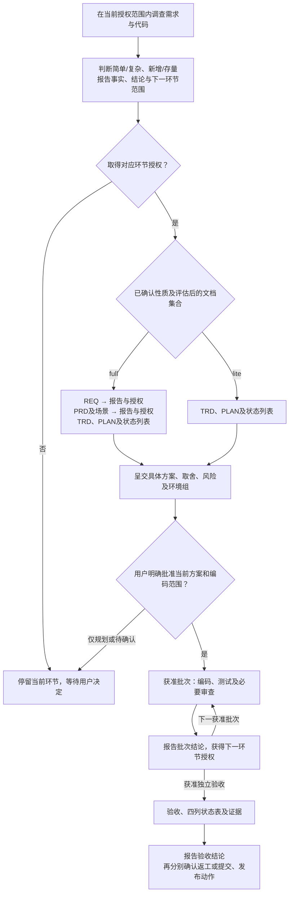

# AI Coding 研发工作流

<a id="runtime-boundary"></a>
## 执行入口与读取范围

本文件完整定义本工作流的执行规则、阶段交接与 DSL 契约。执行时只按需读取本文件、被调用的技能/审查代理以及技能包内的模板和脚本；**不要读取源仓库的 `design-docs/`、README 等外部说明文档来补充执行规则**。被委派的执行者遵守同一边界；需要补充的公共规则先维护到本文件。

目标业务项目的用户指令、项目约定、需求文档、代码、测试和证据仍是实际任务输入，按本次授权范围正常读取。此边界不限制业务调查与验证，也不把维护工作流本身视为实施业务项目的授权。

**所有环节遵守[交付与授权](#stage-authorization)：产出结果后先报告结论，获得用户对下一环节的授权再继续；仅允许有充分事实支持的极简无歧义例外。** 复杂新功能也必须评估具体 TRD 后才能编写业务实现；TRD 内接口设计源码的边界见 [API FIRST](../trd-writer/SKILL.md#api-first)。历史功能逻辑变更还必须按[存量确认](#existing-confirmation)先确认具体代码设计，full 与 lite 均适用，不能以一般实施授权或“内部调整”替代。

**重大设计还须在展开详细设计前遵守[设计边界确认](#design-boundary)。** 进入设计环节不等于获准扩张系统职责、数据归属或功能范围；不得先批量生成表、接口和任务，再让用户纠正未经确认的前提。

通过软链接加载时，解析本文件真实路径以定位技能包内的模板、脚本和关联技能；无需向上查找源仓库设计文档。使用宿主已有工具与项目测试框架，不绑定模型、代理接口或第三方工作流。

导航：[SOLID与接口职责](#solid-interface-design) · [实体/@Data/PO](#entity-lombok-po) · [执行步骤](#steps) · [人类可读](#human-readable) · [产物内容边界](#artifact-relevance) · [相关人确认](#stakeholder-confirmation) · [确认与同步](#decision-sync) · [全链路逻辑审查](#logic-review) · [模板结构](#template-structure) · [审查集中反馈](#review-feedback) · [文档评审状态](#document-review-status) · [需求评审边界](#requirement-review-boundary) · [设计边界](#design-boundary) · [环节授权](#stage-authorization) · [环境授权](#environment-authorization) · [需求分支](#requirement-branch) · [需求分流](#routing) · [邮件通知](#notify) · [文档职责](#documents) · [BRD 业务职责](#brd-business-context) · [PRD 模板](#prd-template) · [TRD 模板](#trd-template) · [DSL](#dsl) · [迭代承接](#iteration) · [测试](#right-bicep) · [证据](#evidence) · [验收](#task-status) · [接入](#onboarding) · [脚本](#script-entry)

<a id="steps"></a>
## 执行步骤

1. 确认实际 projectRoot、授权范围、已有文档及需求目录，例如 `doc/req-r01-profile/`；在首次写入需求文档或代码前，按[需求分支规则](#requirement-branch)创建并切换工作分支，续做时核对并复用对应分支。核对[运行前提](#onboarding)，按[分流规则](#routing)分别判断本轮复杂度与存量影响。
2. 在当前授权范围内调查并记录具体代码事实；涉及重大设计时，先按[设计边界确认](#design-boundary)呈交必要性、现有能力、拟新增职责与取舍，确认后再展开受影响的详细设计。涉及历史功能逻辑时，无论 full/lite，都标明受影响部分；在获准的技术设计环节按[确认规则](#existing-confirmation)呈交具体代码设计，取得用户确认后才能修改相关逻辑，不在调查或需求环节提前完成下游设计。已有本次同一具体方案的确认直接复用，未决问题只阻塞其影响部分。
3. 从首个实际环节维护[全链路证据](#evidence)。lite 由 [trd-writer](../trd-writer/SKILL.md)维护 TRD＋PLAN，使用[共用 TRD 模板](assets/feature/technical.md)和 [lite 任务模板](assets/lite/plan.yaml)；full 按 [req-writer](../req-writer/SKILL.md) → [prd-writer](../prd-writer/SKILL.md) → trd-writer 分环节产出设计与计划，使用[完整模板](assets/feature/)。两种模式的 TRD 均按[文档大前提](#documentation-principle)与[模板规则](#trd-template)覆盖本次必要内容，不按模板堆篇幅。每次交接前更新各产物末尾的[评审结论](#document-review-status)，先向用户报告结果并取得下一环节授权，不自动串行完成所有阶段。按[迭代承接](#iteration)保留基线、编号和未完任务。
4. 按[DSL 契约](#dsl)完善任务，执行 `validate`、`render`、`status`、`check`，并完成[人类可读性交付检查](#human-readable)。交付具体 TRD、阅读计划、任务状态列表、关键取舍、风险、未决项和环境操作范围；脚本检查只证明结构，不证明可读性，也不代表用户批准。满足[环节授权](#stage-authorization)，且获准执行明确编码批次后，才交给 [coder](../coder/SKILL.md)。仅规划或待授权时，实施/验收标明未执行。
5. 在当前获准批次内按[测试与审查规则](#right-bicep)推进任务。执行方式按[运行时分工与归并](#collaboration)选择，文档审查按其[专门规则](#doc-review-parallel)直接并行；不得提前进入尚未授权的环节。指定唯一协调记录者归并 DSL、证据与生成视图。批次结束报告结论，再取得下一批次或独立验收的授权。发现方案或重要影响变化时暂停受影响部分并确认。
6. 获得独立验收环节授权后，交给 [e2e-validator](../e2e-validator/SKILL.md)核对真实场景、测试、契约与保留行为。打回按[依赖恢复](#rework)处理；依据真实结果更新状态和证据，执行 `render`、`status`、`check`，交付[四列状态表](#task-status)及全链路证据。
7. 报告完成范围、验证结果、未决项和提交状态；提交、push、合并、部署分别遵守环节授权，不因编码或验收结束自动进行。已明确确认的同一对象和范围直接复用。需要提交时遵守 [Git 追溯](#traceability)，后续在原需求目录持续维护。

<a id="stage-authorization"></a>
## 全局规则：环节交付后先报告，再授权下一环节

**默认每个环节产出结果后，先向用户报告结论并获得明确授权，才能开始下一环节。** 本节是本工作流所有阶段 skill、审查代理和并行执行者的共享权威规则；full/lite、新功能/存量、业务开发/流程维护均适用。文档模式、代码是否全新、文件是否已写完，都不能豁免环节交接。

唯一可自行执行的例外是：事项已在用户授权范围内，且 AI 有充分事实确认它**非常简单、不会有歧义，并能 100% 确定没有问题**。只要存在任何未知、选择分歧、未验证影响或外部依赖不确定性，就不能使用此例外；不能用“高置信度”“只是基础工作”或虚构的 100% 保证代替事实。采用例外时说明事项及判断依据；复杂方案和明确要求用户确认的事项不得套用。

环节按可独立交付的成果与决策边界划分，不按每次工具调用划分。在已获准环节内完成同一产物所必需的调查、读取、编辑、测试、自审/独立检查及修正可以继续，不为这些内部步骤重复询问；不得为了绕过授权，临时将本应独立交付的环节合并为“完整任务”或扩大实施批次。

| 当前环节的交付 | 获得明确授权后才能进入 |
|---|---|
| 调查事实、范围与复杂度结论 | REQ，或 lite 的 TRD＋PLAN |
| REQ：需求、范围与待决事项 | PRD＋验收场景 |
| PRD：按指定模板完整编写的产品规格、场景与业务接口边界 | TRD＋PLAN |
| TRD＋PLAN：具体方案、批次、风险与环境操作 | 明确范围的编码批次 |
| 编码批次：代码、测试及必要审查结论 | 下一批次或独立端到端验收 |
| 独立验收：通过、失败与未验证范围 | 返工环节或提交 |
| 提交、推送、合并、部署各自的实际结果 | 下一项交付或发布动作 |

交接时展示：**本环节结论、可审阅产物及版本、实际验证和未决项、下一环节目标与允许范围、需用户决定的问题。** 确认必须对应已经展示的对象；“OK／下一步”只承接紧邻且明确的确认事项。流程启动确认不批准尚未产生的 TRD，方案批准不自动授权其后的所有批次、验收和发布动作；内部审查、测试或 CLI 成功也不能代替用户批准。

复杂需求无论新旧，必须展示具体 TRD＋PLAN、主要取舍与风险，取得用户对当前方案及实施范围的明确确认后才能编写业务实现。获准的 TRD 环节包含接口、协议和实体设计源码及其检查，具体边界按 [API FIRST](../trd-writer/SKILL.md#api-first)执行；这不授权业务方法体、SQL 实现、运行装配或环境操作。涉及历史逻辑时再按[详细代码设计](#existing-confirmation)补齐必要内容。事实由 AI 查明；关键决策通过用户级 `grilling`（或已加载的 grill-me 委托）按问题依赖分轮确认，只问仍需用户决定的问题，达成共同理解后再实施。

同一对象、版本与范围已经得到明确确认时直接复用，不重复审批；不能把上一环节授权扩张为下一环节授权。业务行为、公共契约、重要技术决策、代码边界或环境影响发生实质变化时，先呈交差异和影响，重新确认受影响部分。其余工作只能在它自己的现有授权范围内继续。

TRD 尚未产出时，在 `evidence.md` 记录环节、产物版本/摘要、报告结论、用户原始答复及来源、批准的下一环节/范围、排除项和待决项，不为留证提前编写 TRD。进入技术设计后，TRD 的“影响与确认”维护当前方案及授权范围并引用前序记录；后续 evidence 记录实际交付、确认和执行过程，不复制维护方案正文。尚待授权必须明写；不得由 AI 自行补造用户批准。DSL 和 CLI 只检查其既有结构，不能认证用户是否确实批准；不得以新增一个未受支持的布尔字段冒充授权验证。

<a id="requirement-review-boundary"></a>
## 需求评审聚焦业务，技术细节留到 TRD

**需求评审聚焦业务目标、范围和验收，不逐项追问技术实现细节。** 本规则适用于 BRD／REQ、PRD 的编写、评审及其中的 `grilling`／grill-me 访谈，也适用于子代理和审查者。

- BRD／REQ 按[业务职责要求](#brd-business-context)讲清全景业务架构、当前项目／需求的位置与定位、核心痛点、业务解决方案，以及方案依赖的人员团队、服务和数据，再确认目标、范围与可观察的验收结果；PRD 承接为产品行为、交互和验收场景。业务流程、责任交接和依赖条件不是技术细节，不能一并推迟到 TRD。用户决定业务取舍，AI 自主核实事实，不让用户提前承担实现设计。
- 上下文如何筛选、继承与组装，缓存、锁、算法、内部接口及物理字段等实现机制，在获准的 TRD 环节完善。需求阶段记录已经确认的原则及预期结果，不把“需求需要可落地”解释为必须先确定这些机制，也不通过连续细问把需求访谈变成技术方案评审。
- 识别到纯技术待设计项时，在当前环节的交接记录中注明目标、约束及归属阶段；不把它列为需要用户当场决定的业务问题或 BRD／PRD 的完成前置，不为记录而提前新建 TRD。用户明确要求留到 TRD 的细节停止追问，技术阶段按已确认原则承接。
- 技术候选方案若会改变业务效果、功能范围、数据归属、权限边界或成本承诺，先说明具体业务影响，只确认用户需要决定的取舍；实现机制仍在技术阶段展开。该规则不豁免[重大设计边界确认](#design-boundary)，也不能用“技术细节”掩盖尚未确定的业务行为。
- 审查按当前阶段判断完整性：不能因没有接口签名、表结构或内部处理机制就判定需求不完整。文档一致性检查通过只说明已检查范围一致，不代表业务验收通过或下一环节获批；交付继续遵守[环节授权](#stage-authorization)。

<a id="design-boundary"></a>
## 重大设计先确认边界，禁止自行扩张

**重大设计必须先与用户确认关键前提和取舍，再展开受影响的详细设计；不能只在编码前补问。** 本规则适用于需求、产品、技术与计划，以及主代理、子代理和审查者；“仅写草稿”不豁免此边界。

- 重大设计包括系统职责或数据归属变化、架构与模块拆分、批量新增表或持久化副本、重要身份/隔离/标识体系，以及新增业务流程、基础设施或明显增加建设维护成本的方案。不以表或文件数量作为唯一判断标准。
- 先核实并区分用户明确需求、已有系统/接口事实、AI 假设与建议，说明哪些能力应复用、哪些确需本项目新增。现有系统拥有的数据默认通过其接口使用；改为同步、副本或本地权威数据，须单独说明必要性、一致性与维护代价并取得确认。接口暂不可用或需要 mock/测试数据，不能成为复制生产业务模型的依据。
- 在当前获准环节内，先交付可评估的简明提案：问题及需求依据、现有能力与职责边界、拟新增内容、必要性、主要取舍/风险和待决项。涉及数据设计先列拟保存的数据及归属、用途，不直接展开整套字段字典和依赖任务。用户确认相应边界与取舍后再细化；不得先做大方案再以“已经写好”“只是待评估”要求用户事后兜底。
- 关键取舍可按[接入约定](#onboarding)使用用户级 `grilling` 分轮澄清；事实由 AI 自行核实，只把仍需用户决定的问题交给用户。涉及的重大决定未确认时，只继续不依赖该决定且已获授权的调查或工作，不默认采用自己的推荐方案。
- “完善数据和接口”“支持真实业务”“可扩展”或“保证可靠性”不能被扩大解释为复制外部系统、预建通用平台或给每个技术状态单独建表。每项新增须能追溯到已确认需求或明确呈交的必要技术理由；存在技术理由仍不替代重大取舍的用户确认。AI 自写的 REQ/PRD/TRD、审查结论和测试结果不能反向充当用户授权。
- 用户明确排除的方案不得自行增加例外；确有冲突时先展示事实和影响再确认。沿用[环节授权记录](#stage-authorization)保存用户原话、确认对象和范围；同一已确认对象与范围直接复用，普通实施细节不逐项另设审批。新增或改变重大边界只重新确认受影响部分，边界确认也不自动授权编码、环境操作或恢复暂停的业务开发。

<a id="environment-authorization"></a>
## 重要环境操作：TRD 中成组确认，范围内复用

在 TRD 中列明环境组的**目标与用途、具体操作、版本/镜像、数据与权限边界、资源及费用范围、清理和恢复方式、验证方式**，向用户报告并取得明确授权后执行。同一组已批准的操作可以复用授权，不为每次测试重复询问；环境授权不能代替进入下一业务环节的授权。

例如启动已有本机 Docker、拉取指定镜像、创建及销毁隔离测试容器，可作为一组明确授权的测试准备。不能只写“准备环境”便推定这些操作全部获准。只读检查现状可以在当前调查范围内进行；新增主机/全局工具安装或升级、全局配置、持久/共享服务、网络或权限、真实数据/数据库迁移、真实供应商付费调用等，要先确认其具体影响，不能隐藏在“本地测试”或依赖安装里。

目标、操作、版本、数据、权限或费用超出已确认环境组时，只暂停并重新确认超出部分。保持隔离且仍属于既定范围的重复测试、清理和重建不需要重新授权。环境组及用户确认与方案共用上述证据位置；未确认则不得创建、修改或使用相应环境。

<a id="requirement-branch"></a>
## 需求开始前创建工作分支

每项新需求开始时，先只读确认目标项目、需求目录、Git 状态和基线，再在**目标业务仓库**创建并切换需求分支；完成后才能写入该需求的文档或代码。此规则包含新功能、修复、full/lite 和仅规划任务；通过软链接调用 skill 时，不能误在共享 skills 源仓库切分支。直接调用任一阶段技能也要执行相同检查。

分支名为 **`<类型前缀><需求目录完整名称>`**，前缀后与 `doc/` 下的目录名逐字一致，不包含 `doc/`，不改需求目录、DSL 的 `feature` 或已有 R/S/T 编号：

| 需求类型 | 目录示例 | 分支示例 |
| --- | --- | --- |
| 新功能 | `doc/req-r01-profile/` | `feature_req-r01-profile` |
| 修复 | `doc/req-r02-login/` | `fixed_req-r02-login` 或 `bug_req-r02-login` |

仅使用 `feature_`、`fixed_`、`bug_` 三种前缀。用户已指定类型或前缀时沿用；未指定的新功能使用 `feature_`，缺陷修复使用 `bug_`，已有同需求修复分支使用 `fixed_` 时直接沿用。前缀只表达工作类型，不替代基于代码的存量影响判断。

- **新建前：** 在实际 projectRoot 核对 `git status --short`、当前分支、相关本地/远程分支及 worktree。按用户或项目约定选择基线；未指定时核实当前 HEAD 是否适合作为本需求起点，不能默认叠在无关需求分支上。用 `git check-ref-format --branch <分支名>` 校验名称，确认未被其他需求占用，再执行 `git switch -c <分支名> <已核对的基线>`，用 `git branch --show-current` 核对实际结果。
- **已有分支：** 同一需求续做、切换阶段或继续迭代时，核对归属后切回/复用对应分支，不为每个阶段重新创建。只有已核实属于该需求的远程分支时，从它建立本地跟踪分支；分支已被另一 worktree 使用时复用对应工作区。同名但归属不符时先解决命名冲突，不用 `-C`、`-B` 或删除分支强制覆盖。
- **保留工作区：** 不自动 reset、清理、stash 或提交既有修改。无关未提交工作需要隔离时，在不改动原工作区的前提下从已核对基线建立独立 worktree，并把后续 projectRoot 指向它；需要沿用的本需求未提交内容不能因此遗失。无法安全分离时说明具体冲突，继续只读调查。
- **记录与失败：** 将需求目录、分支名、基线提交、实际切换结果和工作区位置记录到该需求的 `evidence.md`。创建、切换或验证失败时，不在主干或无关分支继续写需求文档/代码，也不声称分支已准备完成。分支准备不自动授权提交、push、合并或部署。

## 基本设计原则

- **人类和 AI 都可读，这是交付硬性要求。** 所有产出遵守[人类可读规范](#human-readable)，不能以紧凑、节省 token 或机器可解析为由，用自定义编码代替正常说明。
- **充分思考，适度设计。** 前期尽量梳理完整的业务场景、异常与风险，明确团队协作中的职责、交付边界、接口契约和依赖关系；重大技术决策记录方案取舍、影响与待决问题。文档深度按需求复杂度选择，风险决定调查与验证的深度：简单需求使用精简规格，高风险也要写清影响与措施；目标、关键契约和验收标准必须明确；不为假想需求预建架构或堆砌流程。
- **可迭代。** 按需求小步完善文档、规格和实现，允许规范随实践演进；优先细化当前要做的工作，提前识别影响后续协作和重大决策的约束。保留稳定标识和 Git 历史，破坏性变更说明版本与迁移方式。
- **可维护。** 每份文档职责清楚，同一事实只维护一处，其他地方通过引用关联。文档、DSL、测试与代码同步更新；保持简约，避免重复副本、无价值字段和不必要的流程。

<a id="human-readable"></a>
## 强制规范：所有产出必须人类可读

本规则适用于 full/lite 的需求、产品、技术设计、数据字典、附录、图示、计划、证据和交付报告，也适用于主代理、子代理及审查者。**读者无需历史聊天、实现源码或自定义符号对照表，就应能理解当前问题、业务含义、设计理由、具体做法、影响和待决事项。**

- 先用自然语言说明用途、行为和原因，技术说明再给出必要实现细节，使用真实表名、字段名、类型和标准术语；首次使用影响理解的缩写时解释其含义。稳定的需求/场景/任务编号用于追溯，不代替业务名称和说明。
- **禁止自创压缩语法。** 不用 `B/K/H` 代替数据类型、`!/?/=x` 代替空值和默认值、`S` 代替商家/站点字段、`C/M/T/TM` 代替审计字段组合等；即使提供图例，也不能把解码工作交给读者。普通句子、标准表格和必要的完整技术名称是默认表达方式。
- 接口、协议与实体按 [API FIRST](../trd-writer/SKILL.md#api-first)以设计源码为准，文档简述并链接，不重复维护字段字典；用途、行为和理由仍须用自然语言讲清。对代码未表达且需要独立维护的数据字典，先解释一条记录代表什么、何时创建或更新。字段逐项列出真实名称、中文含义、完整类型、是否可空、默认值，以及必要的单位、枚举与约束；每个业务字段独占一行，不把多个字段挤成编码串。通用字段可以在一处完整定义，各表列出实际采用的字段全名和取舍原因并链接过去。关系、唯一约束和索引须写明实际字段及业务用途。PRD 的业务数据说明遵守[产品职责](#prd-template)，不要求技术类型、物理结构或索引设计。
- SQL、代码、YAML、Gherkin 等使用各自标准语法和代码块；机器执行内容保留精确契约，同时提供必要的自然语言解释与阅读视图，不能让代码或 DSL 代替设计说明。可读性修正不得省略关键约束或擅自改变设计。

**每次交付前必须检查可读性。** 作者逐节核对：是否能直接理解用途与行为、技术名称是否有含义、是否仍需查私有图例才能读懂、关键约束与理由是否完整。需要本阶段独立文档审查时，[doc-reviewer](../../agents/doc-reviewer/AGENT.md)必须同时检查本项，并返回具体位置与修正建议。发现不可读内容，在当前已授权环节内先修正再交付，不等待用户指出后返工，不把“结构校验通过”当作可读性通过，也不为同一产物的修正新增审批。交付记录如实说明可读性检查范围和遗留问题。

<a id="solid-interface-design"></a>
## 强制：SOLID、接口单一职责与对象边界

技术设计、接口定义、编码、重构及代码审查前，必须读取并执行本节；**不能以TRD已有草稿、字段相似、少建几个类、统一入口或编译通过为理由混合职责。** 本节是共享执行规则，只有一处正文；coder、trd-writer及审查流程引用本节，不将通用原则和纠错过程复制到业务TRD、计划或业务evidence。业务文档只写当前项目实际接口、行为、边界、取舍和验证结果。维护本节不授权继续业务开发。

下表同时包含SOLID原则和用户明确要求的工作流设计约定。前后方向独立等要求在本工作流中必须遵守，不将其声称为SOLID理论的唯一实现；具体项目有不同明确指示时按最新指示处理，不能自行以“通用设计”推翻既定职责。普通概念问答或只读判断按实际范围应用本节，不因此创建业务文档、计划、分支或进入未授权实施。

### SOLID如何落实

| 原则 | 必须执行的规则 | 必须纠正的设计 |
| --- | --- | --- |
| S：单一职责 | 一个接口方法只完成一个明确业务目的。不同方向、业务动作或变化原因的用例分别设计入口、参数、结果和必要的存储查询，不通过direction/mode、互斥参数或可空字段选择要做哪件事。类可以包含同一职责下的方法，不机械等同于“一类只能一方法”。 | 向前历史与向后新消息分别用独立HTTP接口、Query和结果DTO；Repository/DAO查询同样分别定义，不能上层拆分后又在底层合回before/after通用查询。 |
| O：开放扩展、避免重复执行核心 | 在现有职责内通过稳定接口和已确认的扩展点增加能力。优先复用已有发布器、框架执行及业务服务，不复制另一条入队、调度或模型执行链。契约或重要行为确需改变时，先说明影响并按既有授权边界处理。 | 已有TypedPublisher.publish及类型映射容器时，直接发布已确认的公共对象；新增合法消息类型及对应处理类即可，不另建同义enqueueMessage业务包装或第二套分发器。 |
| L：实现必须保持调用约定 | 替换实现或使用抽象时，保持输入范围、方向、排序、返回内容、空值、异常和副作用语义；调用方不能为某个实现再猜一套用法。对象结构相似不等于可以相互替代。 | 拉消息必须返回实际消息列表及正确的下一位置，不能原样回显conversationId/lastMessageId冒充恢复；存储失败不能伪装为空列表；Event不能替代HTTP DTO。 |
| I：接口与对象只暴露当前调用方所需内容 | 分清HTTP、消息、领域、存储和连接资源的责任。请求、结果和执行上下文不因部分字段相同就合成大对象；不要求调用方提交服务端已知值或与当前动作无关的字段。 | 不让用户连接目录承担咨询选择/绑定，不强制在线状态推送带咨询ID；不把同一个Event当成HTTP查询条件、校验返回及推送结果。 |
| D：依赖稳定抽象，不绕过边界 | 按项目已确认的编译依赖与运行时调用关系设计；业务规则和用例依赖自有业务接口，具体技术实现留在实现层，启动层负责绑定。接口必须有真实职责，不能为“面向接口”复制已有等价接口。 | Sparrow整洁架构中domain不引用PO、DAO或框架执行类型；Repository实现引用dao-api，不引用dao-mybatis。运行时Controller→用例→Repository实现→DAO实现，不代表domain反向编译依赖infrastructure。 |

### HTTP、消息、连接与上下文的职责

- **HTTP写入用XxxParam，读取条件用XxxQuery，返回业务数据用XxxDTO。** Controller直接返回约定业务结果，复用现有统一响应/异常处理；不得将Event作为HTTP参数或结果。HTTP/WS可调用相同业务能力，但不能因此混用各自入口对象。
- **消息用对应XxxEvent及handler，入队外层按已确认公共协议定义。** 例如Protocol才是TypedPublisher的入队对象，ConsultEvent只是CONSULT对应参数；handler接收Protocol并组装自己的内部对象，不能反过来将Protocol再包装成业务Event入队。每种实际启用的策略明确对应参数、handler及方向，不因公共枚举存在就凭空添加业务入口。
- **推送与消息内部对象按同一消息含义复用，HTTP边界不能随之合并。** 若MessageReadDTO/MessageReceivedDTO只重复对应Event的推送含义，应在保留必要字段、方向和可信来源后消除重复。双向ACK的字段及含义分别写清并验证，不能为了复用省掉其中一侧所需数据。在线状态等服务端推送可用Event/handler，但必须拒绝客户端借同类型执行服务端动作。
- **前端当前窗口由前端明确指定，服务端逐次授权。** 当消息创建后的加载、切换窗口和重连恢复已由HTTP承接时，不能增加ConversationAccessEvent/BIND handler去猜当前咨询、回传查询进度或制造连接绑定。公共BIND常量存在不构成新增业务场景的依据。查询位置、接收ACK和已读是不同事实，不能互相冒充或擅自推进。
- **连接目录只管理已确认的连接资源。** 用户/设备连接的登记、指定连接查询和用户全部连接查询，不以“先有咨询/会话”为前提。业务授权和消息归属在业务用例中完成；设备键可复用时，旧连接回调仍须核对真实连接实例，不能只按设备键删除新连接。该例用于约束已确认的用户连接目录，不给其他项目强加同一业务模型。
- **动态计算留在有职责的服务中，结果与固定快照明确区分。** 历史由服务端按策略和范围计算，不要求调用方传historyRecordIds代替选择；需要还原时固定实际选中的结果。configurationKey是配置选择键，modelConfigRecordId是不可变版本引用，不能混作同一ID或在多个参数/包装对象中传入可能冲突的副本。单条ContextMessageRecord与整次LlmContextRecord职责不同，不为字段看起来一致而强行合并。
- **同一事实只产生、保存一次，失败只重试失败步骤。** 模型结果已保存时不能再要求调用方重复保存、返回一批记录再自行发送，或因落库/推送失败重新执行模型。内部模型快照与可见聊天确为不同事实时，各自保存一次并明确收口、事务和交付边界；不以分层名掩盖重复写入。只有实际调用方需要多项业务结果时才返回列表，不因内部批量保存就暴露列表返回。

<a id="entity-lombok-po"></a>
### 强制：Java实体统一使用@Data，数据库实体按实际字段选择PO/POJO

- **项目自有Java实体类统一使用Lombok @Data，禁止手写机械getter/setter，也禁止使用@Getter/@Setter替代@Data或与@Data重复叠加。** 构造注解按实际构造/反序列化需要选择，不为简便机械添加全套注解。接口业务方法、枚举getIdentity或确有业务语义的计算方法不等同于实体属性访问器，不能为删掉方法而改变业务行为。
- **数据库映射类名不以PO结尾。** 用直接的业务实体名称，持久化职责由po模块/包及映射表达，例如ConversationMessage、SessionMessageSeed；不命名为ConversationMessagePO。修订已授权范围内的存量实体时，同步文件名、DAO及Repository转换、生成器/映射引用和测试，不留下新旧两套同义实体或混合命名。
- **先读项目实际依赖版本中的PO/POJO定义，再按每张表的真实字段选择。** Sparrow公共com.sparrow.protocol.POJO是接口；com.sparrow.protocol.dao.PO是实现POJO、包含通用字段的基类，不是接口。需要PO定义的全部通用字段且映射与已确认表结构匹配时使用extends PO；只需要部分通用字段或不需要通用字段时使用implements POJO，只声明实际所需的列。继承PO已获得POJO能力，不再重复实现或复制通用字段。
- **不为继承统一基类改变表的业务生命周期。** 不给不可变流水、纯关联或仅需部分审计字段的表强加更新人、更新时间、status等列；不能先extends PO再忽略继承列。列的名称、类型、默认值、注解与含义以当前实际定义和已确认表规范核对；存在差异时明确说明并处理，不擅改表规范、遮蔽同名继承字段或重写公共PO。
- **验证整个实体使用链，而不只检查@Data是否存在。** 核对实体使用@Data且没有@Getter/@Setter、Lombok已在实际模块启用、生成访问方法符合调用方和映射需要、没有残留手写属性访问器、类名无PO后缀、父类/接口选择与表实际字段一致；SQL/PO/DAO引用及序列化不得因改名或继承悄悄变化。维护本规则本身不授权批量改业务实体、增改依赖、执行DDL或恢复业务实施。

### 命名、复用和验证：本轮错误的通用防线

- 写代码前先读取最新源码和用户确认，保留已完成的改名、分包、删除及职责调整；不能拿旧TRD、旧测试或AI旧草稿恢复用户已删除的类型。新增接口先说清调用方、触发时机、实际输入与所需结果；没有真实场景，不先建空handler再找用途。
- 复用以**相同业务含义、约束和变化原因**为依据。稳定值类型、同一条已保存HTTP消息数据、已有公共协议和业务能力可以复用；分页结果容器、不同方向Query、HTTP与消息对象、校验和查询结果不能只因字段相似就共用。一个只有等价字段的包装若没有额外职责，应去掉；需要隔离的对象也不能为少一个类而省略。
- 命名表达实际动作。只校验就体现校验，查询就返回实际查询结果；不把“检查咨询权限”命名为连接bind，不把“读当前位置之后消息”命名为包揽所有方向的loadMessages。具体接口名由项目已确认语义决定，不照搬本节例子。
- 类型、单位和来源以已确认契约为准。Java数值业务ID采用约定的Long、时间采用long/Long和明确单位时，需同步整条调用链与序列化；公共ChatSession字符串、供应商原始关联值等真实例外保留，不对所有带Id的字段盲目替换。 getter、setter、PO映射、JSON与前端精度必须一起核对，不把Java Long验证当作浏览器无损读取的证明。
- API FIRST的字段定义以源码及其Schema为主，Operation描述动作，不重复维护Query中同一套字段/参数定义。TRD说明当前业务行为与源码引用，不复制另一套字段表或通用设计原则。
- 不能用构造DTO再序列化的检查宣称实际查询正确；不能用编译或handler占位声明宣称消息已发送、历史已恢复或模型结果已保存。分别验证声明、运行查询/过滤、持久化、推送与端到端行为，明确未执行范围；测试通过也不等于职责划分正确。

### 编写和审查前后的必查项

1. 每个方法能否一句话说明唯一业务目的？存在不同动作、查询方向或模式分支时，先拆接口和参数，不以互斥参数校验补救职责混合；沿Controller、业务服务、Repository、DAO检查，不能只改最外层。
2. 为每个对象标明提供方、消费方、输入/输出角色与可信来源；实体同时按[实体/@Data/PO规则](#entity-lombok-po)核对访问方法、命名和实际表字段。HTTP有无Event，消息有无重复DTO/包装，连接有无无关业务状态，动态计算是否推给了客户端，配置键/版本是否混淆？
3. 返回值是否真正满足调用目的，是否包含实际数据、正确方向和排序，失败/空结果是否明确？是否以回显参数、阶段状态或“已校验”对象替代实际查询结果？
4. 同一身份、数据选择、模型执行、保存和发送是否只有必要的一条执行链？重试是否只重试失败步骤？复用或新建对象能否说明业务理由，而非仅“字段一样”“统一入口”“方便扩展”？
5. 新增入口是否有真实业务场景及授权依据？是否假定前端窗口、借公共枚举扩张功能、或恢复用户已纠正的旧设计？规则维护不能恢复暂停的业务开发。
6. 本批次所有调用方、类型、Schema/注解、必要文档及测试是否同步？实际验证与未验证范围是否如实区分？职责不清、跨边界复用或返回语义错误时，不标记设计完成/实施就绪；在本轮授权范围内先修正再交付，不等用户逐项指出。

<a id="readable-naming"></a>
### 所有代码命名：直接、简单、明确、见字识意

此规则适用于所有代码及其设计文档，不限于某种语言或TRD：类名、接口名、对象名、方法名、变量名、参数名、API路径、请求/响应字段、枚举、配置项、数据库表名与字段名、测试及脚本命名均须人类可读。

- 名字直接说明业务对象或动作；同一概念统一名称，不同概念不得使用相同或容易混淆的名称。避免不必要的缩写、泛化名称、内部代号及必须查图例才能理解的组合词。
- 动作用明确的动词加业务对象，例如createConversation、listConversation、loadMessageHistory；API使用create-conversation等直接表达动作的名称。不要仅用同一个复数资源名配合HTTP方法，让读者猜测是创建、查询还是其他操作；仍使用符合副作用语义的HTTP方法。
- 类、接口及对象的名称说明实际职责，例如ConversationService、CreateConversationParam；不机械叠加Manager/Handler/Processor等词，也不为了命名形式制造等价类型。
- 数据表及字段沿用项目既有大小写、前缀和类型规范，同时写出真实业务含义；通用字段、第三方协议和既有兼容契约不能未经评估擅自改名。
- 设计、实施与审查都检查命名是否见字识意。修订方案时同步受影响的接口、字段说明与引用；现有代码改名须说明调用方及兼容影响，不借维护规范执行未授权重构。

<a id="markdown-formatting"></a>
### 所有文档的 Markdown 排版与存量修改

本规则适用于所有阶段的 Markdown 文档，包括需求、产品、TRD、计划、数据字典、附录、证据、评审与交付报告，不限于技术设计。

更新已有文档前先读取当前工作区版本和用户未提交修改，保留用户手动调整的章节、表格与排版，仅修改本次授权内容，不以旧模板或 Git 基线覆盖现稿。

- Markdown 表格必须包含表头及紧随其后的分隔行；表头、分隔行与每个数据行的列数一致，不能输出半张表或遗漏分隔行。
- 表格前后留空行，每行独占一个物理行；单元格内的字面量竖线须转义（包括行内代码中的竖线）。多段说明、代码块或复杂列表移至表格外，避免原始换行破坏单元格。
- 交付前逐表检查完整性、列数、转义及与相邻段落的边界，并用可用的 Markdown 渲染器检查表格是否被正确识别；未做渲染检查时如实说明。DSL、链接或构建检查不能替代排版检查。

生成文档同样须满足以上排版规则；发现问题时修正生成源或模板并重新生成，不直接覆盖生成正文。

<a id="routing"></a>
## 需求分流与执行流程

<a id="requirement-kind"></a>
### 分开记录性质、复杂度与布局

| 维度 | 取值 | 含义 |
|---|---|---|
| 需求性质 | 技术需求／业务产品需求 | 由用户明确；未明确时先询问，已有确认直接复用 |
| 复杂度 | 简单／复杂 | 根据规则、并发、恢复、协作和风险评估，决定设计与验证深度 |
| 文档布局 | `lite`／`full` | `lite` 以 TRD 承载目标、规则、设计和验收；`full` 分设 BRD/REQ、PRD、TRD 与场景文件；两者均有任务计划和状态列表 |

`lite/full` 只表示文档布局，不表示需求性质、复杂度或篇幅。技术需求可以是“复杂、lite”；不得用“lite 需求”代替复杂度判断。保留 `plan.yaml.mode` 及其现有取值，不改字段名、不增加模式；性质、复杂度及依据在 TRD 中分别写明。

### 编写前先确认需求性质

每次开始编写需求文档前，先核对用户是否明确标识为“技术需求”或“业务／产品需求”。用户已明确标识或同一需求已确认时直接复用，不重复询问；未明确时，必须在写入前主动提示并询问：“这次是技术内部迭代，还是业务／产品需求？技术需求可省略 BRD、PRD；业务需求按复杂度决定文档集合。”不能根据技术关键词、标题或个人判断替用户作此决定，也不能先写文档再补问；等待答复时可继续只读调查。

- **明确的技术需求：** 技术团队自身迭代，可以省略独立 BRD、PRD，不要求业务方或产品经理参与、任命或评审。技术负责人、验收责任与实施授权仍按实际范围落实；TRD 写明目标、影响、技术方案和验收，任务计划及状态列表必备。技术需求可以很复杂，省略 BRD/PRD 不降低设计与验证深度。
- **业务／产品需求：** 先评估简单或复杂；简单需求可采用 lite 布局，省略独立 BRD/PRD，复杂需求采用 full，分别维护 BRD/REQ、PRD、TRD 与验收场景。省略不由篇幅偏好决定。
- **独立技术需求与已有产品需求的迭代分开处理：** 独立技术需求可不设 PRD，维护 TRD、任务计划和状态；不能仅因技术实现涉及产品就要求补写 PRD。已有产品需求的迭代，纯技术改动只更新原 TRD，产品逻辑变化才同步原 PRD。新增或改变业务范围仍须明确影响并取得相应确认。

在 TRD 分别记录需求性质及用户依据、复杂度及设计深度、新增／存量影响。`plan.yaml.mode` 是现有工具的文档布局契约：省略 BRD/PRD 的技术需求使用 `lite` 布局（规则和场景在 TRD），但应明确实际复杂度，不能据此宣称简单；保留完整业务文档集时使用 `full`。不新增未被 DSL 支持的字段或第三种 mode。所有路径均遵守[环节交付与授权](#stage-authorization)。



图示为默认流程；唯一极简例外按 stage-authorization 判断并留证，不为 lite、新需求或纯文档另开豁免。调查、候选设计与提问可在当前环节内交替完善；阶段产物完成后必须向用户交接，不能用“设计仍在进行”掩盖进入下游环节。

| 判断 | AI 的依据 | 执行结果 |
|---|---|---|
| 简单业务／产品需求 | 意图集中、范围明确，业务规则和实现路径清楚，交互与协作关系少，无需展开复杂状态、并发或恢复机制 | `lite`：可以省略独立 BRD/PRD，由 TRD 承载目标、规则和验收；TRD＋PLAN＋状态列表必备。简单不等于满足极简无歧义例外 |
| 复杂业务／产品需求 | 多组业务规则、交互分支、模块协作，或复杂状态、并发、权限、恢复与兼容性设计 | `full`：独立 BRD/REQ、PRD、TRD、验收场景、PLAN 与状态列表；明确技术需求按上节例外可省 BRD/PRD，设计深度和实施确认不减免 |
| 无存量影响 | 调查代码、调用关系、测试及共享配置，确认不改变既有行为、接口或数据语义 | 说明调查依据、关键未知和取舍；同样遵守阶段交接与复杂方案确认 |
| 有存量影响 | 改变历史逻辑、既有行为、接口、共享配置/逻辑或调用方兼容性 | full/lite 均补齐详细代码设计，取得对具体改动的确认 |

先确认需求性质，再评估复杂度和文档集合，不能先省文档再倒推为简单需求。未明确性质必须先提示确认；业务需求无法说明满足简单条件时采用 full。已有获批业务文档及批准事实保留为可追溯基线，技术迭代可引用相关章节，不要求重新编写 BRD/PRD；不为省文件擅自删除历史依据。共享规则描述通用决策，不把某个具体项目或技术名称当作必然属于某类需求的标准。

判定为复杂需求时，先按[邮件通知规则](#notify)提醒并等待进入设计的确认；这次确认只授权开始对应设计环节，不能替代后续实际适用环节及实施批次的交接授权；技术需求省略 BRD/PRD 时不虚设这两个环节。已有对同一确认对象的明确答复直接复用。

存量影响与需求目录归属分别判断：新需求也可能修改旧逻辑。不使用需求名称或“空项目”作为豁免依据。新增依赖、自动配置、迁移和运行环境同样纳入影响调查；无法排除存量影响的部分按有存量影响处理，混合需求分别记录。

简单但高风险的需求可以使用 lite，但仍需呈交风险、影响与控制措施并取得适用授权，不能仅写入文档便实施。已确认方案内的实现细节自主完成；业务、公共契约、重要技术决定或环境边界变化时，对受影响部分重新确认。仅授权规划时到设计交付为止。

<a id="existing-confirmation"></a>
## 老需求：详细询问与代码设计确认

本节对 full 与 lite 同样生效。调查、影响分析和代码设计草案可以自主推进；**修改历史功能逻辑之前必须取得对具体代码设计的明确确认**。只确认需求目标、文档模式或“开始开发”不能替代这项确认。已确认的同一具体方案直接引用其证据；发现方案之外的新逻辑改法时重新确认受影响部分。

先读相关代码、文档和测试，形成可审阅的影响说明，再分组、分轮提问。由 AI 查明技术事实，用户决定业务意图；不让用户猜测代码现状。

说明应具体到本次改动所需的内容：

- **现状与落点：** 文件路径、函数或接口、当前行为；改哪里、如何改，以及必须保留的行为。
- **边界与职责：** 各模块、类/函数分别负责什么，职责之间如何调用；哪些代码允许修改、哪些必须保持，相关团队或调用方的协作边界。
- **接口与代码设计：** 新增或变化的接口输入、输出、失败结果和必要副作用；实现落点、关键执行步骤及受影响调用方，让人明确知道改哪里、如何改。
- **风险与验证：** 边界和异常、回归范围、发布方式与失败后的恢复措施；不适用的项简要说明原因。

通过用户级 `grilling` 或已加载的 grill-me 委托按问题依赖分轮确认：同轮只问前置结论已明确的问题，依赖本轮答案的问题留到下一轮。先确认影响范围和行为，再结合候选设计确认模块职责、代码边界、接口、验证及发布恢复中的必要决定。每轮只问仍需用户判断的问题。已有本次明确确认直接引用，未查清的事实继续调查，避免把核对清单变成机械审批。

调查证据、确认结论与未决事项记录在 TRD 的“影响与确认”一节。涉及已有产品规则时，规则正文更新到所属权威文件，TRD 只记录变更影响并引用；保持事实只有一份。未经确认的受影响部分暂不实施，其余独立工作仅在其当前环节授权内继续。

<a id="documentation-principle"></a>
## 文档大前提：清楚、适量、复用

**所有需求和迭代文档以适量且明确表达本次需求为准，不为了文档而文档。精简只针对内容，不豁免 PRD/TRD 的模板章节、顺序与层级要求。** full/lite 决定必要文件及职责，不决定篇幅；复杂业务需求采用 full，也应各写所需内容；技术需求的文档集合按已确认性质确定。

- 迭代只展开本次新增、变化、影响、关键决策与验收。未变化的背景、业务规则、架构、接口或规范直接引用此前文档的具体章节，补一句本次适用范围；需固定基线时注明可复核版本，不复制大段历史正文。
- 每份文档让读者知道本次要解决什么、改什么、复用什么、如何判断完成；必须理解的关键差异在本稿写清。引用指向权威来源，避免循环引用、层层跳转和含糊的“同前”。
- 模板结构统一按[章节保留、内容按需](#template-structure)执行；通用约束集中维护并引用，不因填模板扩范围。
- 精简不能省掉本次实际变化的产品规则、关键接口与数据契约、异常与风险、验收、未决项或授权状态；确实复杂的部分写到足以评估和实施。R/S/T、稳定锚点、DSL与生成视图契约仍遵守。
- 评审同时检查模板结构符合性和内容是否充分且可读，不以页数或篇幅判定通过，也不要求把已引用的未变内容重抄进来。

<a id="template-structure"></a>
### 章节保留，内容按需省略

**“允许省略”指章节内容可以省略，不是删掉章节。** PRD/TRD 及明确指定模板的文档，保留模板全部章节和子章节的名称、编号、顺序与层级，不得删除、合并、改名、调序或升降级。内容按本次适用范围编写：无需展开的内容可以省略，必要时简述“不适用”及原因；未变内容引用权威章节，不为填满模板虚构事实。当前设计、关键契约、风险、验收与未决项仍须充分，不能把缺失必要内容解释为允许省略。

新增细节放在对应章节的下级标题或附录，不替换模板骨架。标题中的排版空白、转义符及兼容字符可规范化，但不改变名称、编号与层级；项目名称按事实替换，模板编写提示不进入正文。

编写者与审查者使用本节同一标准，交付前逐项比对模板和成稿的标题清单，并检查适用内容是否充分。不能因非必要内容被省略而要求重填，也不能用锚点、链接、DSL 或生成视图通过代替结构及内容检查。

<a id="documents"></a>
## 文档职责与唯一来源

交付内容统一遵守[产物内容边界](#artifact-relevance)，过程留证不混入需求或设计正文。

业务文档按用户需求组织：**目标项目根目录** `doc/<需求目录>/`，需求目录采用 `req-r<至少两位编号>-<英文名称>`，例如 `req-r01-profile`，即 `doc/req-【需求】/`，其中【需求】用稳定编号与名称替换。`/doc` 在交流中指项目目录，不是操作系统根目录。

```text
doc/
├── req-r01-profile/            # lite 文档布局（不代表复杂度）
│   ├── technical.md            # TRD：目标、规则、验收、设计与影响确认
│   ├── plan.yaml               # 任务来源，mode: lite
│   ├── evidence.md             # 各环节的上下文、输入、输出、结果与证据
│   ├── plan.md                 # 自动生成的阅读计划
│   └── task-status.md          # 首次计划交付即生成、持续更新的四列状态表
└── req-r02-order/              # 复杂业务需求：full
    ├── requirement.md          # BRD：全景业务架构、项目定位、痛点、业务方案及人员/服务/数据依赖
    ├── product.md              # 按指定 PRD 模板编写的完整产品需求规格
    ├── technical.md            # TRD：概要、详细设计、测试与影响确认
    ├── acceptance.feature      # 可执行验收场景
    ├── plan.yaml               # 任务来源，mode: full
    ├── evidence.md             # 各环节的上下文、输入、输出、结果与证据
    ├── plan.md                 # 自动生成的阅读计划
    └── task-status.md          # 首次计划交付即生成、持续更新的四列状态表
```

<a id="requirement-document-boundary"></a>
### 新需求独立成文与章节复用

- **独立新需求：** 按独立目标和验收范围判断，新建 `doc/req-rNN-name/`，在已授权阶段编写本需求文档。是否修改存量代码、是否属于同一产品，不决定目录归属。
- **同一需求迭代：** 澄清、返工、纯技术小迭代和产品逻辑小变更沿用原目录，更新范围见[迭代承接](#iteration)。边界有歧义时先明确范围。
- **必备交付：** TRD、任务计划源 `plan.yaml`、生成的 `plan.md` 和 `task-status.md`。状态列表从首次计划交付起持续维护；文档集合按[需求性质与分流](#requirement-kind)确定，未获授权的下游产物不提前编写。

重复内容使用“本次适用说明 + 相关文档具体章节链接”复用；需要固定基线时注明文档编号及可核实版本。本次变化、适用条件、接口影响和验收必须在新文档写清，不能只写“同前”。引用应直接定位权威章节，避免层层跳转；仍遵守 REQ、PRD、TRD 的职责及单向依赖。共用内容用简短说明和章节引用；模板结构及内容省略范围统一按[模板规则](#template-structure)执行。

新需求使用自己的 R/S/T 命名空间；跨需求引用带完整需求目录名。旧需求的未完任务、已完成任务及证据保留在旧目录，不能为了依赖闭包把旧计划搬进新计划；外部前置条件在本次 TRD 中引用并说明就绪验证，`depends_on` 仍只引用本计划任务。同一需求内的编号及跨轮承接按[迭代承接](#iteration)处理。

先检查现有需求目录再分配编号；编号在项目内唯一、不复用。名称使用小写 kebab-case，确定后保持稳定。历史交给 Git；同一需求的评审修订不按轮次复制整套文档。

目录编号 r01 标识一项用户需求；目录内部的 R01、S01、T01 分别标识可验收子项、场景和任务。跨需求引用写完整限定名，如 `req-r01-profile/R01`。DSL 的 `feature` 字段与工具的 `--feature` 参数填写完整需求目录名，不带 `doc/` 前缀，不增加目录层级。用户明确指定的文档路径优先；当前 CLI 固定读取 `<projectRoot>/doc/<feature>/`，遇到其他布局须明确工具适配方式，不能擅自移动文件或伪造项目根。

### lite：两份设计与计划源

`technical.md` 是 TRD，由 trd-writer 按[指定 TRD 模板](assets/feature/technical.md)按实际范围组织必要内容，统一维护本轮目标与范围、带 R 编号的业务规则/基线引用、验收场景、概要与详细设计、测试设计和影响确认。验收放在带 `<a id="acceptance"></a>` 锚点的章节中，使用文档内唯一的 `gherkin` 围栏代码块，场景仍有稳定 S 编号并引用 R。纯文档等无行为任务可省略该块，但任务须写 `scenarios: []` 和具体 `tdd_exception`，并保留适当验证证据。

`plan.yaml` 以 `mode: lite` 指定文档契约，维护当前迭代的任务、依赖、引用、修改范围、验证命令、状态和证据摘要；trd-writer 规划，coder 更新实施结果，验收人据实际结果核验。任务引用 TRD 中的规则、场景和接口，不复制正文。

lite 的设计与计划仅维护这两份源；另在 `evidence.md` 记录全链路过程证据，阅读计划和任务状态表自动生成。风险与措施写入 TRD，任务证据摘要维护于 DSL；手工验收及审查记录由 evidence.md 链接到实际结果。精简的是文档组织，不是行为测试：涉及行为的任务必须有 Gherkin 场景及对应真实测试。

### full：按职责分工

| 文件 | 权威内容 | 主要维护角色 |
|---|---|---|
| `requirement.md` | BRD／REQ：讲清全景业务架构，以及当前项目／需求在其中的位置与定位；明确当前核心痛点、业务上如何解决，以及解决方案依赖的人员团队、业务服务和相关数据及其职责边界；保留来源、确认输入与稳定需求编号 R01，作为 PRD 编制依据 | 需求负责人 / req-writer |
| `product.md` | 按 [PRD：产品需求规格说明书模板](assets/feature/product.md)完整维护产品规格，包括背景、评估、目标、验证方式、业务与功能需求、相关方、风险、范围、数据分析、灰度、相关文档、待确认问题及相关数据表 | 产品负责人 / prd-writer |
| `technical.md` | 按 [TRD：技术需求规格说明书模板](assets/feature/technical.md)维护方案概述、系统需求、总体方案、系统依赖、风险、运行设计、特性设计、部署方案与附录；承载技术契约、测试设计、影响与确认 | 技术负责人 / trd-writer |
| `acceptance.feature` | Gherkin 验收例子，稳定 S 编号并引用 R；涵盖有意义的正常、边界、异常行为 | prd-writer 维护，trd-writer 校对 |
| `plan.yaml` | 当前迭代任务及执行记录，字段职责与 lite 一致 | trd-writer 规划 / coder 更新，验收人核验 |

full 同样维护 `evidence.md`，汇总跨阶段、手工验收与审查的可定位证据。REQ 维护下述业务依据与确认输入，PRD 承接为当前完整产品规格；同一已确认事实通过摘要和来源引用关联，不在两份文档各维护一套可独立修改的定义。产品规则正文在 PRD，场景用具体例子验证，TRD 说明实现，任务引用相应编号。

<a id="artifact-relevance"></a>
## 产物围绕当前需求，skill 规则变更对业务文档透明

**交付文档只呈现与当前项目／需求意图及文档职责直接相关的内容。** 本规则适用于 BRD／REQ、PRD、TRD 等正式文档的正文、元信息、来源表和附录；交付前按目标读者需要检查，不将生成文档的过程当作需求内容。

- **skill 规则变更对业务文档透明。** 因 skill、模板或编写规则调整而重构业务文档，直接呈现当前有效内容，不记录规则变更原因、旧文档问题、纠正过程或结构迁移历史。此要求覆盖正文、元信息、附录、评审区、任务计划、状态列表及业务需求目录的 `evidence.md`；不得将过程说明从正文搬到附录或证据中。
- skill 更新、安装、模板及编写工具维护如需留证，仅记录在 skill 自身维护记录或 Git 历史中，不作为业务背景、需求来源或业务变更。仅由这些调整产生的旧评审和重构记录不在业务文档保留；业务本身的范围、规则、接口、风险变化及有效授权、验证记录仍按业务证据规则维护。
- 业务文档保留真实的业务依据、确认结论、范围、约束、风险、未决项与必要的版本／评审状态；需追溯时精确引用相关业务事实和决定，不搬入整段聊天或无关维护过程。步骤执行、文件改动清单、工具检查结果及阶段交接记录按证据规则维护，不替代文档本身要说明的业务或技术内容。
- 同一用户消息兼含业务要求与 skill 维护要求时，分别落到业务产物与规则维护记录；不得把维护授权写成业务授权，也不能为清理过程内容删掉有效业务要求或隐去尚未确认、尚未验证的事实。
- 编写者和审查者均检查内容相关性，清除模板提示、写作过程说明和无关信息；不能只搜索关键词判定。若当前需求本身就是 skill／流程维护，则相关维护内容属于该需求范围；业务中真实使用的行业技能等概念也按业务含义判断。

<a id="stakeholder-confirmation"></a>
## 文档相关人：信息不确定时先询问，不用占位词代填

本规则适用于 BRD／REQ、PRD、TRD、计划及交付文档中的需求发起人、产品负责人、业务相关方、负责人、TL、评估／验收人等人员与职责信息。

- 先核对用户输入、已确认文档和可用的职责资料，复用已有明确结论；不能从文件路径、账号名、模板示例或文档作者身份推定某人承担业务职责。
- 缺少当前文档所需的人员、团队或职责信息时，向用户集中提出具体问题，再依据答复填写；不要直接写“未指定”，也不能仅换成“待确认”“待落实”来替代询问。问题说明需要确认哪项职责，允许一人兼任，不为后置范围扩列整套组织或要求提前配齐人员。
- 已有依据的角色或团队名称足以表达责任时可以直接使用，不强制收集姓名或联系方式；若具体人选会影响决策、交接或验收，确认后再写，不擅自把责任分配给用户或某团队。
- 用户明确表示暂不安排人选时，记录其实际决定、适用范围及已确认的后续安排；这与 AI 不知道人选不同。未收到答复时，可继续不依赖该信息的内容，在证据／交接中保留具体问题和等待答复状态，不把相关字段已填完整或相关职责已落实作为交付结论。“无／不适用”仅用于已核实确实不涉及该角色的情况。
- 审查者核对人员与职责的事实来源、必要询问及答复承接，不能只搜索占位词，也不能把猜测替换成看似具体的人名。缺口影响当前责任或验收时标明需补充，不能以模板填满认定完整；用户已明确的后置人员安排不机械阻塞当前独立范围。

<a id="decision-sync"></a>
## 确认一次，正文与相关文档同步到位

本节用于 BRD／PRD／TRD 编写、方案修订及 review 前的依据整理。通用协作方法维护在 skill，具体项目的编号算法、重试次数、补偿窗口等规则留在该项目权威文档，不把一次业务取舍推广成所有项目的固定方案。

**同一份文档、同一个问题或方案，以最新明确确认的结论为准。** 本工作流的共用规则只在本文件对应章节完整定义，相关 skill、审查代理及入口说明直接引用稳定锚点，不复制维护规则全文。规则变化时核对全部引用入口及既有副本，将重复定义改成引用；业务文档按自己的权威章节维护业务事实，不把工作流规则抄入业务方案。

- **承接结论，而非重问问题。** 每次续做或收到用户纠正，先整理当前有效结论、来源、适用范围与真正未决项；较新的明确决定只替代同一事项的旧说法。核对会话、当前正文及已有证据，不按文件修改时间或 AI 草稿推定用户决定。仅在含义、范围或影响确有新冲突时询问差异；技术事实先自行查明，问题用具体场景和用户可见结果说明，不让用户替 AI 选方法名或核实框架参数。
- **先落正文，再推进下一轮。** 在已经授权的文档修订范围内，将答复落实到权威章节并同步受影响内容后，再提出下一组依赖问题或交付新版本。纯讨论、只读 review 尚未授权改文档时，交付明确结论及待修改位置，不声称已更新。确认依据按现有 evidence 记录，不另建一套与正文竞争的决策文档。
- **同一事实只有一处主定义。** 按职责维护产品规则、协议字段与线上版本、API/上下文/DAO 出入参、DDL 和计划源；其他文件用稳定章节引用，必要摘要与主定义保持一致。文档修订号、线上协议版本和评审报告轮次分别说明，不混用，也不为看似一致而强行统一编号。
- **每次改动都查完整影响。** 先改主定义，再逐项核对概述、流程图、字段与枚举、算法与样例、存储约束、异常处理、场景及任务依赖；受影响的 `plan.yaml` 更新后重新生成阅读计划和状态。搜索旧名称、旧结论及其同义表述后逐处判读，再通读业务链路；关键词清零、链接可达或版本号更新都不等于语义一致。仅在当前授权范围内改动，超出范围列出具体影响。
- **历史文档也在影响检查范围内。** 不能只看本轮 diff、最新章节或新建报告。早先编写但仍作为现行说明或被引用的相关文档，同步修正过期结论或改为引用最新定义；确需保留的历史快照、评审和验证记录保留当时事实，明确其适用版本及被替代范围，并让当前入口指向最新结论，不能让旧结论继续指导实施。用户已作废或删除的材料按下方规则处理，不为同步而恢复。
- **修复结果必须出现在方案里。** 评审报告记录发现、依据和处理结果，不能成为新规则的唯一正文。宣称某问题已修复前，定位权威定义及受影响接口、场景、任务的最终落点；如果只写了报告，或只改一处而留下其他冲突，仍是未完成。
- **已接受的边界原样承接。** 不兼容旧接口、当前使用内存、后续接入外部组件、由用户补某接口等决定，只在已确认范围生效。TODO 写清缺什么、影响什么、由何角色或后续任务补齐及何时必须完成；不能把有限 TODO 扩大成整段设计留白，也不能无新事实反复要求确认。不得为通过旧测试恢复已撤销的契约。
- **删除历史不等于缺少当前方案。** 用户明确作废或删除的历史材料不恢复、不继续要求补齐；清理当前入口对它们的失效引用，以当前有效正文为准。仍用于支持现行结论的依据若已不可定位，应修正该断言或指出具体证据缺口，不能编造历史通过记录。
- **保留既有验证事实，按变化补查。** 区分用户报告、AI 实际执行、计划中的检查以及未验证部分，绑定对应版本、范围和环境。纯文档修订只做适用的文档检查；没有代码、依赖、环境变化或新疑点时，不为评审反复重跑构建。文档通过、构建成功和业务验收是不同结论。

<a id="logic-review"></a>
## 全链路逻辑审查

涉及技术契约、代码或调用链时，先按[SOLID与接口职责](#solid-interface-design)完成职责和对象边界检查，再执行下列业务推演；声明/测试通过不能代替职责判断。

编写自查与正式 review 使用同一套检查方法；按本阶段职责和已确认范围判断适用项，不能只逐文件检查格式或只看改动行。先按[确认与同步](#decision-sync)固定最新依据，再追踪 **业务规则 → 正文与图 → 协议及接口 → 上下文与数据 → 场景及任务 → 对外结果**，覆盖引用链中的现行文档及仍被使用的旧文档。不是本阶段产物的项目不机械补建，但发现下游现有文档与当前决定冲突时应指出具体位置。

1. **先走正常业务。** 用具体输入走通首次使用、后续操作和重新进入到最终可见结果。每个必需标识/字段明确生成方、产生时点、传递来源和后续用途；下一步输入能由前一步输出或已定义来源提供。区分操作者、内容作者、接收者与业务归属，检查权限来源和对象映射，不允许先要求某 ID、后面才创建该 ID 的循环前提。
2. **分别核对各类顺序。** 涉及异步消息或任务时，分别检查业务编号/展示、入队、执行、提交、推送与确认进度；只有已确认的保证才能证明两者相同。按事件类型核对每一步的条件、责任方和持久化事实；强制操作是否取消旧任务沿用最新决定，不能从“先执行”自行推导“旧任务无效”。
3. **把状态与真实结果对应起来。** 收到、入箱、受理、处理完成、持久化成功和客户端确认分别对应什么事实；失败/重试重复哪一步、复用哪个标识、是否重复外部副作用。查询与补偿核对选取范围、排序、边界及去重关联，不能用“有序、不丢不重”代替这些定义。
4. **核对完整契约与实现计划。** 在 TRD 阶段及涉及技术契约的审查中，沿前后端、业务上下文、Repository、DAO/PO 与存储字段检查名称、含义、类型、可空性、单位及约束；二进制协议核对全帧、双向分支和独立样本。任务前置产物必须完整，逐批次推演能否编译和执行约定检查，不能只确认依赖图无环；不兼容签名与调用方迁移不能被拆成互相无法验证的批次。已明确列入前置任务的待实施工作不因尚未编码就算设计遗漏，但其职责、出入参与依赖必须明确。尚未编码的设计检查不能被写成实际构建或运行结果。
5. **再走适用分支与异常。** 检查已支持的失败、重复、并发、重试、强制及恢复路径，用具体事件验证当前约束是否已覆盖风险；已接受的边界不反复发问，也不扩大成更强保证。问题必须指出触发步骤、冲突的最新规则、实际影响及全部关联位置，不能以想象中的场景推翻当前决定。

完成后按[集中反馈与复审规则](#review-feedback)汇总、去重和核实修正；覆盖范围、不可检查部分及实际证据如实记录。关键词搜索、标题比对、链接检查只是辅助，不能代替上述业务推演。

<a id="review-feedback"></a>
## 审查问题一次性汇总反馈

**同一轮 review 先检查完约定范围，再一次性反馈全部已发现的问题；不得问一次说一次，或发现第一项就结束审查。** 本规则适用于需求、产品、TRD、计划、代码与验收的自审、独立审查，以及主代理汇总反馈。

用户要求文档 review／审查时，调用方按[文档审查并行规则](#doc-review-parallel)分派 [doc-reviewer](../../agents/doc-reviewer/AGENT.md)执行只读审查，先按[确认与同步](#decision-sync)确定当前依据，再汇总报告。用户仅要求 review 时不改方案正文；已有修订授权时，调用方再在该范围内修正、复查。日常起草自检不因此强制调用独立审查者。

- **先固定本轮依据与检查范围。** 列出文档/代码实际版本或工作区快照、授权范围、最新确认与排除项，并标明适用检查项。并行审查者使用同一份依据，分工须覆盖跨文档关系；审查期间正文变化时只补审受影响部分，不能汇总不同版本结果后宣称当前整体通过。按[确认与同步](#decision-sync)区分已确认事实、旧说法和未决建议。
- **全链路逻辑审查必做。** 按[统一检查方法](#logic-review)完成当前阶段的适用项；修订按[确认与同步](#decision-sync)处理全部影响位置，不能以局部修改、自检或历史报告替代当前版本的整体结论。
- **检查任务能否按依赖实施。** 新计划在编号尚未固定时，按真实依赖从小到大编号；已有编号须遵守[跨轮任务承接](#iteration)，不能为了排版重用旧 ID。所有任务的前置条件及展示顺序必须反映实际依赖；数据契约、存储、队列、接入与验证等工作若有先后要求，计划与 TRD 使用同一顺序。核对每项任务有明确产物、边界、验证方式和适用的环境前提；不要因为文档中出现多个步骤就额外拆出无必要的任务，也不要把已确认的后续版本目标当成本轮缺口。
- **先核实风险，再定严重程度。** 对发现的问题给出最小具体场景：前提、操作顺序、在哪一步违反哪条当前约定、用户看到什么结果，并核对已有同步点、约束及版本范围。先检查正常使用与明确支持的分支，再检查相关异常；已被前置约束排除的假设不作为现行缺陷。具体故障不能被“概率低”掩盖；未经证实的极端假设也不能升格为阻塞或驱动额外机制。需要实验才能判断的事项标明验证方法和所属阶段，不让用户反复回答 AI 可以自行核实的技术问题。
- **交付前做一次完整复查。** 汇齐各章节和审查者发现，合并同类问题，处理互相冲突的建议；同一根因涉及多处时列全位置，不逐文件重复扣分。当前环节内可直接修正的遗漏先修正，并复查其全部影响点。随后检查现行正文、任务、生成视图和末尾评审状态是否指向同一版本，实际执行适用的结构检查。问题清单一次列全，分别标注已修、阻塞、非阻塞、未验证及确需用户决定的事项；新证据出现后可以再审，但上一轮漏查须明确承认并补齐。
- **用户说“review／审查／评审”时，默认交付可行性报告和打分结果，不能只回复“没问题／已通过”，也不能等用户追问才给报告或分数。** 报告按本轮实际范围，用人话讲清：能不能做、逻辑是否正确、功能与任务是否完整、全部阻塞及缺失、已接受的非阻塞TODO、验证依据和未验证范围，以及下一步建议。小范围审查可给简短报告，不机械扩展成完整研发流程；文档 review 按 [doc-reviewer 报告规则](../../agents/doc-reviewer/AGENT.md#doc-review-report)保存新轮次报告，其他已有报告按实际范围同步更新，并在回复中给出结论、分数及链接。
- **评分默认满分100分。** 列出评分维度、各项得分与满分、总分及具体扣分依据；按审查对象选择适用维度，说明评的是方案准备度、实现质量还是验收情况。评分是有依据的审查判断，不是成功概率或质量保证；高分不能抵消阻塞，文档得分不代表功能已经实现或运行通过。复审沿用可比口径，分数变化说明实际依据；用户已接受的TODO按实际影响说明，不反复包装成阻塞。证据不足仍给出明确标注范围与限制的暂评分，不编造验证结果。
- **不足100分必须同时交付逐项扣分与补齐清单，不让用户追问“为什么不是满分、到底还缺什么”。** 每项列明：扣几分、具体缺失或问题及其位置/依据、对当前目标有什么实际影响、是否阻塞、补齐动作、完成后如何检查，以及由AI自行处理还是确需用户决定；各项扣分之和必须等于100减总分。已在本轮修好的问题不继续计入当前扣分，只在处理记录保留。
- 扣分依据必须具体，不能只写“还有优化空间”“尚未验证”或为显得谨慎固定扣分。未验证须说明究竟哪项行为/证据未检查及如何补证；方案审查不得仅因尚未进入编码阶段而扣实现未完成的分。用户已接受的TODO、明确排除的范围和后续阶段工作不自动算当前缺失；确实影响当前评分时说明具体影响。已无当前范围内的扣分依据就如实给100分，并明确该分数只代表本轮已检查范围，不保证不存在未知问题。
- **复审要能结束。** 按原问题编号核对修正落点与关联影响，区分已修复、未修复、已接受边界和新发现；未变化且证据仍有效的部分直接承接。约定范围已检查、全部已知问题已归类、必要修正已复查、引用/生成视图与结论一致时即可交付。没有新变化、新证据或未决检查，不为凑分数重复启动整轮审查；用户明确要求再次全面 review 时仍按要求执行。新增发现说明属于方案变化、新证据还是上一轮遗漏；遗漏须承认并补查同类位置，不能归咎于用户或为维持“一次性”而隐瞒。
- 必要资料缺失导致部分检查无法完成时，一次说明缺失资料、受影响范围与当前全部已知问题，继续完成不依赖该资料的检查；不能把未检查部分说成无问题。用户明确要求分轮审查时按其安排，但每轮仍完整汇总该轮范围内的问题。

<a id="document-review-status"></a>
## 所有文档末尾明确评审结论与用户确认状态

**本工作流产出的所有正式文档均须在最下方保留独立的“评审结论”章节。** full／lite、新建／修订均适用，覆盖 BRD／REQ、PRD、TRD、独立数据设计、计划、任务状态、验收报告和 evidence 等，不因没有专用模板而省略。历史文档在本次实际触及或交付时补齐，不把未重新审查的存量文档标为通过。此章记录当前文档的真实状态，属于文档交付内容，不是 skill 维护过程；无关编写和工具日志仍按[内容边界](#artifact-relevance)分离。

- **写清对象与依据：** 文档／版本及评审范围、评审日期与实际审查方式、审查状态与结论、阻塞问题及非阻塞待办、未验证范围、用户确认状态、确认日期及来源、下一环节与实际授权范围。使用稳定的 `review-conclusion` 锚点，未发生或证据不足时直写“未审查”“待确认”“未验证”，不得预填通过、无问题或用户已同意。
- **分别记录两类状态：** 文档审查使用“未审查／待修订／待复审／已审查（无阻塞）”；用户确认使用“待确认／已确认／未通过／需重新确认”。审查无阻塞只代表可提交用户评估，不能自动变成用户确认或下一环节授权；“已确认”必须对应用户实际确认的对象、版本和范围，不能把某份文档的批准复制给其他文档。业务验收、运行验证和代码完成状态另按证据核对。
- **按事件更新：** 起稿设置初始状态；自审或 doc-reviewer 审查结束后，调用方／协调记录者将实际结论摘要附在本章，可附完整短结论或引用详细报告；用户答复后立即更新确认状态、依据和已获授权范围。reviewer 保持只读，不代用户确认。有未解决的 critical／major 问题写明待修订；非阻塞事项写清影响及处理阶段，不能用一句“通过”遮蔽。
- **绑定当前版本：** 业务规则、范围、契约、关键方案或证据发生影响原结论的改变时，受影响文档标“待复审／需重新确认”，保留历史结论及失效范围；无关修改不撤销其他文档的有效批准。仅补录真实评审、用户确认或修正不影响含义的排版时，说明正文未变，复用已有确认，不反复要求批准。
- **摘要与原始记录分工：** 末章是当前状态摘要，原始答复、评审发现／处理、版本快照及历史结果在 `evidence.md` 或实际审查报告留存并精确引用；二者不得维护相互矛盾的授权。evidence 自身末章只说明它已核对的记录范围，不能把其中某份文档已批准误写为整份 evidence 或全部业务已批准。记录不需要用户单独批准时明确“不适用”及依据，不据此扩大授权。
- **保持模板和机器契约：** PRD／TRD 按文档大前提适量组织，最末保留“评审结论”，可简短记录并链接证据，不复制过程日志。`plan.yaml`、`acceptance.feature` 等机器可读产物在文件末尾用原生 `#` 注释写同名章节和状态摘要／证据入口，不加入未支持的 schema 字段，也不放入会被当作任务或场景执行的正文。
- **生成视图也覆盖：** `plan.md`、`task-status.md` 的生成正文继续只读；末尾由生成器隔离的评审区允许协调记录者维护。`render/status` 在生成正文完全一致时保留末章，正文或来源摘要变化时重置当前状态为待复审／需重新确认并保留历史评审；旧格式首次补章写未审查／待确认。`check` 严格比较生成正文并校验末章边界及来源绑定，不认证评审或用户批准的真实性。任务状态表正文仍只有原四列，评审章不增加任务字段。协调记录者先生成，再仅编辑 `<!-- ai-coding-workflow:review:start -->` 与 `<!-- ai-coding-workflow:review:end -->` 之间的评审内容，保留控制标记、必需字段和对象／来源摘要。来源摘要按源文件全文计算，补录源文档状态也可能触发保守失效；核实正文含义未变后可复用有效原确认并注明依据，不机械要求用户再次批准。

交付前核对文档头部状态、末章和 evidence 一致，再按[环节授权](#stage-authorization)报告；文档获批只在其明确范围内生效。下一环节尚未授权时明确记载，不因本章完整而自动推进。

<a id="brd-business-context"></a>
## BRD／REQ 必须讲清全景业务架构、项目定位与业务解决方案

**BRD 必须讲清：全景业务架构是什么 → 当前项目／需求在其中处于什么位置、承担什么定位 → 当前核心痛点是什么 → 业务上如何解决 → 解决方案依赖哪些人员团队、业务服务和相关数据。** 业务架构包括服务对象、主要业务能力、业务流转、相互协作及责任归属，不是技术分层或部署架构。不能只列功能、技术链路和范围外事项；读者脱离聊天也应能理解这些内容。编写与审查均须覆盖以下要求，深度按本次影响范围确定，不要求为一个子需求重新设计整套公司业务。

- **全景业务架构与项目定位：** 优先读取用户指定的全局业务流程、上层方案或既有服务约定，注明来源和确认状态；说明服务客户、实际使用者、整体业务目标、主要业务能力及其关系，再明确当前项目／需求承担什么业务职责、解决哪一段问题、上游输入和下游交付是什么、与哪些团队或业务协作。没有上层资料时只整理有依据的上下文，明确缺口，不编造全景或把建议基线当成已批准范围。
- **核心痛点与目标：** 说明谁在什么场景遇到什么问题、现有处理方式与限制、业务影响，以及本轮优先解决的问题和预期改善。区分事实、待验证假设与目标；没有基线就不虚构损失、效率或转化指标，也不以“系统跑通”代替业务价值说明。
- **范围与责任边界：** 区分整体服务、本需求及本轮交付，列明承担、复用、交接、后置和排除事项。产品功能后置不自动免除已承接的服务责任；说明本轮交付能证明什么、不能替代什么，不从全景推导当前要实现全部模块。
- **业务解决方式：** 描述从触发、资料准备、正常处理到异常交接和结果确认的必要业务步骤，写清每步的输入、动作、输出与决策责任；说明哪些由人员、现有服务或本次能力承担。用业务语言说明如何解决痛点，不提前规定接口签名、表结构、算法或框架，也不能以“留待 TRD”省略业务流程。
- **人员团队与职责：** 从业务解决方案推导所需的人员团队，区分付费客户、使用者、业务负责人、执行者、资料确认／决策者及协作方，按实际需要列出其业务范围、交付、交接和最终处理责任。角色可以兼任；人员或职责信息按[相关人确认](#stakeholder-confirmation)先核实、必要时询问，不能用“未指定”代填。接待时段等安排按事实说明缺口和已确认的落实时点；不能只列研发、测试人员，也不虚构姓名、人力或服务承诺。
- **服务与数据支持：** 对应业务解决步骤，说明依赖哪些业务服务和相关数据、各自支持解决哪一部分问题。列明业务服务的提供方、能力边界、现有／待接入／模拟状态及授权条件；说明必要数据的用途、权威来源、确认或维护责任、使用范围及可用性。列明缺失支持对本轮或后续交付的影响、替代方式与落实角色，不把未核实能力写成可用，不借依赖分析扩建外部系统或复制其主数据。
- **验收与未决项：** 将痛点、业务结果和本轮可观察证据对应起来，区分验证原型、正式服务验收与经营效果。未决事项注明影响范围、需要谁决定及何时落实；背景、边界和依赖的重要缺口必须报告，不能只凭文档内部一致或引用有效宣称 BRD 完整。

`requirement.md` 是上述业务依据的唯一维护位置，使用[需求模板](assets/feature/requirement.md)承接；已有全局资料通过必要摘要和精确引用关联，不复制维护另一套全景。PRD 按既有完整模板承接为产品规格；技术实现继续遵守[需求评审边界](#requirement-review-boundary)。

<a id="prd-template"></a>
### PRD：严格遵守模板结构

编写或审查前读取 [PRD 模板](assets/feature/product.md)，统一执行[模板结构与内容检查](#template-structure)。full 必须保留独立 PRD；本节只定义产品文档特有的职责。

- 写清本次产品目标、范围、用户行为与异常、关键约束、验收和待决问题。已有背景及未变规则引用 REQ 或历史 PRD 的具体章节；不复制长篇内容，不编造指标、日期、人员和运行结果。
- 在详细需求正文以独立行声明 `<a id="R01"></a>` 等稳定锚点，对应 REQ 编号，供场景与计划引用；放在模板的详细需求章节内，不改变该章节编号与层级。
- 验收场景唯一正文在 `acceptance.feature`，PRD 引用 S 编号；结果与原始确认在 evidence.md，正文只保留必要结论和来源。
- 风险从业务影响说明；数据说明业务含义、来源归属及用途，不提前设计物理表和技术机制。经营指标、竞品、看板及附录按本次业务适用性填写，结构与内容省略遵循[模板规则](#template-structure)，不编造内容。
- 先产品后技术，TRD 引用 PRD；PRD 不引用 TRD 内容、路径或锚点来替代业务说明。发现实际业务缺口按授权更新产品依据，不能用技术方案反向批准业务范围。
- 保留适用的产品约束和真实评审状态。既有已批准 PRD 在重构中保留批准依据，未变内容可引用；lite 的简单局部修订按迭代规则承接原基线。

<a id="trd-template"></a>
### TRD：严格遵守模板结构

full/lite 编写或审查前读取 [TRD 模板](assets/feature/technical.md)，统一执行[模板结构与内容检查](#template-structure)。本节只定义技术文档特有的职责。

- 说明本次复杂度及模式评估、现状与变化、模块和调用边界、重要取舍、风险、验证与必要恢复方案；full 引用 PRD 的目标、R编号及规则，lite 在 TRD 承载必要产品规则。公共架构与未变设计直接引用既有章节。
- 本次新增或变化的公共接口按[接口共识](#interfaces)写到可实施，实际数据变化按[人类可读规范](#human-readable)写字段与约束；没有变化时引用基线，不虚构接口、表或迁移。不机械展开每个私有函数。
- Java/Maven、MySQL 等模板约束仅在本次实际适用时落实，通用规范集中引用；选用通用字段仍遵守其完整定义，不能借精简改变约束。不要为填模板新增模块、数据库或环境。
- 未决项、真实元信息、授权范围必须清楚。需要的排期仅用简表引用 T 编号，任务正文和状态只维护在 DSL；无排期决定时简述未定，不为未知日期堆空表。

稳定锚点保留在对应语义的正文中，不得改变模板章号或层级，新增测试、验收和授权内容放入相应章节或附录，不能放进注释或代码块：

| 锚点 | 内容职责 |
| --- | --- |
| `trd` | 文档编号 `TRD-<需求目录>`、迭代、来源与可复核基线 |
| lite 的 `R01` 等 | 本次规则或基线与明确变化；full 引用 PRD，不复制规则正文 |
| `api-01` 等 | 实际接口或变更设计，关联 R/S |
| `environment-authorization-record` | 所需环境操作组、边界与授权出处；无操作可简述 |
| `test-strategy` | RIGHT-BICEP 适用性、场景/测试绑定和预期断言，实际结果引用 evidence |
| lite 的 `acceptance` | 唯一顶层 Gherkin 块；full 引用 acceptance.feature，不复制场景正文；纯无行为任务按 DSL 例外 |
| `stage-authorization-record` | 当前方案及范围、确认和未决项，引用原始依据 |

交付前逐项核对模板章节、顺序与层级，并核对内容充分性、引用有效性、PRD→TRD 单向承接、模式评估、适用约束与授权状态。最末保留简明评审结论；CLI 校验不等于设计正确或用户批准。

### 两种模式共用的生成视图

- `plan.md`：从 DSL 生成团队阅读计划，展示任务顺序与追溯关系；生成正文不手改，最末评审区按[评审规则](#document-review-status)维护。
- `task-status.md`：从规划到验收持续更新的独立状态视图，任务正文仅含任务编号、名称、状态、备注四列，最末另有评审结论；由当前阶段的协调记录者生成，不另建手工任务数据。

测试例子须保留必要输入与断言，不因唯一来源原则而删去。两种模式均由 `plan.yaml` 明确任务来源，生成视图不承担业务或任务事实的维护职责。

<a id="interfaces"></a>
## 接口共识

`technical.md` 按[指定模板](#trd-template)组织：按本次内容说明改动位置、模块职责、数据流及重要取舍，展开必要接口与存储设计、特性及部署。概要和详细设计是内容职责，不是另一套章节骨架；有实际争议才比较方案，不机械凑两个选项。

详细设计覆盖本轮新增或变化的 HTTP、RPC、公共及跨模块接口。每个接口使用稳定显式锚点，如 `<a id="api-01"></a>`，说明：

- 入口、职责及接口设计源码链接；具体签名、实体与字段定义、必填性、校验和默认值以源码为准，按 [API FIRST](../trd-writer/SKILL.md#api-first)交付，不在文档重复维护。
- 输出类型与语义、错误/失败结果、可见副作用、权限与状态变化。
- 实现落点、关键执行步骤；有必要时写事务、并发、幂等、重试及算法边界。
- 关联的需求和验收场景；已有契约直接链接权威定义，无需重复维护。

没有新接口的改动使用实现章节锚点。普通实现细节无需机械展开全部私有函数；涉及历史功能逻辑时，仍须明确相关函数的代码设计并取得确认。不得为补模板凭空增加架构、后端字段或业务前提。

<a id="dsl"></a>
## DSL 契约

Gherkin 定义验收场景，YAML 定义当前迭代的任务。`plan.yaml` 通过 `mode` 选择文档契约；省略时按 full 读取，不根据文件缺失推断模式。工具只校验与生成，真实测试由项目测试程序执行。

### 标识与场景

R 编号使用独立行、代码块之外的 `<a id="R01"></a>` 声明。lite 在 `technical.md` 声明目标与规则；full 在 `requirement.md` 和 `product.md` 声明同一 R，分别关联诉求输入与 PRD 的详细需求。编号稳定、不复用。技术设计用同样形式的 `<a id="api-01"></a>` 等显式锚点。

lite 的验收章节使用 `<a id="acceptance"></a>`，并在 TRD 中维护唯一一个语言标记为 `gherkin` 的围栏代码块；生成的场景引用指向 `technical.md#acceptance`。full 将同样的 Gherkin 正文放入独立的 `acceptance.feature`。例如：

```gherkin
@R01
Feature: 显示名称校验
  @S01
  Scenario: 拒绝空名称
    Given 用户正在修改显示名称
    When 提交空字符串
    Then 提示名称不能为空
```

这是格式示例，不是任何项目已经确认的需求。每个 Scenario/Scenario Outline 直接标记一个唯一 `@S数字`（如 @S01），编号采用至少两位数字的 R/S/T 形式，并具有至少一个 `@R数字`；R 可从 Feature/Rule 继承。使用官方 Gherkin 语法，包括中文语法、Examples、数据表等，不自创扩展步骤关键字。计划引用的场景必须有实际步骤；Scenario Outline 还须至少有一行 Examples 数据。lite 的场景块必须位于顶层并正确闭合，代码示例或 HTML 注释中的锚点不能代替正文声明。

场景是长期维护的验收库，计划只引用当前迭代相关部分。两种模式中，有行为的任务都必须有场景与真实测试，lite 不提供 TDD 豁免。无行为任务须写 `scenarios: []` 和具体 `tdd_exception`，仍关联需求与设计并提供适当验证证据；只有这类任务时，lite 可省略 Gherkin 块。

### 测试维度

按 [RIGHT-BICEP](#right-bicep) 设计用例。technical.md 维护各维度的适用性和场景/测试引用；相关任务通过 `design` 引用 `technical.md#test-strategy`，执行结果写入 `evidence`。六个维度都要思考，但记录可用紧凑描述，不强制六行表；不适用项可以合并说明理由。任务按实际交付结果拆分。

### 任务格式

```yaml
schema: 1
mode: lite
feature: req-r01-profile
iteration: "01"
tasks:
  - id: T01
    title: 拒绝空显示名称
    requirements: [R01]
    scenarios: [S01]
    design: [technical.md#api-01, technical.md#test-strategy]
    files: [src/profile.mjs, test/profile.test.mjs]
    depends_on: []
    verify: node --test test/profile.test.mjs
    status: todo
    remark: ""
```

示例命令只示范格式；正式任务必须结合目标项目给出真实入口，不允许把占位符当作可执行计划。

| 字段 | 约定 |
|---|---|
| `schema` | 固定整数 1；未知版本拒绝读取 |
| `mode` | 本轮的文档契约，可选 lite 或 full；未填写按 full 读取；切换按迭代承接规则处理，不能仅改字段 |
| `feature` | 需求目录完整名称，如 req-r01-profile，对应 doc/req-r01-profile/，不增加目录层级 |
| `iteration` | 非空字符串，标识当前迭代，建议写成带引号的编号 |
| `tasks` | 本轮执行任务及必要的已完成前置任务（包含其传递依赖），至少一项；无关历史不累积在当前计划 |
| `id`、`title` | 稳定 T 编号（如 T01）和清楚的结果描述 |
| `requirements` | 本任务涉及的 R 编号，至少一个；lite 在 TRD 声明，full 在需求与产品文档声明 |
| `scenarios` | 本任务验收的 S 编号；有场景时任务的 R 与所引场景的 R 集合一致；无行为任务写 [] 并提供 tdd_exception |
| `design` | 至少一个文件与显式锚点，如 technical.md#api-01；文件相对功能文档目录 |
| `files` | 预计新增或修改的文件，相对项目根；允许尚不存在，不允许路径越界或 Git 内部路径 |
| `depends_on` | 本轮前置任务编号，无依赖写 []；不可循环 |
| `verify` | 在项目根执行的实际验证命令；工具不执行此字符串 |
| `status` | todo、doing、done、blocked |
| `remark` | 可选字符串，可为空；任务状态列表的简短备注，未填写显示“—”；前轮基线或上游打回须写明，不替代 evidence |
| `evidence` | 可选；包含 red、green、review 的简短结果及可定位证据；done 时 green/review 必填，red 或 tdd_exception 至少一个 |
| `tdd_exception` | 可选；没有适用行为测试或新 RED 时的具体理由，不得用来绕过未验证行为 |

证据不粘贴整段日志。例如 `green: "node --test ...：8/8 通过；test/profile.test.mjs 的 S01 用例"`。审查注明独立或自审及结论。日志较长时链接可复核的报告；任务阻塞原因写入 remark；详细审查证据仍放 review。`doing` 与 `done` 都要求依赖已 done，但它仍不自动等于已提交、已部署或所有环境验收完成。上游被打回时，由验收方/协调记录者按[依赖恢复规则](#rework)一并阻塞传递依赖并处理失效证据；CLI 不自动变更状态。跨轮基线保留和退出项处理见[迭代承接](#iteration)，并行写入见[记录归并](#collaboration)。

### 校验与路径边界

- 顶层仅允许 schema、mode、feature、iteration、tasks，除 mode 外均必填；任务仅允许上表的任务字段，除 remark、evidence、tdd_exception 外均必填。evidence 仅允许 red、green、review，已提供的值必须为非空字符串。
- YAML 按 1.2 解析，拒绝重复键、未知字段与解析警告；所有列表元素必须符合各自类型且不重复、不带首尾空格。任务的 requirements、design、files 非空，scenarios、depends_on 可为空；任务编号唯一，标题与 verify 为非空字符串。
- `design` 使用相对需求目录的 `.md#显式锚点`，目标必须存在且仍在项目内；`files` 相对项目根，可列尚未创建的文件；`verify` 在项目根执行，正式计划使用该项目的真实测试入口。跨需求协作在技术文档明确，`depends_on` 只引用同一计划内任务。
- 需求源文件、引用文档、输出和任务文件的路径不能越过项目根或进入 `.git`，现存路径组成部分不能为软链接；这不禁止用共享 `.agents` 软链接加载技能脚本。替换模板中的 `REPLACE_*`、`TBD` 等占位符后再校验。
- 每个场景直接声明唯一 S 编号并关联已声明 R；有场景的任务，其 requirements 必须与所引用场景的 R 集合完全一致。场景库允许保留本轮未引用的历史场景。
- 自动校验检查结构、引用和状态条件，不证明业务语义、证据真实性或历史编号未被复用；这些由执行者与审查者核对。

<a id="iteration"></a>
## 迭代承接与文档深度变化

先复用已确认的需求性质，再判断本轮是否改变产品逻辑。技术需求从简单扩大为复杂，仅增加技术设计与验证深度，不因此触发 BRD/PRD 或 full 布局。已有产品需求的迭代按下表同步受影响文档；独立技术需求不因技术实现涉及产品而补写 PRD。

先按[新需求独立成文](#requirement-document-boundary)区分独立新需求与同一需求迭代。同一需求沿用原目录、文档布局和 R/S/T 编号；不能因为本轮改动小就将 full 改为 lite，或搬动规则和场景。`mode` 表示文档来源契约，不表示本轮工作量。先核对原需求、PRD（如有）、TRD、未完成任务与代码现状，按实际影响更新。

| 本轮情况 | 编写范围 | 权威来源 |
|---|---|---|
| 同一需求的纯技术小迭代，产品逻辑不变 | 设计文档只更新原 TRD，不新建需求目录，不重写 BRD/PRD；任务、状态及证据有变化时同步相关记录 | 产品规则仍以原 PRD（如有）为准，TRD 引用相关章节并说明技术变化 |
| 同一需求的产品逻辑小变更 | 同步更新原 PRD 中受影响的规则；按影响更新场景、TRD、计划和状态，不新建需求目录；业务目标或约束变化时才同步 BRD | 已有 PRD 始终维护当前产品规则，不能只在 TRD 写相反规则而把 PRD 留作过期基线 |
| 原需求按规则省略了 PRD，仍符合省略条件 | 继续在原 TRD 更新规则、方案与场景，未变内容引用原章节 | 保持现有 lite 来源，不为一次小改补建 PRD |
| 业务需求复杂度扩大，不再符合 lite，或用户确认采用完整业务文档集 | 在原目录补齐必要的 BRD、PRD、场景和 TRD 内容，未变内容引用；在 REQ/evidence.md 记录原 TRD 编号及可复核版本 | PRD 承接整理后的业务输入，TRD 承接技术设计，避免维护两份当前产品规则 |
| 具有独立目标和验收范围的新需求 | 新建需求目录，按需求性质和复杂度确定文档集合 | 引用相关历史章节，不复制整套旧文档 |

TRD 使用稳定文档编号 `TRD-<需求目录>`，例如 `TRD-req-r01-profile`，在 technical.md 头部标明并使用 `trd` 锚点；它由需求目录派生，不另建编号系统。引用具体版本时同时注明迭代与 Git 基线提交，例如 `TRD-req-r01-profile` 的迭代 01、基线 `<commit>`；需求子项仍使用 `req-r01-profile/R01`，文档编号不能代替 R/S/T。

重写同一路径前记录原 TRD 的编号、来源与版本；有 Git 基线时可用 `git show <commit>:doc/req-r01-profile/technical.md` 复核，不能把指向重写后当前文件的链接当作原版本证据。未提交输入在 evidence.md 中保留必要原文摘录、来源和版本状态，不伪造提交引用，也不为留证擅自提交。

仅在文档职责确实改变且范围已确认时调整布局，不为小迭代主动执行 full → lite。确需切换时保留已有 R/S/T 及可复核来源，核对规则、场景、设计和任务引用完整，必要前置任务仍有有效验证依据。lite → full 后按 full 职责维护当前规则，旧 TRD 版本仅作为历史来源。布局切换不自动改变业务范围或取得实施授权。

### 跨轮任务承接

`plan.yaml` 包含本轮要执行的任务，以及它们所需的已完成前置任务及其传递依赖。未完成任务沿用原编号结转；若决定退出或推迟到本轮之外，先明确范围调整，再在 evidence.md 记录原 ID、原因、确认依据和后续安排，不能静默消失。新增工作使用未使用过的新编号，不将旧 ID 改作另一项工作。

必要前置任务保留原 `done`、设计/场景引用和仍有效的证据，在 remark 标明“前轮依赖基线，非本轮新增成果”；无关历史留给 Git。当前模式必须能解析计划中每项保留任务的 R/S/设计引用，不能留下悬空依赖。新工作依赖它们，不等于必须重做它们；先核对基线与当前代码/契约是否匹配，仅在变化、失效或覆盖疑点时复验。

任务状态表列出本轮计划全部条目，包括明确标注的必要前置基线，仍只有四列。切换 iteration 前确认未完成项的去向与引用闭合，更新本轮上下文、证据和生成视图。

<a id="rework"></a>
## 验收打回与依赖恢复

当任务完成条件失效，验收方会同协调记录者先定位被打回任务及其全部直接、间接依赖任务，在同一轮记录更新中将这些任务标为 `blocked`，备注写明被打回原因或“上游打回，待复验”。独立任务保持原状态；这里只调整执行与验收状态，不自动回滚代码。

将旧 GREEN/REVIEW 的来源保留在 evidence.md 并明确标记失效或待复验，清除这些任务在 DSL 中已不能代表当前结果的 green/review，不能拿旧成功摘要恢复 done。完成状态或前置条件被打回后，不保留依赖它的 doing/done 状态；CLI 会拒绝这种不一致状态。

先报告验收打回结论，按环节授权取得受影响返工范围的确认，再修复被打回任务并记录真实验证和审查；其前置条件满足后按 `blocked → doing → done` 推进。上游恢复后，按依赖顺序让后续任务进入实施或复验，验证相关契约及保留行为后再恢复 done，不机械重做未变化的实现。汇总本轮失败、修复、复验和遗留问题，再执行 render、status、check，未全部通过也如实交付。

<a id="collaboration"></a>
## 并行执行与记录归并

先核对每个任务属于当前已获准环节。除下述文档审查外，主代理在运行时结合工作量、依赖、文件冲突、上下文能否完整交接、协调成本及宿主能力选择串行或 sub-agent 并行；任务相互独立不等于必须并行。短任务、强依赖主代理上下文的工作，或并行收益不足时由主代理执行；有明确收益且可独立推进时再分派。不要求每个 Task 固定派发一个代理。未取得下一环节授权时，不得委派子代理提前编写下游设计或业务实现；“基础代码”“独立任务”不能替代阶段授权。

分派前保留可追溯的主记录，交接本次目标、最新确认及来源、当前文档/代码版本、范围与排除项、依赖、文件职责、验证方式和待决事项；不能让关键上下文只存在于某个子代理的临时对话中。同一需求有多个执行者时指定一名协调记录者，由其统一写入 `plan.yaml`、`evidence.md` 并生成 plan.md/task-status.md。其他执行者只修改分配给自己的实现文件，回传任务 ID、改动、真实命令/结果、证据位置和阻碍，不并发覆盖公共记录。

协调记录者核对结果与当前代码、合并状态后再校验生成；发现同一事实冲突先核实，不以最后写入者为准。串行执行时可由当前执行者兼任，不引入额外锁服务或固定代理模型。

<a id="doc-review-parallel"></a>
### 文档审查直接并行

文档审查的依据是已经明确的文档和最新确认，调用方直接按审查维度或文档职责分派多个只读 doc-reviewer，不套用一般实施任务的并行收益选择，也不为分派再次请求批准。所有审查者使用同一版本、最新确认、范围与排除项；直接调用 doc-reviewer 时也由调用方统一组织，子审查者只完成获分配范围，不递归重新分派整轮审查。

分工必须覆盖跨文档引用和完整业务链路，不能仅把文件切开各审各的；调用方负责保留主记录、核对跨分工关系、汇齐并去重全部发现，再一次性交付报告。审查期间文档发生变化时，按[同一版本审查规则](#review-feedback)补审受影响部分。宿主确实不支持并行代理时，如实说明限制，串行完成相同范围并披露实际独立性，不冒称已并行。

<a id="notify"></a>
## 邮件通知规则

工作流在以下时机通过 [task-monitor](../task-monitor/SKILL.md) 统一维护的 `scripts/send-email.py` 向 `zh_harry@163.com` 发送通知（发件人 `server@sparrowzoo.com`，密码读环境变量 `email_password`，不写入仓库）。规则适用于工作流全部技能（req-writer、prd-writer、trd-writer、coder、e2e-validator），只在此处维护，下游技能引用本节。

| 时机 | 触发条件 | 行为 |
|---|---|---|
| 复杂需求提醒 | 分流判定为「复杂」时，在进入设计前 | 发邮件说明复杂依据，**停下等待用户确认**；确认只授权开始相应设计环节，后续交接仍遵守阶段门禁 |
| 任务失败两次 | 同一任务连续两次未能通过验证或被打回（未形成有效 RED、GREEN 未达、审查未过、验收打回；TDD 中符合预期的有效 RED 不计失败） | 发邮件说明失败原因与下一步，该任务标 `blocked` 并**停下等待用户确认**，其余独立且已授权的任务继续 |
| 全部完成 | 全部任务结束并完成最终验收后 | 发邮件汇总：任务状态计数、未决项、commit/push/merge 状态，指向 task-status.md 与 evidence.md |

发送命令（在项目根执行，正文可作参数或用 stdin 传入）：

```sh
python3 .agents/skills/task-monitor/scripts/send-email.py "主题" "正文"
```

各阶段的交付授权不因邮件表未单列而省略；邮件只在上述时机发送，不为每次普通交接增加邮件。发送失败不阻塞其它已授权工作，但须在 `evidence.md` 记录发送失败与原因；「停下等待用户确认」的时机在用户确认前不继续对应部分。

<a id="execution"></a>
## 可执行的含义

AI 读取 `plan.yaml`、引用设计和场景，用宿主已有工具实施。Gherkin 场景绑定真实测试代码/步骤，由项目测试程序执行。生成器只读文件并生成 Markdown，**不会运行 YAML 中的命令、调用模型或自动改业务代码**。

测试框架按项目实际情况选择，不强制安装 Cucumber。使用其他框架时，场景 ID 必须映射到可定位、可执行的测试；仅把 Gherkin 解析成功或让 AI 阅读，不能称为验收通过。缺少测试基础设施时，将最小测试入口列入任务，不假设命令已存在。

若文档与 DSL 语义冲突，先按职责所属文档查明意图并修正；涉及已确认业务、范围或外部契约变化时只对齐相关差异。所有阶段遵循 stage-authorization；历史逻辑的代码设计变化还需具体确认，不能以“内部实现调整”代替，新功能不得凭笼统实施授权跨环节推进。

<a id="right-bicep"></a>
## 测试用例设计：RIGHT-BICEP

RIGHT-BICEP 用来识别有效测试用例，与 RED → GREEN 的实施顺序配合使用。每轮对六个维度逐一考虑，按实际行为和风险选择有价值的用例；同一用例可以覆盖多个维度，不要求每个接口机械凑齐六组测试。

| 维度 | 要回答的问题 | 落地要求 |
|---|---|---|
| Right · 正确结果 | 核心逻辑的结果是否正确？ | 依据已确认规则断言精确结果、状态与必要副作用；不能只断言非空或没有抛错。 |
| B · Boundary 边界 | 边界条件是否正确？ | 检查最小/最大值及两侧、空值、空集合、畸形输入等适用边界；非法输入要验证约定的反馈。 |
| I · Inverse 反向关系 | 能否利用反向操作校验？ | 在适用前提下检查加/减、编码/解码等往返关系；有损转换或不可逆行为不能强行套用。 |
| C · Cross-check 交叉验证 | 能否用独立方法验证结果？ | 使用独立实现、可信数据或手工计算样例作参照；不要用被测函数或同一错误逻辑生成预期结果。 |
| E · Error condition 错误条件 | 能否主动触发错误路径？ | 注入超时、依赖失败、非法状态等实际错误，验证错误结果、状态清理与约定的恢复行为。 |
| P · Performance 性能 | 响应时间和资源消耗是否可接受？ | 按已确认目标定义负载、环境、测量方式及阈值/基线，检查耗时、内存、调用次数等相关指标；不凭空规定毫秒门槛。 |

在 `technical.md` 的“测试设计”中记录适用维度及其场景/测试引用，可以用简短文字或紧凑表；不强制六行表，不适用项可合并说明原因。纯文档等无需行为测试的任务可统一说明，仍需验证与审查证据。业务可见验收行为在 lite 中维护于 TRD 的 Gherkin 块，在 full 中维护于 `acceptance.feature`；算法性质、错误注入和性能测试按项目测试层组织，不将所有单元测试都翻译成 Gherkin。

I/C 没有可靠前提或独立参照时说明原因；P 不适用时说明原因。若性能属于已承诺的验收目标但阈值或环境尚未确定，列为待确认/未验证，不能用“不适用”跳过。场景、任务与测试证据使用稳定编号，相关任务引用技术文档的测试设计锚点；测试维度统一维护在技术文档中。

规划时确定适用维度与用例，编码时实施并记录真实 RED/GREEN，验收时检查用例质量和实际结果。六个维度的结构检查不等于业务验收通过。

## RED / GREEN / 审查

- RED：执行新增或收紧的行为断言，记录命令、失败的场景/测试和预期失败原因。依赖缺失、语法错误、未定义步骤及“未执行”不算有效 RED。
- GREEN：记录实际命令、结果摘要及可复核的测试/日志位置。SKIP、空测试集、静态推断不等于通过。
- 无需运行测试的纯文档等任务填写 `tdd_exception` 理由，仍提供适当验证和审查证据。已有测试足以覆盖的修复说明为什么无需新 RED，不制造假失败。
- 测试只能证明已验证范围。移动浏览器、线上环境等未实际验证的部分如实列出，不用单元测试结果代替。
- 审查关注契约、实现正确性和测试能否发现回归；复杂或高风险改动使用可用的独立视角。不锁模型；无法独立审查时注明自审，不能冒称独立通过。
- 阻塞写清原因与下一步；未触发暂停条件时，在当前授权范围内按具体失败原因修正，不机械重跑同一套审查。达到[邮件通知规则](#notify)的连续两次失败条件时，报告实际原因、已做检查和建议，再等待用户确认，不能以内部修正为由越过该门禁。

<a id="evidence"></a>
## 证：全链路证据

每个需求在 `doc/req-【需求】/evidence.md` 持续维护一份证据文档，例如 `doc/req-r01-profile/evidence.md`。lite 与 full 均须维护，从首个实际环节开始记录，交付前汇总；它是过程证据索引，不增加一份需求规格或重复任务状态。使用[统一证据模板](assets/evidence.md)，按真实发生的阶段记录，不预填成功结论。

每个环节写清 **上下文、输入、输出、结果、证据位置**：上下文说明本轮范围、必要前提和授权/确认依据；输入指向实际消费的需求、代码、规则或上游产物；输出指向实际形成的文件、代码、测试或审查结果；结果区分已核验、失败、未验证、未执行与不适用，并写明未决项；证据包含可定位的文档锚点、文件/函数、测试名称与命令、报告/日志、审查记录或 Git 引用。按需要记录时间、执行者/审查方式、代码版本及环境，让结果能对应到实际对象。

| 环节 | 记录责任 | 应能追溯的内容 |
|---|---|---|
| 调查与分流 | develop-work-flow 或首个实际执行的 skill | 用户诉求、需求目录与分支/基线及切换结果、代码事实、简单/复杂与新/老判断、授权和确认来源 |
| 需求与产品 | req-writer / prd-writer；lite 由 trd-writer 合并记录 | 需求及规则输入、确认范围、R/S 标识与产物；lite 注明合并于 TRD，不伪称运行了独立阶段 |
| 技术与计划 | trd-writer | 代码影响、职责与契约、设计依据、任务拆分及计划校验结果 |
| 实施与测试 | coder | T 任务对应代码、真实 RED/GREEN、命令和测试报告，或有依据的 TDD 例外 |
| 审查 | 审查调用方 | 实际审查范围、独立/自审方式、发现、处理与复核结果；reviewer 保持只读 |
| 验收 | e2e-validator | R/S/T 到实际验证的对应、通过/失败/未验证项、生成视图检查及遗留问题 |
| 提交与交付 | 提交者 / develop-work-flow | 已授权交付范围、现有提交或 Task trailer 查询依据，以及未提交/未发布状态 |

证据以引用为主：规则与设计正文仍在权威文档，任务状态和 red/green/review 摘要仍在 `plan.yaml`；evidence.md 补齐跨阶段上下文与证据入口，不复制维护这些事实。长日志保存在团队可访问的报告或仓库附件中，不以本机 `/tmp` 路径作为唯一长期凭据。用户确认要能定位到原始消息/工单；无法共享原会话时，保留报告结论、产物版本/摘要、确认时间、必要原文、明确获准的下一环节与范围，并链接 TRD 中的确认记录。核对先交付、再确认、后执行的时序，不从工作已经发生倒推用户授权。

各阶段的执行者更新自己负责的记录，已有阶段直接链接可核实资料；缺失或无法核实就如实标明，不根据文档齐全、计划命令或任务状态反推已执行。新迭代继续维护同一文件并注明迭代范围，历史由 Git 保存；已完成任务的证据因相关代码或契约变更失效时标明待复验。仅规划的实施/测试/验收标为未执行，真正不适用的阶段说明原因。

e2e-validator 在最终验收核对全链路：缺少应有输入/输出、证据不可定位、证据与当前版本不符或环节未核实，均不能宣称该部分通过，但仍交付真实记录和下一步。`validate/render/status/check` 不自动核验 evidence.md 的完整性或真实性，由 AI/人工审查；`task-status.md` 的任务正文始终只保留四列，最末评审结论按[统一规则](#document-review-status)维护。提交追溯沿用下节规则，不为写入自身提交 hash 反复修改本次提交中的 evidence.md。

<a id="task-status"></a>
## 规划至验收：任务状态列表

在需求目录生成独立的 `task-status.md`，路径为 `doc/req-【需求】/task-status.md`，例如 `doc/req-r01-profile/task-status.md`。它与该需求的 plan.yaml 放在同一目录，不集中存放多个需求的任务。

任务状态正文只显示以下四列，不增加表格标题、统计、执行日志或其他任务字段；文件最末另设[评审结论](#document-review-status)：

| 任务编号 | 名称 | 状态 | 备注 |
|---|---|---|---|
| T01 | 实现输入校验 | 未开始 | — |

上表仅为格式示例。实际文件由生成器读取本轮 `plan.yaml` 的全部任务，按依赖顺序生成；四列依次来自 id、title、status、remark，缺少备注显示“—”。状态显示为：todo → 未开始，doing → 进行中，done → 已完成，blocked → 受阻。

规划阶段任务初始状态为 todo，不把方案获批标为任务完成；实施和验收阶段由当前记录者依据真实结果更新 DSL：未执行或未通过的任务不能标记已完成；失败、受阻及待验证事项在 remark 中简短说明原因与下一步，详细证据引用实际测试报告；全链路记录、手工验收和审查结论统一汇入 `evidence.md`，引用真实来源。即使未全部通过，也应如实生成该状态列表。

随后运行 `render`、`status`、`check`。任务列表不手工维护；末尾评审区由协调记录者按实际结果更新。后续任务状态或备注变化时重新生成，并复核评审状态。CLI 的 check 仅在列表存在时检查它是否过期，因此每次计划交付必须先运行 status，再 check，并核对文件存在；不能把 check 单独通过当作交付齐全。状态表是任务结果摘要，不代替业务验收和测试证据。

<a id="traceability"></a>
## 追溯与 Git

`R01 → S01 → T01 → 测试证据 → Git 提交`。R、S、T 在同一需求目录内稳定且不复用；新一轮按[迭代承接](#iteration)更新 iteration 和任务集合，历史由 Git 保留。跨功能变更在各自功能文档维护对应规则，用技术文档链接说明协作关系；任务依赖在同一计划内校验；跨需求的交付依赖在技术文档中明确，并由协作双方对齐。

提交采用 Conventional Commits，正文带本次任务 trailer，例如：

```text
feat(profile): reject empty display names

Task: req-r01-profile/T01
```

一个提交可包含紧密关联的多个任务并逐行记录 Task；不强制分别提交 RED 和 GREEN，不为凑记录提交破损代码。当前提交不把自身 hash 写回自身文件，避免循环更新。按 Git 解析出的 `Task` trailer 完整值查询，不使用子串 grep，避免 T10 命中 T100 或提交正文中的提及。例如在业务项目根查询 T10：

```sh
git log --all --format='%H%x09%(trailers:key=Task,valueonly,separator=%x09)' |
  awk -F '\t' -v target='req-r01-profile/T10' '{ for (i=2; i<=NF; i++) if ($i == target) { print $1; break } }'
```

命中表示该提交包含完整的任务 trailer，不代表已合并或部署；未命中时明确记录未找到对应提交，不伪造 hash。

<a id="onboarding"></a>
## 接入与运行前提

接入前确认 Node.js 22+、npm、Git，以及宿主可加载的用户级 `grilling`；复杂方案与其他关键决策可直接调用 grilling，或经已加载的 grill-me 委托。`grill-me`/`grilling` 属于第三方用户级依赖，不随 AICoding 的目录链接安装，setup 也只安装解析库。已有可用版本直接复用；缺失时从已确认来源安装到对应工具的用户级 skills 目录并核对可加载性，不安装进业务项目或 AICoding。安装与环境变更遵守 environment-authorization。来源或安装条件尚未明确时说明具体缺项，只继续当前获准环节内不依赖它的工作，不假称已完成访谈。

通过目录软链接跨项目复用同一份 skills。每个项目的 `.agents` 和 `.claude` 都直接指向 AICoding 的 `.agents` 唯一源。以下以 `${user.home}/workspace/AICoding` 为源仓库位置示例；`${user.home}` 表示用户家目录，在 Shell 命令中写作 `${HOME}`。请按实际克隆位置调整路径：

```text
项目/.agents → ${user.home}/workspace/AICoding/.agents
项目/.claude → ${user.home}/workspace/AICoding/.agents
```

**首次接入项目：** 在目标项目根目录执行以下命令。先确认项目根目录下 `.agents` 和 `.claude` 均不存在（含失效软链接）；若已有正确链接则直接复用，若已有目录或其他链接，先核对并保留其中的本地内容，再调整。

```bash
aicoding_source="${HOME}/workspace/AICoding/.agents"
ln -s "$aicoding_source" .agents
ln -s "$aicoding_source" .claude
```

使用 `readlink` 核对两个链接，输出都应为用户家目录展开后的同一个唯一源绝对路径：

```bash
readlink .agents
readlink .claude
```

源仓库 AICoding 自身保留 `.claude/settings.local.json` 等本地设置，通过 `.claude/skills → ../.agents/skills` 与 `.claude/agents → ../.agents/agents` 两个目录链接暴露统一入口；不逐个维护 skill 链接。上述业务项目的 `.agents`、`.claude` 仍直接指向唯一源目录。

接入后，按需调用已加载的 `develop-work-flow`、`req-writer`、`prd-writer`、`trd-writer` 等 skills。

**后续维护：** 修改、新增 skills、agents、模板和脚本都回到 AICoding 的 `.agents`，Git 提交与 GitHub 同步也在 AICoding 仓库进行。各项目通过现有目录链接复用源文件，无需复制或逐个建立 skill 链接。运行规则统一维护在本 SKILL.md，业务文档仍按约定保存在对应项目；外部设计说明仅供维护者参考，执行时不读取。唯一源移动或换电脑后，重新核对并调整两个链接的目标。

DSL 的 `schema` 显式标识格式版本，当前为 1；只有破坏兼容性的格式变化才升级。维护执行规则时同步核对关联技能、模板、脚本与验证用例，不预先建设多版本平台。

<a id="script-entry"></a>
## 脚本入口

以下入口供执行本工作流的 AI 使用。运行前需具备 Node.js 22+ 和 npm；目标项目的 `.agents` 软链接指向共享源 `.agents`。在目标项目根执行，`--feature` 填完整需求目录，例如 `req-r01-profile`：

```sh
# 同一机器、同一用户首次使用，或锁文件更新、依赖需要修复时执行
node .agents/skills/develop-work-flow/scripts/setup.mjs
# 需求源文件准备完成后，将示例目录名替换为实际需求目录
workflow_feature="req-r01-profile"
node .agents/skills/develop-work-flow/scripts/workflow.mjs validate --project "$PWD" --feature "$workflow_feature"
```

按当前阶段将 `validate` 替换为下述 `render`、`status` 或 `check`，项目根和需求目录参数保持一致。

**软链接与依赖安装的职责：**

- `.agents` 软链接负责复用共享源中的 skills、agents、模板和脚本；第三方运行依赖另由 `setup.mjs` 准备。
- `setup.mjs` 默认将脚本目录中的 `package.json`、`package-lock.json` 复制到 `${HOME}/.local/share/ai-coding-workflow/`，在该目录执行 `npm ci --ignore-scripts`，按锁文件安装第三方库。其中 `yaml` 解析 `plan.yaml`，`@cucumber/gherkin` 解析 Gherkin 验收场景，`@cucumber/messages` 提供解析所需的 AST ID 生成器。源码与依赖清单、锁文件继续由共享源维护。
- `workflow.mjs` 显式从上述用户级目录加载依赖，负责 DSL 校验与 Markdown 生成。业务项目继续维护自身代码、文档和测试环境；这些工具依赖无需加入业务项目，也不安装到共享 skill 源目录。

**安装时机：** 默认配置下，同一台机器、同一用户的多个项目共用该依赖目录。首次使用脚本、依赖锁文件更新或依赖需要修复时执行 `setup.mjs`；接入新项目或仅修改 skill 文本、模板时通常无需重装。每次调用 `setup.mjs` 都会复制清单并执行安装，是否需要重装由调用方判断。该脚本仅准备工具依赖，Node.js 和 npm 需预先安装，业务实施与测试仍由 AI 调用项目自身工具完成。

测试可用 `AI_CODING_WORKFLOW_DEPS` 指定独立的绝对临时依赖目录，`setup.mjs` 与 `workflow.mjs` 使用同一配置。

- `validate`：按 `plan.yaml` 的 `mode` 检查源文件、DSL 字段、稳定编号、引用、依赖、状态与必要证据。`lite` 读取 technical.md＋plan.yaml，`full`（默认）读取完整文档集；场景分别来自 TRD 的 Gherkin 块或 acceptance.feature。
- `render`：校验后按依赖顺序生成 `plan.md`；拒绝覆盖手写文件。
- `status`：从 DSL 生成同目录 `task-status.md`，仅显示任务编号、名称、状态、备注；不执行验证命令，不改 DSL 或 `plan.md`，拒绝覆盖手写文件。
- `check`：检查 `plan.md` 与已经存在的 `task-status.md` 是否和来源一致；每次计划交付须先生成状态列表，再执行此检查并核对文件存在。

非零返回码表示调用或校验失败。以上命令均不执行业务测试；结构检查通过后仍须执行任务的验证命令，核对业务语义与证据。维护脚本时，在 `scripts/` 执行 `node --test`，测试仅使用临时 fixture。

`validate`、`render`、`status`、`check` 都先完整校验输入；生成文件的专用标记与来源摘要由脚本维护，不能手工伪造标记来覆盖既有文件。`check` 不自动修复或生成视图，失败时先修正真实来源，再运行相应生成命令。
