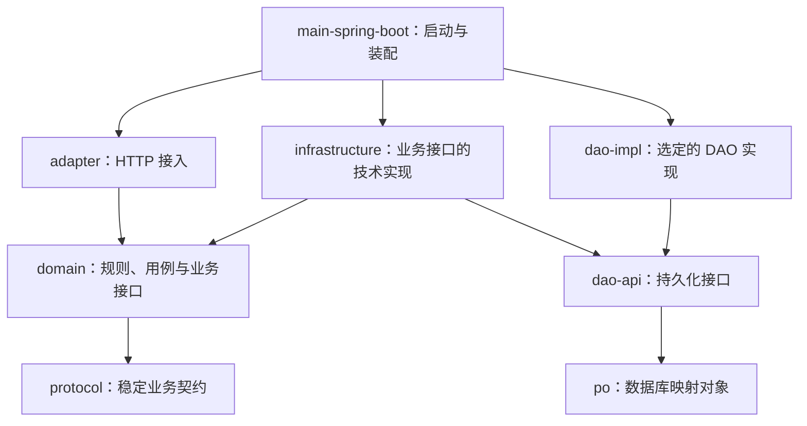

# TRD：技术需求规格说明书模板


# TRD：项目名称 

技术需求规格说明书（TRD） 


2022年09⽉01⽇ 需求发起⼈：项目发起人 产品经理：产品经理姓名

# ⼀\. ⽅案概述 

## 1\.1 背景介绍 

## 1\.2 价值  

架构价值 

商业价值 

## 1\.3 最终⽬标 

### 现状 

### 新版迭代说明

解决核⼼问题 

## 1\.4 相关系统TRD 

⽆ 

## 1\.5 术语和缩略语 


# ⼆、系统需求  

# 三、总体⽅案 

## 3\.1 全景架构图

根据PRD构建全景业务依赖图。\`\`\`*mermaid 生成*

## 3\.2 内部模块依赖图

### 结构风格 Java/Maven 整洁架构约束、

编译依赖

箭头 \`A → B\` 表示 A 依赖 B；项目内部编译依赖以此图及下述补充边为准。\`dao\-impl\` 仅代指选定的 \`dao\-sparrow\` 或 \`dao\-mybatis\`，不要求创建同名模块。



- 图为基本关系；源码直接使用其他模块类型时，须显式声明对应 Maven 依赖，不依赖偶然获得的传递依赖。

- 允许补充的直接依赖：adapter → protocol、infrastructure → po / protocol、选定的 DAO 实现 → po；启动代码直接引用接口时，声明 main\-spring\-boot → domain / dao\-api。

- 禁止 domain → infrastructure / dao\-api / po、adapter → infrastructure / DAO 以及循环依赖；不得用反射、静态工具类或公共模块绕过边界。

- protocol、po 不依赖其他项目内部业务模块；这不代表没有外部库依赖，也不代表领域层完全无框架依赖。按实际用途审查外部依赖，避免 Web、ORM、数据库细节进入业务契约。

- dao\-sparrow 与 dao\-mybatis 是互不依赖的并列实现，可以只保留一种；同一套 DAO 接口默认只装配一种实现。

### 代码归属

|模块|职责与边界|
|---|---|
|protocol|稳定请求参数、查询条件、结果 DTO、协议枚举；不含业务实现、PO、HTTP/Servlet、ORM 或数据库类型。|
|domain|领域模型、业务规则、用例服务、Repository/Gateway 接口；不含 Controller、SQL、Mapper、PO、DAO 或基础设施实现。|
|adapter|Controller、格式与必填校验、协议与领域对象组装、响应及异常映射；不承载核心业务规则，不直接访问 DAO 或基础设施实现。|
|infrastructure|Repository/Gateway 实现、领域对象与 PO 转换、外部服务与缓存适配；通过 dao\-api 访问持久化，不绑定具体 DAO 实现，不重复实现业务规则。|
|dao\-api|使用 PO 的持久化查询与写入接口、必要的存储查询条件；不含业务编排，不依赖 domain 或具体 ORM 实现。|
|dao\-sparrow / dao\-mybatis|DAO 实现、SQL、Mapper、ORM 配置与数据操作；不含业务规则或 Controller，不依赖 domain 或 infrastructure。|
|po|表映射对象、字段、主键与持久化元数据；不含领域业务行为。|
|main\-spring\-boot|启动、环境配置、扫描范围、实现绑定及运行依赖；不含业务规则，其他业务模块不得反向依赖它。|
|bom|依赖版本；作为公共父 POM 时可提供约定的公共构建配置。不含业务类，版本管理不代替实际依赖声明。|

- DTO 表达输入输出，领域对象表达业务状态与规则，PO 表达数据库记录；禁止直接向客户端返回 PO。

- adapter 组装协议与领域对象，infrastructure 转换领域对象与 PO；简单用例可直接使用稳定协议契约，不强制复制等价对象。

- 生产代码放在各模块 src/main/java；保留已有生成器要求的 PO 命名、Mapper 布局等，不为形式统一进行无关重命名。

### 接口实现与运行时调用

- **接口归属与实现：**domain 定义 Repository/Gateway，infrastructure 实现；dao\-api 定义 DAO，选定的 DAO 模块实现。业务接口与持久化接口不是同一接口。

- Repository 使用业务语义，输入输出为领域模型或稳定业务契约，不暴露 PO、Mapper、SQL、ORM 专有分页对象；DAO 使用 PO 表达存储数据。

- **典型持久化请求的运行时调用：**Controller → domain 用例服务 → Repository 接口对应的实现 → DAO 接口对应的实现 → 数据库；结果沿调用链返回。这是调用关系，不是模块编译依赖。

- 用例服务通过业务接口访问外部能力；Repository 实现访问持久化时只引用 DAO 接口，并完成对象转换。main\-spring\-boot 绑定两类接口的实现，不是每次请求经过的业务节点。


## 3\.3\. 核心业务流程图及类图

# 四、系统依赖 

4\.1、 

# 五、⻛险 

# 六、运⾏设计 

## 6\.1  接口设计 具体到字段

### 6\.2 数据库表结构详细设计 具体到字段


# 七 特性设计 

## 7\.1 索引性能 

## 7\.2 安全性 

⽆

## 7\.3 可靠性 

## 7\.4 监控与报警列表 

# ⼋、部署⽅案 

## 8\.1 灰度⽅案 


## 8\.2 上线⽅案 


## 8\.3 回滚⽅案 

# 九 附录 

1\. 编程规范 

2\. ⽇志设计 

3\. 存储设计 

### 表结构设计规范（MySQL）


\- 自有业务表表名以 \`t\_\` 开头，表名和字段名采用小写 snake\_case；业务域前缀按项目统一，例如客服可采用 \`t\_cs\_\`。表和字段使用明确注释，说明含义、单位及枚举值。
\- 按每张表的业务生命周期选用下面的通用字段，不要求机械添加全部七项；设计中列明采用/不采用及理由。选用某字段时，其字段名、类型、UNSIGNED、长度、非空约束、默认值和注释均与模板一致，不自行换成 create\_time、datetime 或其他变体。

通用字段如下，原则上每张表都要有，但要按实际使用情况而定，如果只有新增无修改的场景，不要强制加modify 相关字段，如果使用请严格按该命名执行

```SQL
`create_user_id` bigint UNSIGNED NOT NULL DEFAULT 0 COMMENT '创建人ID',
`gmt_create` bigint UNSIGNED NOT NULL DEFAULT 0 COMMENT '创建时间',
`modified_user_id` bigint UNSIGNED NOT NULL DEFAULT 0 COMMENT '更新人ID',
`gmt_modified` bigint UNSIGNED NOT NULL DEFAULT 0 COMMENT '更新时间',
`create_user_name` varchar(64) NOT NULL DEFAULT '' COMMENT '创建人',
`modified_user_name` varchar(64) NOT NULL DEFAULT '' COMMENT '更新人',
`status` tinyint(1) NOT NULL DEFAULT 1 COMMENT '状态：1=启用 0=禁用'
```


4\. 交接⽂档 

5\. 项⽬排期 

|任务|开发者|开始时间|结束时间|PD\(人天\)|
|---|---|---|---|---|
|商品新增|张三|2022\-09\-01|2022\-09\-02|1|

6\. 历次沟通意⻅汇总表 

