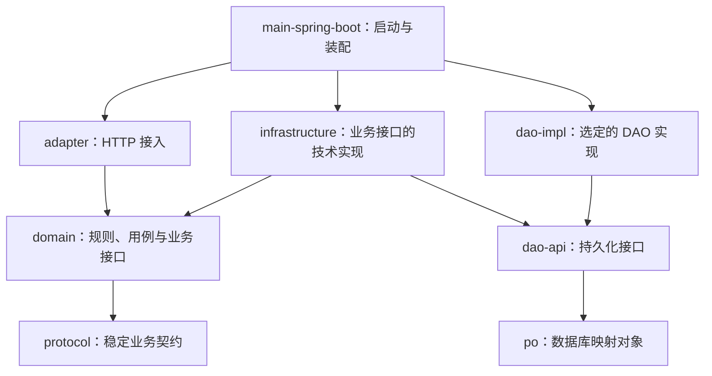

# Sparrow 风格 Java/Maven 整洁架构约束

本文件可直接放到项目根目录。模块名表示职责，前缀、业务上下文、Java 包名和坐标使用目标项目已确认的命名，不机械照搬示例。
`domain` 同时承载业务规则和用例编排，并依赖稳定的 `protocol`；不单独设置 `application` 模块。改变这些边界前须说明理由与影响，并确认方案。

## 编译依赖

箭头 `A → B` 表示 A 依赖 B；项目内部编译依赖以此图及下述补充边为准。`dao-impl` 仅代指选定的 `dao-sparrow` 或 `dao-mybatis`，不要求创建同名模块。



- 图为基本关系；源码直接使用其他模块类型时，须显式声明对应 Maven 依赖，不依赖偶然获得的传递依赖。
- 允许补充的直接依赖：`adapter → protocol`、`infrastructure → po / protocol`、选定的 DAO 实现 `→ po`；启动代码直接引用接口时，声明 `main-spring-boot → domain / dao-api`。
- 禁止 `domain → infrastructure / dao-api / po`、`adapter → infrastructure / DAO` 以及循环依赖；不得用反射、静态工具类或公共模块绕过边界。
- `protocol`、`po` 不依赖其他项目内部业务模块；这不代表没有外部库依赖，也不代表领域层完全无框架依赖。按实际用途审查外部依赖，避免 Web、ORM、数据库细节进入业务契约。
- `dao-sparrow` 与 `dao-mybatis` 是互不依赖的并列实现，可以只保留一种；同一套 DAO 接口默认只装配一种实现。

## 代码归属

| 模块 | 职责与边界 |
| --- | --- |
| `protocol` | 稳定请求参数、查询条件、结果 DTO、协议枚举；不含业务实现、PO、HTTP/Servlet、ORM 或数据库类型。 |
| `domain` | 领域模型、业务规则、用例服务、Repository 接口；不含 Controller、SQL、Mapper、PO、DAO 或基础设施实现。 |
| `adapter` | Controller、格式与必填校验、协议与领域对象组装、响应及异常映射；不承载核心业务规则，不直接访问 DAO 或基础设施实现。 |
| `infrastructure` | Repository 实现、领域对象与 PO 转换、外部服务与缓存适配；通过 `dao-api` 访问持久化，不绑定具体 DAO 实现，不重复实现业务规则。 |
| `dao-api` | 使用 PO 的持久化查询与写入接口、必要的存储查询条件；不含业务编排，不依赖 `domain` 或具体 ORM 实现。 |
| `dao-sparrow` / `dao-mybatis` | DAO 实现、SQL、Mapper、ORM 配置与数据操作；不含业务规则或 Controller，不依赖 `domain` 或 `infrastructure`。 |
| `po` | 表映射对象、字段、主键与持久化元数据；不含领域业务行为。 |
| `main-spring-boot` | 启动、环境配置、扫描范围、实现绑定及运行依赖；不含业务规则，其他业务模块不得反向依赖它。 |
| `bom` | 依赖版本；作为公共父 POM 时可提供约定的公共构建配置。不含业务类，版本管理不代替实际依赖声明。 |

- DTO 表达输入输出，领域对象表达业务状态与规则，PO 表达数据库记录；禁止直接向客户端返回 PO。
- `adapter` 组装协议与领域对象，`infrastructure` 转换领域对象与 PO；简单用例可直接使用稳定协议契约，不强制复制等价对象。
- 生产代码放在各模块 `src/main/java`；保留已有生成器要求的 PO 命名、Mapper 布局等，不为形式统一进行无关重命名。

### 结构解析
- Protocol 层
  通常与client-api 一起打包给client 调用方，作为双方通信协议，由于采用严格分层架构设计，为方便domain层引用，将通信协议的数据部分抽离复用。该层主要包括
    1. DTO 返回给调用方的数据对象
    2. Param 传入到提供方的写参数
    3. Query 传入到提供方的读参数
- Domain核心业务层
  不允许依赖其他基础设施，保证核心业务逻辑稳定。
  核心业务逻辑层包括：
1. 基本通信协议，由前端传入的Query Param 及DTO可以直接透传至Domain层，本架构依然采用简单贫血的MVC模式。
2. 通用工具类
   可以依赖常用的工具类，比如apache-commons包等
3. 第三方rpc 接口
   领域服务可以直接进行远程调用，该调用作为RPC的消费方，而非服务方。
- Client API层
  该层与 protocol 一起提供给调用方，作为调用方与消费方的通信协议。
- Adapter 层
  适配层为为第三方提供各种调用方式，包括但不限于(http controller \spring cloud\dubbo\mq consumer\schedule等。
- Dao 层
  直接面向数据库的操作 api ,由dao-impl 提供实现。一般不涉及业务逻辑，与业务逻辑隔离解耦。
- 基础设施层
1. 该层实现domain层中面向业务的repository接口
2. Domain 层无法直接解决的业务问题，比如发邮件、加解密等需要依赖第三方具体技术库的问题。
3. Domain 层的业务需要多种实现的场景。
- MAIN组件
## 接口实现与运行时调用

- **接口归属与实现：** `domain` 定义 Repository，`infrastructure` 实现；`dao-api` 定义 DAO，选定的 DAO 模块实现。业务接口与持久化接口不是同一接口。
- Repository 使用业务语义，输入输出为领域模型或稳定业务契约，不暴露 PO、Mapper、SQL、ORM 专有分页对象；DAO 使用 PO 表达存储数据。
- **典型持久化请求的运行时调用：** Controller → domain 用例服务 → Repository 接口对应的实现 → DAO 接口对应的实现 → 数据库；结果沿调用链返回。这是调用关系，不是模块编译依赖。
- 用例服务通过业务接口访问外部能力；Repository 实现访问持久化时只引用 DAO 接口，并完成对象转换。`main-spring-boot` 绑定两类接口的实现，不是每次请求经过的业务节点。


## Maven 与装配

- `modules` 决定聚合构建，`parent` 决定继承，`dependencyManagement` 只管理版本、不添加依赖；目录嵌套不形成继承，聚合也不表示已装配。
- 若使用同仓库公共父 POM，将其纳入聚合，并让各模块的 `parent.relativePath` 指向实际位置；其外部父 POM 也必须可解析。
- 使用空 `<relativePath/>` 时，明确父 POM 的预先安装或仓库获取方式，不假定复制目录即可构建；import BOM 不提供父 POM 的插件和构建配置继承。
- 核对 `groupId`、`artifactId`、版本管理条目与实际模块一致，特别是 DAO 实现；不把脚手架占位符当作目标项目配置。
- 启动模块明确选定 DAO 实现，并匹配驱动、数据源、组件与 Mapper 扫描；切换实现须验证，不能只改依赖就宣称成功。
- 启动类、全局响应处理、扫描范围及配置使用目标包名，避免误扫其他应用配置。

## 表结构设计规范（MySQL）

- 进入具体表结构设计前先告知用户，读取已有业务需求和表规范；设计结果交用户评估后再实施。维护本规范不代表已经批准业务表或允许执行 DDL。存量规范与本模板冲突时先说明差异，不擅自覆盖。
- 本节的命名、通用字段及其余表设计规则只适用于项目自有业务表。第三方框架管理的表以所选版本的官方实际表结构和迁移为准，保留其表名、字段、类型及约束；不套用 `t_` 前缀或自有通用字段，不为统一风格改造框架表。
- 自有业务表表名以 `t_` 开头，表名和字段名采用小写 snake_case；业务域前缀按项目统一，例如客服可采用 `t_cs_`。表和字段使用明确注释，说明含义、单位及枚举值。
- 按每张表的业务生命周期选用下面的通用字段，不要求机械添加全部七项；设计中列明采用/不采用及理由。选用某字段时，其字段名、类型、UNSIGNED、长度、非空约束、默认值和注释均与模板一致，不自行换成 create_time、datetime 或其他变体。

```sql
`create_user_id` bigint UNSIGNED NOT NULL DEFAULT 0 COMMENT '创建人ID',
`gmt_create` bigint UNSIGNED NOT NULL DEFAULT 0 COMMENT '创建时间',
`modified_user_id` bigint UNSIGNED NOT NULL DEFAULT 0 COMMENT '更新人ID',
`gmt_modified` bigint UNSIGNED NOT NULL DEFAULT 0 COMMENT '更新时间',
`create_user_name` varchar(64) NOT NULL DEFAULT '' COMMENT '创建人',
`modified_user_name` varchar(64) NOT NULL DEFAULT '' COMMENT '更新人',
`status` tinyint(1) NOT NULL DEFAULT 1 COMMENT '状态：1=启用 0=禁用'
```

- `gmt_create`、`gmt_modified` 统一为 Unix epoch 毫秒，使用 UTC 语义；应用使用受控 Clock，持久化适配负责与 Instant 转换。选用的创建/更新时间在插入时填入实际时间，更新时只推进更新字段；默认 0 是模板兼容值，不能作为正常写入的有效时间。其他业务时间字段逐项注明单位、空值及到期语义，不直接套用 0。
- 创建/更新人来自可信身份或明确系统操作上下文，不能直接信任请求 body。创建人信息保留创建时快照，更新只改更新人字段；名称最多 64 字符，不静默截断。0/空串仅用于已定义的系统或无本地人员身份场景；外部字符串主体不能强转 bigint，确需追溯时另存可信来源与原主体标识。通用审计字段不替代业务授权或完整审计事件。
- `status` 仅表达启用/禁用，校验值为 0/1；不作为逻辑删除位，也不承载待处理/执行中/失败等业务状态。业务状态机使用独立且含义明确的字段。不可变事件、流水或纯关联表是否需要更新人、更新时间或启用状态，按实际行为决定，不因继承通用 PO 强行添加。
- 每表明确主键及生成策略。新业务实体优先评估单列 `id bigint UNSIGNED`，自增或分布式生成须结合业务确认；不在通用模板中强制唯一方案。业务唯一性另由包含必要租户/站点范围的联合唯一约束保证。保留复合主键时核对 ORM 的实际能力，使用完整键查询/更新，不给多个字段机械标注 MyBatis-Plus 的 `@TableId`。引用字段与被引用标识的类型、长度和符号一致；unsigned bigint 映射 Java long 时限定在非负有符号 long 范围，超出范围另行确定映射，不能溢出。
- 字段类型按业务域选择：金额使用明确精度/小数位的 DECIMAL，不用浮点数；枚举值和迁移方式有定义；NULL、空串和 0 不混作同一语义。租户/站点/主体字段按隔离需求设置，通用创建人字段不能替代资源归属。
- MySQL 业务表采用 InnoDB、utf8mb4；对身份、幂等键、外部编号等明确大小写与尾空格比较要求，再选列级比较规则，不沿用文本默认校对规则推定相等。索引由查询条件、排序、唯一性和锁定路径驱动；明确联合索引顺序，避免重复或无查询依据的索引。索引命名使用 `uk_`（唯一）、`idx_`（普通），外键是否建立按一致性和删除/更新策略评估。
- 设计交付包含用途与生命周期、字段字典、通用字段取舍、主键/生成方式、业务唯一约束、索引及对应查询、关系和隔离边界、状态迁移、审计来源与版本化迁移方案。数据库修改沿用项目既有迁移工具，已有数据的重命名/类型调整先设计兼容与回退，不以自动建表或清库替代。

## 业务约束与验证

- 格式校验在接入边界；业务约束由 `domain` 保证，不能只依赖 Controller。技术异常映射为业务可理解错误，客户端错误不得泄露 SQL 或原始数据库异常。
- 业务要求唯一性时，设计数据库唯一约束及冲突处理，不能只依赖“查询不存在再插入”；用例设计明确事务原子性与实现机制，不引入反向依赖。
- 变更检查覆盖职责与依赖、直接依赖声明、对象转换和实际装配；按变更验证业务规则、输入与错误映射、数据库约束及相关事务行为。
