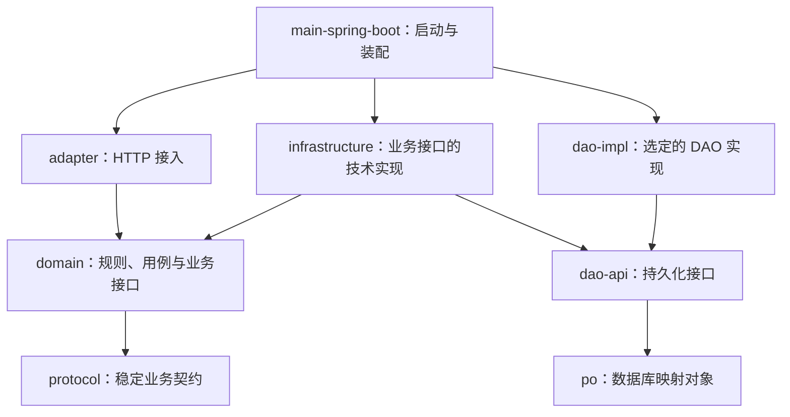

# Sparrow 风格 Java/Maven 整洁架构约束

本文件可直接放到项目根目录。模块名表示职责，前缀、业务上下文、Java 包名和坐标使用目标项目已确认的命名，不机械照搬示例。
`domain` 同时承载业务规则和用例编排，并依赖稳定的 `protocol`；不单独设置 `application` 模块。改变这些边界前须说明理由与影响，并确认方案。

## 编译依赖

箭头 `A → B` 表示 A 依赖 B；项目内部编译依赖以此图及下述补充边为准。`dao-impl` 仅代指选定的 `dao-sparrow` 或 `dao-mybatis`，不要求创建同名模块。

- 图为基本关系；源码直接使用其他模块类型时，须显式声明对应 Maven 依赖，不依赖偶然获得的传递依赖。
- 允许补充的直接依赖：`adapter → protocol`、`infrastructure → po / protocol`、选定的 DAO 实现 `→ po`；启动代码直接引用接口时，声明 `main-spring-boot → domain / dao-api`。
- 禁止 `domain → infrastructure / dao-api / po`、`adapter → infrastructure / DAO` 以及循环依赖；不得用反射、静态工具类或公共模块绕过边界。
- `protocol`、`po` 不依赖其他项目内部业务模块；这不代表没有外部库依赖，也不代表领域层完全无框架依赖。按实际用途审查外部依赖，避免 Web、ORM、数据库细节进入业务契约。
- `dao-sparrow` 与 `dao-mybatis` 是互不依赖的并列实现，可以只保留一种；同一套 DAO 接口默认只装配一种实现。

## 代码归属

| 模块 | 职责与边界 |
| --- | --- |
| `protocol` | 稳定请求参数、查询条件、结果 DTO、协议枚举；不含业务实现、PO、HTTP/Servlet、ORM 或数据库类型。 |
| `domain` | 领域模型、业务规则、用例服务、Repository/Gateway 接口；不含 Controller、SQL、Mapper、PO、DAO 或基础设施实现。 |
| `adapter` | Controller、格式与必填校验、协议与领域对象组装、响应及异常映射；不承载核心业务规则，不直接访问 DAO 或基础设施实现。 |
| `infrastructure` | Repository/Gateway 实现、领域对象与 PO 转换、外部服务与缓存适配；通过 `dao-api` 访问持久化，不绑定具体 DAO 实现，不重复实现业务规则。 |
| `dao-api` | 使用 PO 的持久化查询与写入接口、必要的存储查询条件；不含业务编排，不依赖 `domain` 或具体 ORM 实现。 |
| `dao-sparrow` / `dao-mybatis` | DAO 实现、SQL、Mapper、ORM 配置与数据操作；不含业务规则或 Controller，不依赖 `domain` 或 `infrastructure`。 |
| `po` | 表映射对象、字段、主键与持久化元数据；不含领域业务行为。 |
| `main-spring-boot` | 启动、环境配置、扫描范围、实现绑定及运行依赖；不含业务规则，其他业务模块不得反向依赖它。 |
| `bom` | 依赖版本；作为公共父 POM 时可提供约定的公共构建配置。不含业务类，版本管理不代替实际依赖声明。 |

- DTO 表达输入输出，领域对象表达业务状态与规则，PO 表达数据库记录；禁止直接向客户端返回 PO。
- `adapter` 组装协议与领域对象，`infrastructure` 转换领域对象与 PO；简单用例可直接使用稳定协议契约，不强制复制等价对象。
- 生产代码放在各模块 `src/main/java`；保留已有生成器要求的 PO 命名、Mapper 布局等，不为形式统一进行无关重命名。

## 接口实现与运行时调用

- **接口归属与实现：** `domain` 定义 Repository/Gateway，`infrastructure` 实现；`dao-api` 定义 DAO，选定的 DAO 模块实现。业务接口与持久化接口不是同一接口。
- Repository 使用业务语义，输入输出为领域模型或稳定业务契约，不暴露 PO、Mapper、SQL、ORM 专有分页对象；DAO 使用 PO 表达存储数据。
- **典型持久化请求的运行时调用：** Controller → domain 用例服务 → Repository 接口对应的实现 → DAO 接口对应的实现 → 数据库；结果沿调用链返回。这是调用关系，不是模块编译依赖。
- 用例服务通过业务接口访问外部能力；Repository 实现访问持久化时只引用 DAO 接口，并完成对象转换。`main-spring-boot` 绑定两类接口的实现，不是每次请求经过的业务节点。

## Maven 与装配

- `modules` 决定聚合构建，`parent` 决定继承，`dependencyManagement` 只管理版本、不添加依赖；目录嵌套不形成继承，聚合也不表示已装配。
- 若使用同仓库公共父 POM，将其纳入聚合，并让各模块的 `parent.relativePath` 指向实际位置；其外部父 POM 也必须可解析。
- 使用空 `<relativePath/>` 时，明确父 POM 的预先安装或仓库获取方式，不假定复制目录即可构建；import BOM 不提供父 POM 的插件和构建配置继承。
- 核对 `groupId`、`artifactId`、版本管理条目与实际模块一致，特别是 DAO 实现；不把脚手架占位符当作目标项目配置。
- 启动模块明确选定 DAO 实现，并匹配驱动、数据源、组件与 Mapper 扫描；切换实现须验证，不能只改依赖就宣称成功。
- 启动类、全局响应处理、扫描范围及配置使用目标包名，避免误扫其他应用配置。

## 业务约束与验证

- 格式校验在接入边界；业务约束由 `domain` 保证，不能只依赖 Controller。技术异常映射为业务可理解错误，客户端错误不得泄露 SQL 或原始数据库异常。
- 业务要求唯一性时，设计数据库唯一约束及冲突处理，不能只依赖“查询不存在再插入”；用例设计明确事务原子性与实现机制，不引入反向依赖。
- 变更检查覆盖职责与依赖、直接依赖声明、对象转换和实际装配；按变更验证业务规则、输入与错误映射、数据库约束及相关事务行为。
